# DOLORES: does sugarcane remember a drought?

*This is the full documentation of the DOLORES RNA-seq project: the experiment, the samples, the methods and every result, told in order, with the checks that were made on the way. Boxes marked **Concept** explain a method when it first comes up, and a glossary at the end collects the terms. For the short version, with only the main insights, read [`analysis/results/report_story.md`](analysis/results/report_story.md).*

**How this document is organised**

| Part | Sections | What it holds |
|---|---|---|
| The question | 1 | Hypotheses and the answer to each |
| The experiment | 2 | Design, sampling days, labels |
| Samples and methods | 3 | Which libraries exist, reference genome, quantification, annotation, statistics |
| Checks before the biology | 4–5 | First look at the data; problematic libraries; which contrasts can be biased |
| Results | 6–13 | One section per hypothesis, then gene copies and gene modules |
| Synthesis | 14–15 | All verdicts in one table; what to do next |
| Reference | end | Where every file is, what is in git, glossary, full sample table |

---

## 1. The question and the hypotheses

A plant that survives a drought is sometimes better prepared for the next one. This is called **drought memory**, or **stress priming**.

The best-studied case comes from Zoya Avramova's lab:
- They dried *Arabidopsis* and maize plants several times and compared the response to the 1st and the 3rd dehydration (Ding et al. 2012, 2013, 2014).
- Most drought genes respond the same way every time.
- Some hundreds respond **more strongly** the 3rd time. They "remember".
- The textbook example is the dehydrin gene **RAB18**: after training, it is switched on faster and higher.

Sugarcane adds a twist. It is planted from pieces of stalk, not from seeds: each new plant grows from a **bud** on a stalk cut from the mother plant. If a drought leaves a mark in the mother's buds, the new plants, called **propagules**, could inherit it.

The same group at IAC/Unicamp saw a hint of this. Propagules from drought-stressed mothers coped better with drought (Marcos et al. 2018, PLoS One). DOLORES asks whether that memory can be seen in gene expression, in three places:
- the leaves of the mother;
- her buds;
- the propagules.

There are two cultivars:
- **IACSP95-5000** ("5000"): a productive cultivar.
- **IACCTC07-8008** ("8008"): a drought-tolerant one.

We expected them to behave differently, so every analysis treats them separately.

### 1.1 The six hypotheses

| # | Hypothesis | What we would see if it is true | Tested in |
|---|---|---|---|
| **H1** | **Leaves learn:** the mother's leaves respond differently to the 3rd drought than to the 1st. | Genes that respond more strongly (or differently) at the 3rd drought than at the 1st. | [section 6](#6-do-leaves-learn-h1) |
| **H2** | **The tolerant cultivar remembers more:** 8008 has more leaf memory than 5000. | More memory genes in 8008, and a significant cultivar × drought-cycle interaction. | [section 7](#7-does-the-tolerant-cultivar-remember-more-h2) |
| **H3** | **Buds keep a mark:** drought leaves a lasting change in the mother's buds. | Buds of stressed mothers differ from buds of watered mothers. | [section 9](#9-do-buds-keep-a-mark-h3) |
| **H4** | **Propagules respond differently:** propagules of stressed mothers respond differently to their own drought. | A different drought response in propagules of stressed vs watered mothers. | [section 10](#10-do-propagules-respond-differently-h4) |
| **H5** | **The same genes carry the mark** from mother leaf to bud to propagule. | The genes that change at one step also change at the next. | [section 11](#11-is-it-the-same-genes-from-mother-to-bud-to-propagule-h5) |
| **H6** | **Known memory genes are memory genes here:** the memory genes of *Arabidopsis* and maize behave as memory genes in sugarcane. | Their sugarcane counterparts fall into the memory classes. | [section 8](#8-do-the-textbook-memory-genes-behave-as-memory-genes-here-h6) |

*Table 1. The hypotheses of DOLORES.*

Two more questions came up along the way, without a hypothesis number. Does one copy of a gene carry the memory ([section 12](#12-does-one-copy-of-a-gene-carry-the-memory))? Are there groups of genes that follow drought *history* rather than current drought ([section 13](#13-gene-modules-that-follow-history))?

### 1.2 The answers in brief

H1, H3 and H4 carry the story at this point. The other hypotheses are too weak to conclude from with the present samples.

| # | Answer | How solid |
|---|---|---|
| **H1** | **Yes, for a defined set of genes (8008).** Among about 8,000 groups that respond the same way at both droughts, 84 respond differently at the 3rd, and 32 fall in the memory classes. They are led by desiccation-protection genes: the RAB18 dehydrin, LEA proteins, a seed-storage protein. **5000:** 1,229 groups differ between droughts, but its 1st-drought group is a single plant. | 8008 solid; 5000 exploratory |
| **H3** | **Yes, for the timing of the stress.** Buds stressed 135 days before sampling differ from buds stressed 6 days before in 407 groups (8008) and 147 (5000), led by PAL genes that move in opposite directions in the two cultivars. Stressed vs watered buds cannot be compared: the watered buds' libraries were prepared differently. | T vs M solid; vs watered lost |
| **H4** | **Yes, the same in both cultivars:** propagules of stressed mothers respond more mildly to drought, sparing photosynthesis and growth genes. | exploratory: one reference plant per cultivar |
| H2 | Too weak for now. 5000 seems to change more between droughts, but one plant can produce that pattern (we reproduced it in 8008). 8008 responds more strongly at the 1st drought. | needs more 5000 D1 plants |
| H5 | Too weak for now. In 8008 the mother's leaf drought genes are slightly higher in T buds; no link from buds to propagules was detected. | needs watered propagules of stressed mothers |
| H6 | The known genes are drought genes in sugarcane too; RAB18, LEA3 and PIT1 also keep their memory behaviour. | solid, but a side question |
| Copies | Gene copies move together; no single copy carries the memory. | solid |
| Modules | Groups of co-expressed genes follow current drought; one module repeats the H4 result. | solid |

*Table 2. Short answers. The full verdicts, with what they rest on, are in [section 14](#14-the-story-so-far).*

---

## 2. The experiment

### 2.1 Mother plants (experiment 1)

Three-month-old plants of both cultivars, from the Sugarcane Breeding Program of the Agronomic Institute (ProCana, IAC, Brazil), were transplanted into 20 L pots with fertilised red-yellow latosol and grown in a greenhouse with daily irrigation. Five months after transplanting, the plants of each cultivar were divided into three groups:

| Group | Treatment |
|---|---|
| **W** (well-watered) | Daily irrigation throughout: the control |
| **T** (tillering) | Three drought cycles during tillering (vegetative growth) |
| **M** (maturation) | Three drought cycles during maturation |

One drought cycle is **9 days without irrigation, then 6 days of re-irrigation**.

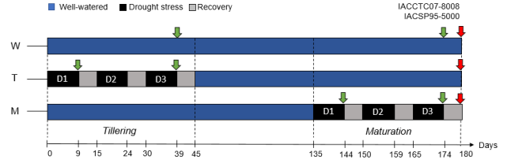

*Figure 1. Mother plants. W plants are always watered. T plants go through three drought cycles (D1, D2, D3) while young (tillering, days 0–45). M plants go through three cycles late in the season (maturation, days 135–180). Green arrows mark leaf samples; red arrows mark bud samples.*

Figure 1 already contains three facts that shape everything later:
- **Leaves were sampled at the peak of a drought** (day 9 of a cycle), at the 1st (D1) and the 3rd (D3) cycle. So we see the drought response at cycle 1 and cycle 3, not the recovery.
- **All buds were collected on day 180.** For T plants that is 135 days after their last drought: a test of long-term memory. For M plants it is only 6 days after the last drought, so "memory" and "still recovering" are mixed.
- **The watered control leaves were sampled on day 39**, the same day as D3, but 30 days after D1. So "D1 vs W" also compares plants sampled on day 9 with plants sampled on day 39, which adds 30 days of growth to the drought effect.

### 2.2 Propagules (experiment 2)

At the end of experiment 1, stalk cuttings of the W, T and M plants were planted to raise new plants, to test whether drought memory is passed on. Three-month-old propagules were transplanted into 12 L pots and grown with daily irrigation. Two months later each group was split: one drought cycle (D) or kept watered (W).

| Group | Mother | Propagule treatment | Sequenced |
|---|---|---|---|
| W/W | watered | watered | yes |
| W/D | watered | one drought cycle | yes |
| T/D | stressed at tillering | one drought cycle | yes |
| M/D | stressed at maturation | one drought cycle | yes |
| T/W | stressed at tillering | watered | **no** |
| M/W | stressed at maturation | watered | **no** |

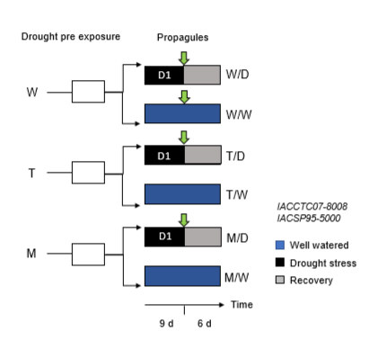

*Figure 2. Propagules. Buds from W, T and M mothers were grown into new plants. Each group was then split: one drought cycle (D) or kept watered (W). Only W/W, W/D, T/D and M/D were sequenced.*

Because T/W and M/W were not sequenced, the propagule set can compare droughted propagules of stressed and watered mothers, but it has no watered controls for propagules of stressed mothers.

### 2.3 Labels

The labels used in every table and figure:

| Label | Meaning |
|---|---|
| W | well-watered (C in the lab spreadsheet) |
| D1, D3 | leaf sampled at the peak of the 1st / 3rd drought |
| `Mt_…`, `Mm_…` | mother leaf, tillering / maturation experiment |
| T, M (buds) | buds of tillering-stressed / maturation-stressed mothers |
| `Fw`, `Ft`, `Fm` | propagule from a watered / tillering-stressed / maturation-stressed mother |
| `Fw_W`, `Fw_D1`, `Ft_D1` … | propagule group, then the propagule's own treatment |
| `A_vs_B` | a **contrast**: A compared with B. A positive value means higher in A. |

---

## 3. Samples and methods

### 3.1 The libraries

The original design ([`Esquema_experimental_RNAseq.pdf`](Esquema_experimental_RNAseq.pdf)) and the sample spreadsheet describe **26 groups and 78 RNA-seq samples**, 3 plants per group, in three sample sets. From 78 planned samples to the 48 libraries in the models:

| Step | Libraries | Why |
|---|---|---|
| Planned | 78 | 26 groups × 3 plants |
| Files in `RAWDATA/` | 69 | 9 samples were never available |
| Independent libraries | 51 | 18 files from Dolores's Google Drive are copies of other libraries (section 5.1) |
| **In the models** | **48** | 3 libraries carry the other cultivar's alleles (section 5.1) |

By sample set:

| Sample set | Groups | Planned | In `RAWDATA/` | Copies (dropped) | Independent | Other cultivar (excluded) | **In the models** |
|---|---|---|---|---|---|---|---|
| Mother plants, buds (end of experiment 1) | 6 | 18 | 18 | 0 | 18 | 2 | **16** |
| Mother plants, leaves (during the drought cycles) | 12 | 36 | 34 | 12 | 22 | 1 | **21** |
| Propagules, leaves (experiment 2) | 8 | 24 | 17 | 6 | 11 | 0 | **11** |
| **Total** | **26** | **78** | **69** | **18** | **51** | **3** | **48** |

**Libraries in the models, per group** (out of 3 planned). Three groups have none (8008 Mm_D1, Mm_D3 and Fm_D1) and seven have one.

*Mother buds*

| Cultivar | W | Tillering-stressed (T) | Maturation-stressed (M) |
|---|---|---|---|
| 5000 | 3 | 2 | 3 |
| 8008 | 3 | 3 | 2 |

*Mother leaves*

| Cultivar | Mt_W | Mt_D1 | Mt_D3 | Mm_W | Mm_D1 | Mm_D3 |
|---|---|---|---|---|---|---|
| 5000 | 2 | **1** | 2 | 3 | **1** | **1** |
| 8008 | 3 | 3 | 2 | 3 | **0** | **0** |

*Propagule leaves*

| Cultivar | W/W (Fw_W) | W/D (Fw_D1) | T/D (Ft_D1) | M/D (Fm_D1) |
|---|---|---|---|---|
| 5000 | 2 | **1** | **1** | 3 |
| 8008 | **1** | **1** | 2 | **0** |

The fate of every one of the 78 samples is in the [sample table](#appendix-sample-table) at the end. Read counts and notes are in [`sample_inventory.csv`](sample_inventory.csv), and the missing samples in [`INVENTORY.md`](INVENTORY.md).

All libraries are stranded (dUTP type, Salmon library type ISR), paired-end 2 × 100 bp, about 11 million pairs each, and poly-A selected: 3.4–7.8% of genic reads fall in introns, where total-RNA libraries usually give 20–50% (`analysis/results/qc/library_type/`, `analysis/code/17_library_type.sh`). The one exception is `79_S6` (section 5.1).

### 3.2 Reference genome: POJ2878

Reads are quantified against the **POJ2878** genome. POJ2878 is a *S. officinarum* × *S. spontaneum* hybrid and a founder of modern sugarcane cultivars (Nature 2026, doi:10.1038/s41586-026-10576-7).
- **Genome:** NCBI GCA_060231685.1. The headers are renamed from GenBank accessions to the sequence names used in the GFF (`refs/POJ2878/rename_headers.sh`).
- **Gene models:** `Sh_POJ2878_v1.gff3`, from Figshare: 397,650 genes and 424,890 transcripts.
- **Details:** sources, MD5s and checks are in [`refs/POJ2878/SOURCE.txt`](refs/POJ2878/SOURCE.txt). The genome files themselves are not in git.

### 3.3 Quantification: nf-core/rnaseq 3.27.0 (Salmon)

The 51 independent libraries were run through **nf-core/rnaseq 3.27.0** on the SGE cluster, in Salmon-only mode (no genome alignment), on 2026-10-23.
- **Run script:** [`nf-rnaseq/run_POJ2878/run_nfcore_POJ2878.sh`](nf-rnaseq/run_POJ2878/run_nfcore_POJ2878.sh)
- **Parameters:** [`nf-rnaseq/params_proposal/params_POJ2878_salmon.yaml`](nf-rnaseq/params_proposal/params_POJ2878_salmon.yaml)
- **Cluster config:** [`nf-rnaseq/conf_cluster/sge_cluster.config`](nf-rnaseq/conf_cluster/sge_cluster.config) and [`process_overrides.config`](nf-rnaseq/params_proposal/process_overrides.config)
- **Sample sheets:** `samplesheet_POJ2878_clean.csv` and `sample_metadata_POJ2878_clean.csv`

Main settings:
- Trim Galore 2.3.0 (`--2colour 20 --length 36`).
- rRNA removed with Bowtie2 2.5.4 against the pipeline's default rRNA database (SortMeRNA `smr_v4.3_fast_db`, built from SILVA and Rfam).
- Salmon 2.7.0 with a decoy-aware index (genome as decoy), `--seqBias --gcBias --numBootstraps 30`. The 30 bootstraps are for the allele-level analysis (section 12).
- Salmon keeps one copy of each set of identical transcript sequences (its default): 65,316 transcripts were collapsed this way, which is common in this polyploid genome.

Results (QC report: [`nf-rnaseq/run_POJ2878/results/multiqc/multiqc_report.html`](nf-rnaseq/run_POJ2878/results/multiqc/multiqc_report.html)):
- **Salmon mapping rate:** median 69.3% (range 54.6–76.4%).
- **rRNA:** median 14.4% of reads.
- **Weakest libraries:**
  - `79_S6`: 1.05 M mapped fragments, 77% rRNA.
  - `66_S4`, `67_S5`, `65_S3`: 1.9–2.8 M mapped fragments, 52–58% rRNA.
- **Count tables:** the merged tables (`salmon.merged.gene_counts.tsv`, TPM, transcript counts and `tx2gene`) are on the server in `nf-rnaseq/run_POJ2878/results/salmon/`. They are not in git: each is 20–250 MB.

### 3.4 Functional annotation (GO, InterPro, KEGG)

The POJ2878 gene models come with no functional annotation, so we annotated the predicted proteins ourselves (2026-10-24 to 2026-10-26). Steps, versions and commands are in [`annotation/SOURCE.md`](annotation/SOURCE.md).

1. **Proteins:** gffread on the genome and GFF gives 424,890 proteins. Identical sequences were collapsed to 307,787 unique proteins for annotation (`annotation/proteins/make_proteins.sh`).
2. **eggNOG-mapper 2.1.13** (eggNOG 5.0.2) as an SGE array over 16 chunks (`annotation/eggnog/`). It gives a name, description, GO terms, KEGG KO and pathways, and EC numbers.
3. **InterProScan 6.0.3.0** with InterPro 110.0 and all free member databases, with InterPro2GO (`annotation/interproscan/`). It ran in 4 parts on the SGE cluster.
4. **Merge** (`annotation/go/merge_annotation.py`): copies each unique protein's annotation back to every transcript with that sequence, then groups transcripts into genes using Salmon's `tx2gene`. The gene IDs therefore match the count tables.

Coverage of the 397,650 genes ([`annotation/go/coverage.tsv`](annotation/go/coverage.tsv)):

| Annotation | Genes | % |
|---|---|---|
| Any annotation | 396,632 | 99.7 |
| eggNOG hit | 392,089 | 98.6 |
| InterPro entry | 369,349 | 92.9 |
| GO, InterProScan | 246,830 | 62.1 |
| GO, eggNOG | 137,404 | 34.6 |
| **GO, combined** | **272,954** | **68.6** |
| KEGG KO | 160,589 | 40.4 |

Output tables, in `annotation/go/` on the server (not in git, 90–450 MB each):
- `gene2go_list.tsv`: one line per gene, ready for topGO `readMappings`.
- `gene2go.tsv` and `transcript2go.tsv`: one row per pair, with a `source` column (ips, eggnog or both).
- `gene_annotation.tsv` and `transcript_annotation.tsv`: name, description, InterPro, Pfam, KEGG KO and pathway, EC.

Notes for enrichment:
- eggNOG GO lists already include parent terms; InterPro2GO lists only the specific terms. topGO and clusterProfiler add the parents anyway.
- For pathways, use the eggNOG KEGG pathways. InterProScan's pathway column is mostly Reactome IDs for animal species, so it was left out.

### 3.5 Allele groups: the unit of analysis

> **Concept: a genome with many copies of each gene.** Sugarcane is a highly polyploid hybrid: most genes exist in about 8–12 copies (alleles), inherited from two ancestral species. The POJ2878 reference genome assembles each copy separately, so its 397,650 "genes" are really alleles. Reads from one gene are split among nearly identical copies, which makes each copy noisy.
>
> We therefore grouped the copies. **OrthoFinder** compared the proteins of sugarcane, sorghum, maize, rice and *Arabidopsis* and found **orthologues**: genes in different species that descend from the same ancestral gene. All sugarcane alleles whose orthologue is the same sorghum gene were summed into one **allele group**, giving 78,613 groups. Sorghum is the closest diploid relative, so a group is close to "one gene" in the usual sense. [Section 12](#12-does-one-copy-of-a-gene-carry-the-memory) checks that this grouping does not hide memory in a single copy.
>
> Bonus: the same orthology links sugarcane groups to genes already studied in *Arabidopsis* and maize (section 8).

The groups are built in `orthology/` ([`orthology/README.md`](orthology/README.md)). Results are at the allele-group level unless stated otherwise; allele-level tables are kept as well (`analysis/results/de/gene/`, on the server).

### 3.6 Statistics

| Item | Detail |
|---|---|
| Differential expression | DESeq2, each cultivar separately. Buds: `~condition` (W, T, M). Leaves: mother and propagule leaves in one model, `~condition`, so groups with a single library borrow variance from the others. |
| DEG | padj < 0.05 and \|log2FC\| ≥ 1 |
| Contrast status | **conclusive**: both groups have ≥ 2 libraries. **exploratory**: one group has a single library. **descriptive**: maturation mother leaves. |
| Memory classes | As in Ding et al. 2013/2014 (section 6). We added `0+`/`0-` for late responders. |
| Known memory genes | Ding 2013 (*Arabidopsis*) and Ding 2014 (maize) memory classes, plus 40 curated genes, mapped to groups by orthology and tested with limma `cameraPR` in every contrast (`memory_genes/SOURCES.md`). |
| Enrichment | topGO weight01 (BP and MF; terms kept at p < 0.01, **not corrected for multiple testing**) and KEGG with clusterProfiler (BH-adjusted). |

The scripts, one per step, are listed in [`analysis/README.md`](analysis/README.md). Three ideas are needed before any result makes sense.

> **Concept: log2 fold change (log2FC).** This is how much a gene changes between two conditions, on a doubling scale:
> - +1 = twice as much;
> - +3 = 8 times;
> - −2 = a quarter;
> - +10 ≈ 1,000 times.
>
> 0 means no change.

> **Concept: differential expression and replicates.**
> - **What the test asks.** DESeq2 asks whether the difference between two groups is large compared with how much plants *within* a group differ. That within-group variation can only be measured with 2 or more plants.
> - **One plant per group.** When a group has a single plant, DESeq2 borrows the variation measured in the other groups of the same model. This is why mother and propagule leaves share one model.
> - **What that costs.** The contrast can be computed, but if that one plant is unusual nothing in the data can reveal it. So every contrast carries a label: conclusive, exploratory or descriptive (table above).
> - **padj and DEG.** Testing ~30,000 groups at once produces many false hits by chance. **padj** is the p-value corrected for this (it controls the false discovery rate). A **DEG** (differentially expressed gene, here a group) has padj < 0.05 and changes at least two-fold (|log2FC| ≥ 1).

**From here on, file names in `code font` are relative to `analysis/results/`**, and `../code/` is `analysis/code/`.

---

## 4. First look at all the data

> **Concept: PCA.** Each library is an expression profile: one value per allele group (its count after a variance-stabilising transformation, VST), tens of thousands of values per library, impossible to look at directly. Principal component analysis (PCA) finds the directions along which libraries differ most and draws each library as one point. We used the 2,000 groups that vary most between libraries, because groups that barely change add noise but no structure.
> - **PC1** is the strongest axis of difference, **PC2** the second strongest.
> - The percentage on each axis says how much of the total variation it captures.
> - Libraries that are close together have similar transcriptomes.

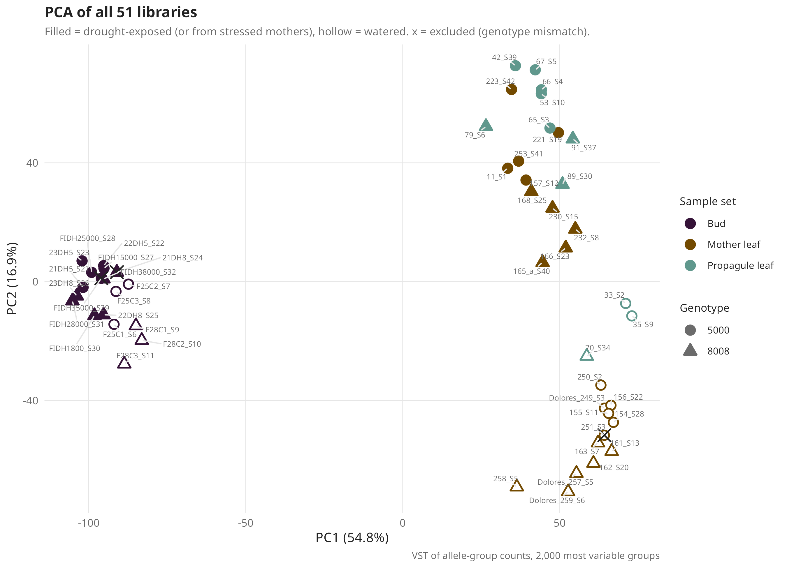

*Figure 3. PCA of all 51 libraries. Colour = sample set, shape = genotype, filled = drought-exposed, hollow = watered, × = excluded library (section 5).*

The dataset has a clear structure:
- **PC1 (55%) is tissue.** Buds sit on the left and leaves on the right. Buds and leaves are simply very different organs.
- **PC2 (17%) is drought.** Among the leaves, drought-stressed leaves (filled) sit at the top and watered leaves (hollow) at the bottom. The treatment worked: drought is the second largest signal in the whole experiment.
- **Genotype is a smaller effect.** Circles (5000) and triangles (8008) are mixed within each cloud.

The next figure zooms in, one panel per genotype and tissue.

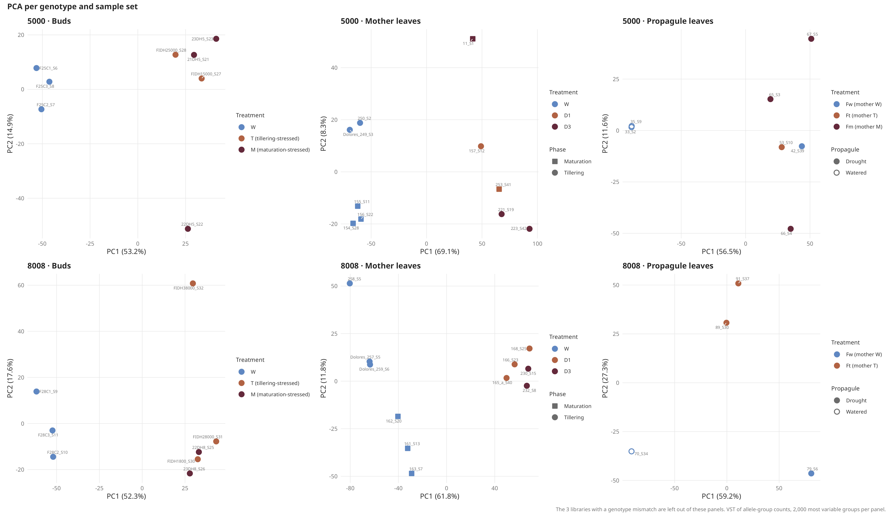

*Figure 4. PCA per genotype and sample set (excluded libraries left out). Colour = treatment history: blue = watered, orange = 1st drought or tillering stress, dark red = 3rd drought or maturation stress.*

Each panel already hints at part of the story:
- **8008 mother leaves (bottom middle).** Watered plants sit on the left, drought plants on the right, and the D1 (orange) and D3 (dark red) plants are **mixed together**. If the leaves had "learned", D3 should sit apart from D1. Keep this picture in mind for section 6.
- **5000 mother leaves (top middle).** The single D1 plant (`157_S12`) sits halfway between watered plants and D3 plants. Either the 1st drought response was weaker, or this one plant was less stressed. With one plant we cannot tell (section 7 comes back to this).
- **Buds (left).** In both genotypes PC1 (~52%) separates watered buds from stressed buds, while T and M buds overlap. This looks like a strong drought mark, but section 5 shows why we cannot trust it.
- **Propagules (right).** Watered propagules sit on the left and drought propagules on the right. In 8008 the two Ft plants sit between the watered plant and the Fw_D1 plant. This is a first hint of the propagule story, with a catch explained in section 10.

---

## 5. Detective work: problems found before any biology

Before asking biological questions, we checked whether the data can answer them: which libraries can be trusted (5.1), which contrasts can be biased by sequencing run or sampling time (5.2, 5.3), which groups rest on one plant (5.4), and what age and time of day add (5.5).

### 5.1 Problematic libraries: copies, the other cultivar, and one failed library

Three kinds of problem were found, and each was handled differently.

| Problem | Libraries | What we did |
|---|---|---|
| Copies of other libraries | 18 files from the Google Drive | **Dropped.** They are not samples. |
| Alleles of the other cultivar | `FIDH35000_S29`, `21DH8_S24`, `251_S3` | **Excluded from every model** (ignored, not relabelled). |
| Failed poly-A selection | `79_S6` | **Kept**, because it is the only 8008 Fw_D1 plant. Every result that uses it is flagged. |

**Copies (18 libraries, dropped).** `RAWDATA/` holds 69 libraries: the 51 we already had, plus 18 downloaded from Dolores's Google Drive on 2026-09-29. Every one of the 18 is a copy of one of the 51 original libraries, often relabelled as another sample (checked 2026-10-22):
- their read names are found in the original libraries;
- they share the originals' barcode error spectra;
- some have repeated read names, R1/R2 out of step, or Windows line endings.

Which original each one copies is in the [sample table](#appendix-sample-table) and in [`FINDINGS.md`](nf-rnaseq/run_POJ2878/integrity_check/FINDINGS.md).

**The other cultivar (3 libraries, excluded).**

> **Concept: an expression fingerprint.** 5000 and 8008 carry different alleles, and an allele that is missing from a genome can never be expressed. So whether each of ~31,000 genes is "on" or "off" works as a genetic fingerprint, whatever the tissue or the treatment.

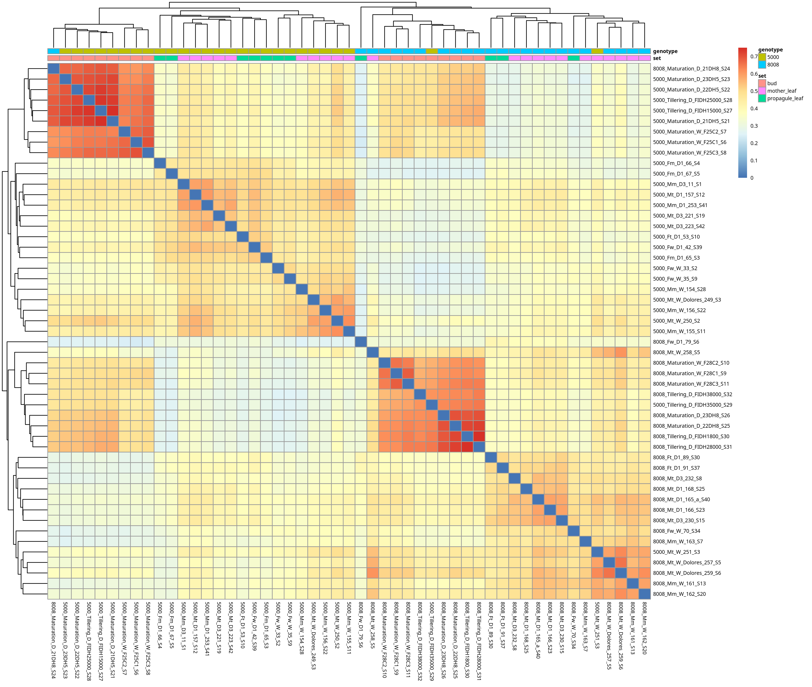

*Figure 5. Similarity of the on/off patterns between libraries (red = similar). The colour bar on top gives the labelled genotype.*

Two large blocks appear, one per cultivar. Three libraries sit in the wrong block. None of them is a copy of another library: each is a real sample of the other cultivar. Dolores's sample table is correct, so the mix-up happened when the tissue was sampled or the tubes were handled.

Could they be put back into the right group? We asked which group of their *true* cultivar each one resembles (`qc/relabel_check/`, `../code/19_relabel_check.R`). The method is a nearest-centroid match on the 1,000 groups that best separate the candidate groups. It was calibrated by leaving out, one at a time, every correctly labelled library and checking whether the match recovers its group.

| Library | Label | Alleles say | Expression says | How sure | Where it would go |
|---|---|---|---|---|---|
| `FIDH35000_S29` | 5000 T bud | 8008 | T bud (score T 0.64, M −0.64); its three nearest libraries are 8008 T buds | fairly: the match recovers 4 of 5 known 8008 buds | 8008 T buds, as a 4th plant |
| `21DH8_S24` | 8008 M bud | 5000 | M bud (score M 0.38, T −0.38) | **not sure**: the match recovers only 2 of 5 known 5000 buds, so T and M cannot be told apart | 5000 M buds, as a 4th plant |
| `251_S3` | 5000 Mt_W leaf | 8008 | a watered mother leaf (Mm_W 0.88, Mt_W 0.79; all drought groups negative) | watered: sure (12 of 15 known 8008 leaves recovered, the errors between neighbouring groups). Tillering or maturation: cannot be told | 8008 Mt_W or Mm_W, as a 4th plant |

*Source: `qc/relabel_check/flagged_assignment.tsv`, `qc/relabel_check/loo_calibration.tsv`.*

At first sight the two bud libraries look like a swap of two tubes. But a swap would also exchange the treatments (an 8008 M bud and a 5000 T bud), and the expression points the other way: each library keeps the treatment on its label and only the cultivar is wrong.

**Relabel or ignore? Ignored (decided 2026-11-04).**
- Every group was designed with 3 plants, and the three groups the libraries would join already have 3. Relabelling would create groups of 4 plants that the experiment never had.
- For `21DH8_S24` the group cannot be assigned with confidence, and for `251_S3` the phase cannot.
- The cost is one plant in three groups: 5000 T buds, 8008 M buds and 5000 Mt_W are left with 2 libraries each.

This leaves **48 libraries** in the analysis; the three are marked × in Figure 3 and listed with the reason in `../data/excluded_samples.tsv`. If the lab records ever show where a tube came from, relabelling takes three steps: correct the cultivar and group in `../data/samples.tsv`, remove the library from `../data/excluded_samples.tsv`, and rerun from `../code/03_de.R`.

**A failed library, kept with a warning (`79_S6`).** In Figure 5 the row `8008_Fw_D1_79_S6` is pale against everything. This library is about 76% ribosomal RNA (the median library is 25%), so only 1.05 million reads count genes (the median is 6.2 million) and only ~15,000 groups are detected (the median is ~29,000). Its poly-A selection seems to have failed: 48% of its genic reads are intronic, against 3.4–7.8% in the other libraries tested (`qc/library_type/`). It is the **only** 8008 propagule of a watered mother under drought, the reference for the 8008 propagule comparisons, so it stays in. We come back to it in section 10.

### 5.2 Batch and sampling time: which contrasts can be biased

> **Concept: confounding.** Imagine every watered bud went through one sequencing run and every stressed bud through another. Any difference between the runs (chemistry, loading, flow cell) then looks exactly like a drought effect, and no statistics can pull the two apart. The only cure is in the design: spread every group across runs.

The FASTQ files record which sequencing run produced each read, so we could check this directly. The sampling days come from Figures 1 and 2.

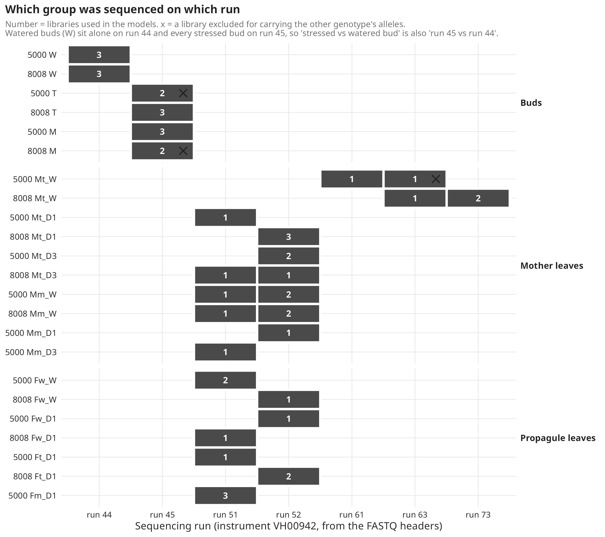

*Figure 6. Number of libraries per group (rows) and sequencing run (columns). × = excluded library.*

| Contrast | Sequencing runs | Sampling day | What can bias it | Verdict |
|---|---|---|---|---|
| Leaf `Mt_D1_vs_Mt_W` | 51/52 vs 61/63/73 | day 9 vs day 39 | run; 30 days of age; maybe the hour of sampling (section 5.5) | large responses are safe, small ones are not |
| Leaf `Mt_D3_vs_Mt_W` | 51/52 vs 61/63/73 | day 39 both | run | large responses are safe, small ones are not |
| Leaf `Mt_D3_vs_Mt_D1`, the memory test | 51/52 both | day 39 vs day 9 | 30 days of age, which no design can remove: the 3rd drought always comes later | **clean for run** |
| Maturation leaves `Mm_…` (5000) | 51/52 | D1 day 144; D3 and W day 174 | 30 days of age; one plant per drought group | descriptive |
| Leaf `Mm_W_vs_Mt_W` | 51/52 vs 61/63/73 | day 174 vs day 39 | run; 135 days of age | descriptive; the strongest run fingerprint in leaves (section 5.3) |
| Bud `T_vs_W`, `M_vs_W` | 45 vs 44 | day 180 both | run **and** library preparation, completely | **not usable** (section 5.3) |
| Bud `T_vs_M` | 45 both | day 180 both | nothing technical. Time since the stress (135 vs 6 days) is the comparison itself | **clean** |
| Propagule `Fw_D1_vs_Fw_W` | 5000: 52 vs 51; 8008: 51 vs 52 | same drought cycle | one Fw_D1 plant | exploratory |
| Propagule `Ft_D1_vs_Fw_D1`, `Fm_D1_vs_Fw_D1` | 5000: 51 vs 52; 8008: 52 vs 51 | same drought cycle | one Fw_D1 plant, on the other run from the groups compared with it | exploratory |

*Bias of each contrast. Source: `qc/sequencing_runs.tsv` for the runs.*

What the table and Figure 6 show:
- **Buds.** Every watered bud is on run 44 and every stressed bud on run 45. "Stressed vs watered bud" is the same comparison as "run 45 vs run 44". This is why PC1 of the bud PCAs (Figure 4) cannot be trusted. T and M buds share run 45, so **T vs M is a clean comparison.**
- **Mother leaves.** The watered tillering controls (Mt_W) were sequenced on later runs (61, 63, 73), and every drought leaf on runs 51/52. So D1 vs W and D3 vs W are partly confounded. **D3 vs D1, the actual memory test, is within runs 51/52.**
- **Runs 51 and 52 behave as one batch.** Some contrasts cross them: in 5000 the D1 plant is on run 51 and both D3 plants on run 52, and each propagule reference plant (Fw_D1) is on the other run from the plants compared with it. Libraries of the same group on the two runs are as alike as libraries on the same run (median distance 0.48 across runs, 0.66 within a run; `qc/run_pair_distances_summary.tsv`, `../code/20_run_check.R`). And in the propagules the arrangement is reversed between the cultivars, so a run effect would push the two cultivars in opposite directions.
- **One Mt_W library stands apart.** In 8008, `258_S5` (run 63) is twice as far from the two Mt_W libraries of run 73 as they are from each other (distance 1.06–1.17 vs 0.54; `qc/run_pair_distances.tsv`). It adds noise to the 8008 contrasts against Mt_W.
- **Hour of sampling.** The lab confirmed that each sampling started early in the morning and in some cases lasted until past midday; the hour of each plant was not recorded. So every contrast is also confounded with time of day, by up to several hours, and this cannot be corrected. It matters most where clock genes show up (section 5.5).

### 5.3 How big is the bud run effect, and can it be removed?

The question "do buds of stressed mothers differ from buds of watered mothers?" is the strongest test of H3, so we tried hard to rescue it. We asked three things: how do the two runs differ technically, do genes that should never change look stable, and can a batch-correction method remove the run effect?

**The two runs differ in library preparation.**

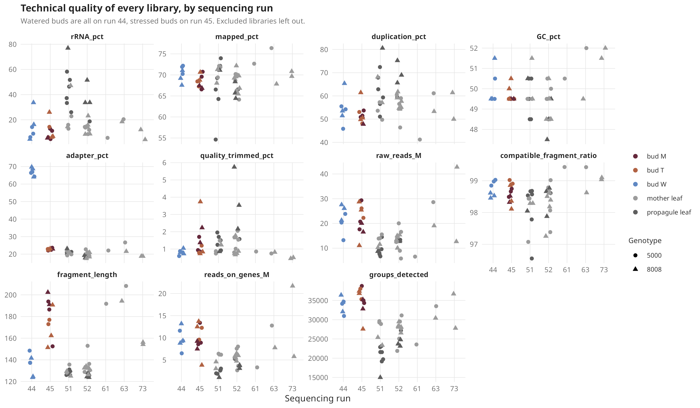

*Figure 7. Technical metrics of the bud libraries, by run. Leaves are shown for reference.*

Most metrics are the same in both runs: read depth, mapping rate, rRNA, duplication, GC content, genes detected. Two are not (Table 3).

| Metric | Run 44 (W buds) | Run 45 (T, M buds) | Leaves | Wilcoxon p |
|---|---|---|---|---|
| Adapter content (% of reads) | 66.7 | 22.6 | 20.3 | 0.00025 |
| Fragment length (Salmon, bp) | 137 | 182 | 130 | 0.00025 |
| Mapped (%) | 70.6 | 68.5 | 69.3 | 0.04 |

*Table 3. Median per group. Source: `bud_batch/qc_run44_vs_run45.tsv`.*

Short fragments and high adapter content go together: when a fragment is shorter than the read, the sequencer reads into the adapter. So the W buds' libraries were built with shorter fragments. That points to a **library preparation** difference (fragmentation time, size selection, or a different kit lot), not only a different sequencing run.

> **Concept: why fragment length matters.** Fragment length changes which genes are counted efficiently. Short fragments favour short transcripts and are sensitive to GC content in a different way from long fragments. Salmon corrects some of this, but not all. A batch of short-fragment libraries therefore shifts many genes up or down at once, according to their length and GC, without any biology.

**The run leaves a fingerprint by gene length and GC.** If the run difference is technical, the log2 fold changes between runs should follow gene length and GC content. A biological contrast should not (Table 4).

| Contrast | Same run? | rho with GC | rho with length |
|---|---|---|---|
| 8008 T_vs_W (bud) | no (45 vs 44) | −0.20 | 0.33 |
| 8008 M_vs_W (bud) | no | −0.27 | 0.35 |
| 8008 T_vs_M (bud) | yes (45) | 0.11 | −0.03 |
| 5000 T_vs_W (bud) | no | −0.31 | 0.39 |
| 5000 M_vs_W (bud) | no | −0.20 | 0.44 |
| 5000 T_vs_M (bud) | yes | −0.18 | −0.09 |
| 8008 Mt_D1_vs_Mt_W (leaf) | no (51/52 vs 61/63/73) | 0.21 | −0.17 |
| 8008 Mm_W_vs_Mt_W (leaf) | no | 0.32 | −0.28 |
| 8008 Mt_D3_vs_Mt_D1 (leaf) | yes | 0.17 | −0.10 |
| 5000 Mt_D1_vs_Mt_W (leaf) | no | 0.11 | −0.08 |

*Table 4. Spearman correlation between each contrast's log2 fold change and the gene group's GC content or length. Source: `bud_batch/gc_length_bias.tsv`.*

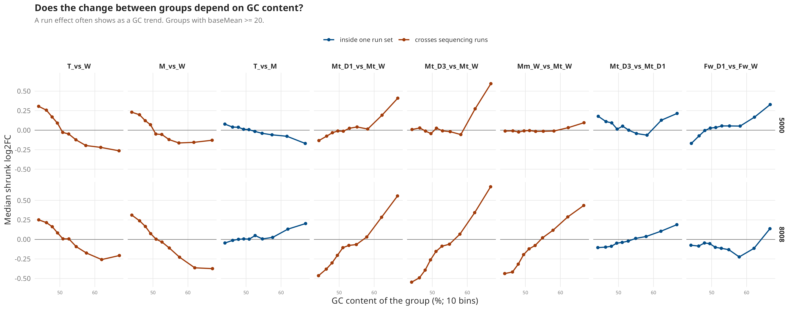

*Figure 8. Log2 fold change against gene GC content and length, for contrasts within one run and across runs.*

Every bud contrast against W carries a clear length trend (rho 0.33 to 0.44). T vs M, within one run, does not. There is a side finding for the leaves: 8008 contrasts against the watered tillering leaves (Mt_W, sequenced on later runs) carry a GC trend too, and Mm_W vs Mt_W, which should be a mild age effect, shows the strongest one. So the Mt_W leaves also carry a run fingerprint. It is weaker than in buds and the D1/D3 responses are large, so the leaf conclusions stand, but small leaf differences against Mt_W should be read with care.

**Genes that should not change, change.**

> **Concept: negative-control genes.** Some genes are expected to stay constant: "housekeeping" genes such as actin or GAPDH, or genes that barely vary among all our leaf samples. If many of them come out as differentially expressed, the contrast is driven by something other than biology.

We used two sets: 1,000 groups that were the least variable across all leaf libraries, and 28 reference genes from the sugarcane qPCR literature (Figure 9).

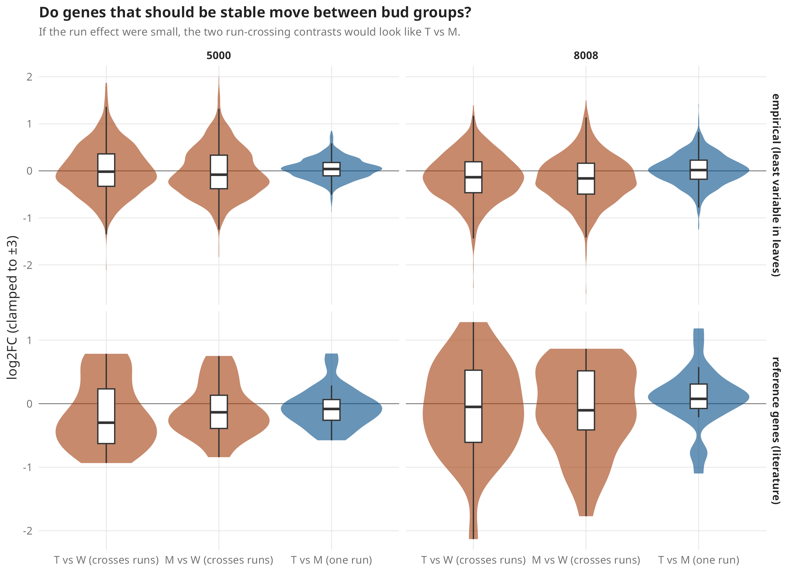

*Figure 9. Log2 fold change of control genes in each contrast. Source: `bud_batch/control_genes_lfc_summary.tsv`.*

- In buds, W vs T or M: 16–34% of the stable genes come out with padj < 0.05.
- In buds, T vs M (same run): 0.3–0.4%.
- In leaves, Mt_D3 vs Mt_D1 (same run): 0%.

The stable genes are only "stable" when no run boundary is crossed.

**A batch correction cannot separate run from treatment.**

> **Concept: RUVg.** "Remove Unwanted Variation" estimates hidden technical factors from control genes, genes assumed not to be affected by the biology. The factors are then added to the model as covariates, like a batch label. It only works if the unwanted factor is not the same thing as the biological groups. If every W bud is on one run and every stressed bud on the other, the factor and the treatment are identical, and removing the factor removes the treatment too.

We estimated one or two factors (k = 1, 2) from the 1,000 stable genes (Figure 10).

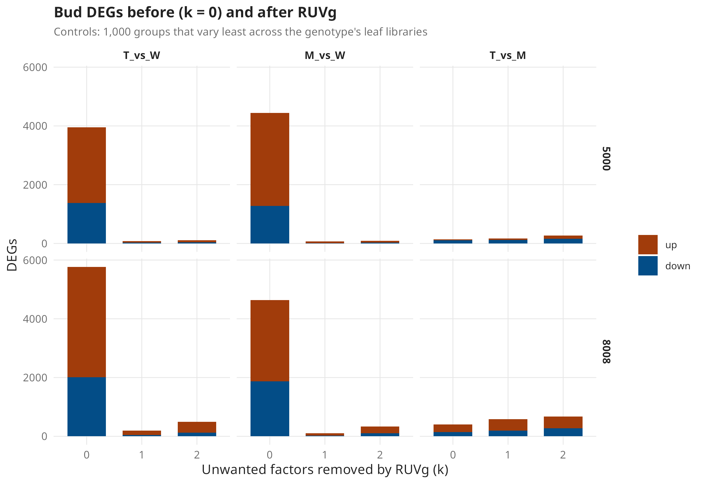

*Figure 10. Bud DEGs before (k = 0) and after removing one or two RUVg factors. Source: `bud_batch/ruvg_deg_summary.tsv`.*

- The first factor correlates −0.97 (8008) and −0.98 (5000) with "watered or not". It *is* the run.
- Removing it drops the W-vs-stressed DEGs from about 4,000–5,700 to about 60–200.
- T vs M, within one run, keeps a similar number of DEGs (8008: 404 before, 581 after; 5000: 143 before, 172 after).

One detail is worth mentioning. After removing the factor, the genes that leaves switch on under drought come out *higher* in 8008 stressed buds than in W buds (camera FDR 7 × 10⁻¹⁴ for T vs W; `bud_batch/leaf_drought_programme_in_buds.tsv`). Before correction there was no such signal. This is what we would expect if the buds of stressed mothers kept part of the drought programme. But it is what is left after removing a factor that is 97% the same as the treatment, so it can also be an artefact of the correction. 5000 shows nothing of the kind. We note it as a hint, not a result.

**Verdict on the bud batch:** the W-vs-stressed bud comparison cannot be rescued with these data. The difference between the runs is a library preparation difference, it is as large as the biology, and it is perfectly confounded with the treatment. Only re-preparing and re-sequencing some libraries together can fix it (section 15). The T vs M bud comparison is clean and remains the one usable bud test.

### 5.4 Groups with a single plant

The groups with a single library are:
- **5000:** Mt_D1, Mm_D1, Mm_D3, Fw_D1 and Ft_D1;
- **8008:** Fw_W and Fw_D1.

Every propagule comparison against Fw_D1 therefore rests on one plant in each genotype, and every 5000 comparison with its 1st drought rests on one plant too. Section 7 shows how much a single plant can change a result.

### 5.5 Age and time of day

- **Age.** D1 leaves are 30 days younger than the watered controls (Figure 1).
- **Time of day.** Each sampling started early in the morning and in some cases lasted until past midday, and the hour of each plant was not recorded (section 5.2). The clock genes of each library tell us what can be said about it.

> **Concept: reading the hour from clock genes.** The plant's daily clock is a loop of genes that peak one after another. CCA1/LHY peaks at dawn and falls during the morning. The PRR genes, GI and TOC1 rise later, towards midday and the evening. So between early morning and midday, a later hour means **less CCA1/LHY and more of the day and evening genes**. Two libraries that differ in both, in opposite directions, were probably sampled at different hours. Drought can also act on these genes, so the reading is a hint, not a clock.

We took six clock groups: CCA1/LHY (the **morning score**) and PRR73, PRR37, PRR59/95, GI and TOC1 (their mean is the **day/evening score**). Expression is log2, centred within leaves and within buds (`../code/23_clock_check.R`).

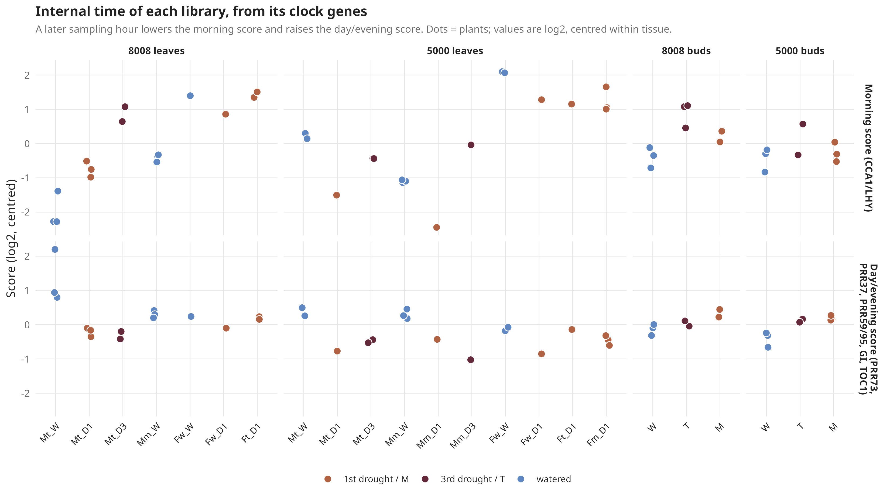

*Clock scores of every library. Top: morning score. Bottom: day/evening score. Dots = plants. Source: `clock/clock_index.tsv`.*

What the scores show (`clock/clock_by_contrast.tsv`):
- **Plants of one group share their internal time.** In leaves, 99% of the variation of the scores is between groups (spread within a group 0.22, range between groups 5.5). The groups were sampled one after another. So hour is tied to the group, and it cannot be put in a model: we tried the scores as a covariate, and every test lost all its power.
- **Drought against watered leaves: the largest differences.**
  - In 8008 the watered leaves look later in the day on both scores (morning score 1.2 to 2.8 lower, day/evening score 1.5 to 1.6 higher than in drought leaves).
  - In 5000 both scores are lower under drought, which is not the pattern of a time shift.
  - The day and evening genes are lower under drought in both cultivars, so part of this is a drought effect. Genes of the daily clock are not interpreted in these contrasts.
- **3rd against 1st drought (the memory test): the day and evening genes do not move.** The day/evening score differs by −0.10 in 8008 and +0.29 in 5000. A difference of several hours would move it. Only CCA1/LHY is higher at D3: 3 times in 8008 (+1.6), 2 times in 5000 (+1.1).
- **Buds, T against M:** the same internal time in 5000; in 8008 CCA1/LHY is a little higher in T (+0.7) and the day/evening score is equal.
- **Propagules of stressed against watered mothers under drought:** the scores differ by 0.7 at most.
- **`258_S5`,** the Mt_W library of 8008 that stands apart (section 5.2), has a day/evening score of 2.2 against 0.8 and 0.9 in the other two. It looks sampled later than they were.

**THI1 and CCA1/LHY** (`clock/clock_genes_de.tsv`). THI1, a thiamine synthesis gene controlled by the clock, and CCA1/LHY are among the 8008 memory genes (section 6.2).
- **THI1 is repressed by drought, whatever the hour.** In 8008, 11 of the 13 THI1 groups fall at D1 (17 to 170 times; the other two are barely expressed). In 5000, 9 of the 10 expressed THI1 groups are lower at D3 than in watered leaves. The clock scores of the two cultivars move in opposite directions in these contrasts, and THI1 falls in both.
- **Its further fall at D3 goes together with the rise of CCA1/LHY.** THI1 is lower at D3 than at D1 in 12 of 13 groups in 8008 (significant in 2) and in all 10 in 5000 (significant in 5, on one D1 plant). In both cultivars CCA1/LHY is higher at D3 and the day and evening genes are unchanged.
- **Two readings remain.** The D3 leaves were sampled a little earlier in the morning than the D1 leaves, in both cultivars: CCA1/LHY falls fast after dawn, before the day and evening genes start to rise. Or the 3rd drought raises CCA1/LHY. The data cannot tell which.

**Verdict:** THI1 is a drought-repressed gene for certain. THI1 and CCA1/LHY as memory genes stay open, and they count as one signal, not two. The other memory genes are drying-protection genes; a large difference in hour between D1 and D3 is unlikely, since the day and evening genes are equal.

### 5.6 Two notes for reading the tables

- **Extreme fold changes in single-allele groups.** Many `U:` groups (one allele that could not be assigned to a sorghum gene) switch on or off between plants, with |log2FC| of 6 to 27. Most of the 5000 `-+` class looks like this: about −8 at D1, then +8 at D3. It points to the one D1 plant rather than to memory.
- **Enrichment.** GO terms are uncorrected p < 0.01 and often rest on 2 to 5 genes. Some KEGG maps are animal pathways reached through shared gene families: "Estrogen signalling" is HSP70/HSP90, and "MicroRNAs in cancer" is a mix of transporters and kinases. Read them as gene families.

---

## 6. Do leaves "learn"? (H1)

> **Concept: memory classes.** Following Ding et al., every gene gets two signs: how it changed at the 1st drought (D1 vs watered), then how it changed at the 3rd drought compared with the 1st (D3 vs D1).

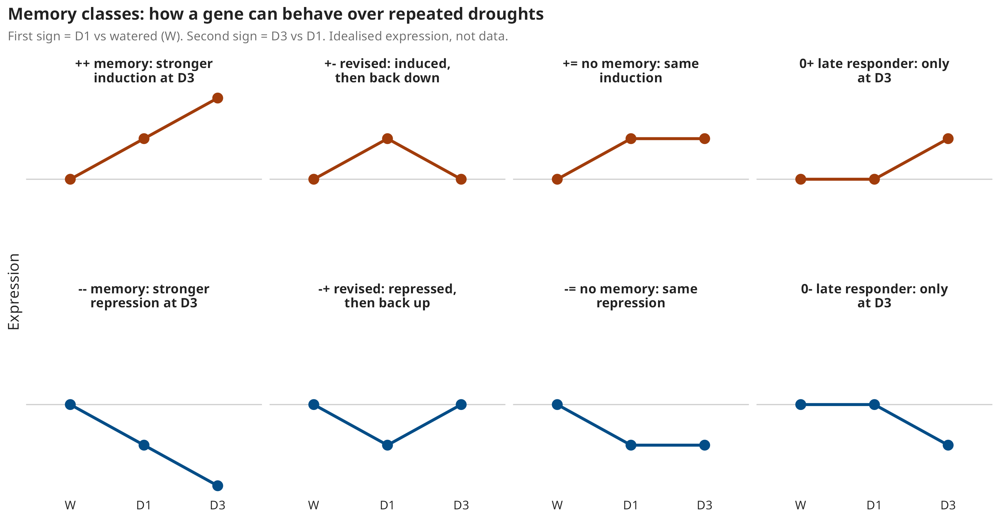

*Figure 11. The memory classes, drawn as idealised genes. Top row: genes switched on by drought. Bottom row: genes switched off.*

The names to remember:
- **`++` and `--`** are **memory genes**: the 3rd response is stronger than the 1st.
- **`+=` and `-=`** are **non-memory genes**: same response both times.
- **`+-` and `-+`** are "revised" genes, whose response reverses.
- **`0+` and `0-`** are late responders, which only react at D3.

### 6.1 A sea of genes that respond the same way both times

| Genotype | D1 vs W (up / down) | D3 vs W (up / down) | D3 vs D1 (up / down) | D3 vs D1 status |
|---|---|---|---|---|
| 8008 | 3,905 / 4,196 | 3,585 / 3,978 | **35 / 49** | conclusive |
| 5000 | 2,091 / 1,750 | 4,646 / 4,657 | 500 / 729 | exploratory (one D1 plant) |

*Table 5. DEG counts in tillering mother leaves (`de/group/deg_summary.tsv`).*

**What the DEGs do.** The main GO processes and KEGG pathways of each contrast (`enrichment/go_enrichment.tsv`, `enrichment/kegg_enrichment.tsv`; plots in `plots/go/`):

| Contrast | Higher (up) | Lower (down) |
|---|---|---|
| **8008** D1 vs W (3,905 / 4,196) | Response to water deprivation, heat and hydrogen peroxide (dehydrins, chaperones). Phenylpropanoid, flavonoid and stilbenoid synthesis. Breakdown of branched-chain amino acids and tryptophan; galactose metabolism; glyoxylate cycle. | Chloroplast organisation, chlorophyll synthesis, photosystem II assembly, antenna proteins, Calvin cycle. Thiamine synthesis. rRNA processing, ribosome biogenesis, tRNA charging. |
| **8008** D3 vs W (3,585 / 3,978) | The same programme: heat, high light, water deprivation. Flavonoids and phenylpropanoids even stronger (KEGG padj 1e-20), lignin, cutin and wax. | Thiamine synthesis, circadian rhythm, chloroplast organisation, rRNA processing, tRNA charging, sulfur and nitrogen metabolism. |
| **8008** D3 vs D1 (35 / 49) | Drying protection: RAB18 dehydrin, two LEA proteins, embryo-specific protein ATS3, a seed-storage protein. Also a sugar transporter, cytokinin oxidase, tyrosine/DOPA decarboxylase, glutamine synthetase and the clock gene CCA1/LHY. | Thiamine synthesis (THI1), papain-like cysteine proteases (4 groups), branched-chain amino acid synthesis (2-isopropylmalate synthase, acetohydroxy-acid isomeroreductase), rRNA maturation. |
| **5000** D1 vs W (2,091 / 1,750; one D1 plant) | Chlorophyll breakdown, breakdown of branched-chain amino acids, phenylpropanoids, tryptophan metabolism and auxin synthesis, response to water deprivation. | Photosynthesis (KEGG padj 2e-22), antenna proteins, Calvin cycle, chlorophyll synthesis, water transport (aquaporins), cytokinin signalling. |
| **5000** D3 vs W (4,646 / 4,657) | Phenylpropanoids and flavonoids, amino acid breakdown, fatty acid β-oxidation, glutathione metabolism, chlorophyll breakdown. | Translation (482 groups), photosynthesis, chloroplast organisation, chlorophyll synthesis, tRNA charging, ribosome biogenesis. |
| **5000** D3 vs D1 (500 / 729; one D1 plant) | ABA response, protein dephosphorylation (PP2C phosphatases), MAPK and hormone signalling. | Translation and ribosome (KEGG Ribosome, 102 groups, padj 3e-41), protein folding (HSP70/HSP90 chaperones). |

*Functional content of the tillering-leaf contrasts (up / down DEG counts in brackets).*

Both cultivars run the same drought programme: protection and secondary metabolism go up, photosynthesis and protein synthesis go down. The contrast between the 3rd and the 1st drought is where they differ: in 8008 it is a short list of drying-protection genes, in 5000 a broad further shutdown of translation.

In 8008, about 8,000 groups respond to the 1st drought and about 7,500 to the 3rd, and **84** of them respond differently the 3rd time. Figure 12 shows the sea of equal responses that these 84 stand out from.

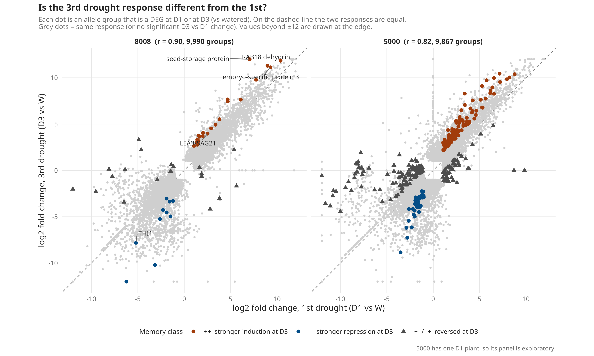

*Figure 12. Each dot is a group that responds to drought at D1 or at D3. x = response at the 1st drought, y = response at the 3rd. On the dashed diagonal the two are equal. Coloured dots are the memory classes.*

How to read it:
- **On the diagonal:** the gene did the same thing both times.
- **Above the diagonal on the right:** a stronger induction at D3 (`++`).
- **Below it on the left:** a stronger repression (`--`).

In 8008 (left) almost everything hugs the diagonal: the correlation is **r = 0.90**. Of 5,674 groups that respond at both cycles, 5,673 respond in the same direction (`report_tables/h1_d1_vs_d3_concordance.tsv`). The 3rd drought response is a faithful **replay** of the 1st, which makes the genes that leave the diagonal easy to see.

The UpSet plot shows the same thing from another angle.

> **Concept: UpSet plot.** A Venn diagram for many sets at once.
> - **Rows** are sets: here, the DEGs of each contrast, split into up and down.
> - **Each column** of connected dots is one intersection: the groups that are in exactly those sets.
> - **The bar above** gives its size, and the bars on the left give the size of each set.

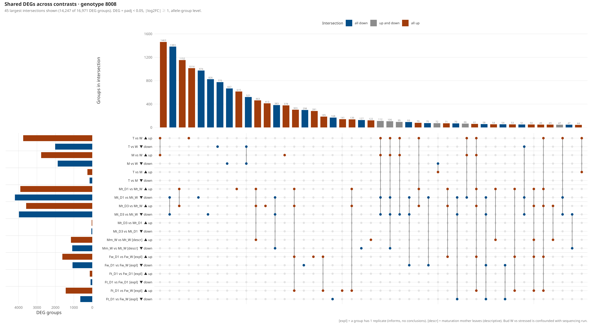

*Figure 13. Shared DEGs across all contrasts in 8008. Red = up, blue = down, grey = intersections that mix up and down.*

What stands out in 8008:
- **The leaf columns.** Two of the three largest columns are leaf groups: 1,383 groups go **down at both D1 and D3**, and 1,152 go **up at both**. The rows `Mt_D3 vs Mt_D1` are almost empty.
- **The largest column overall (1,463).** These are buds, up in both T vs W and M vs W: the "stressed vs watered bud" signal, which is the batch-confounded one of section 5.3.

### 6.2 The genes that remember (8008)

Among this sea of genes that respond equally, a set behaves like memory genes in 8008: 22 groups are `++` and 10 are `--`. Another 19 reverse their response (`+-`, `-+`), and 1,889 respond at the 3rd drought only (`0+`, `0-`). The identity of the memory genes is striking. Most of the `++` genes are **desiccation-protection** genes:

| Gene | D1 vs W | D3 vs D1 |
|---|---|---|
| RAB18/XERO1 dehydrin | +10.4 | +1.4 |
| LEA3/SAG21 | +2.5 | +1.4 |
| another LEA protein | +7.8 | +2.0 |
| seed-storage protein | +7.1 | +4.9 |
| embryo-specific protein 3 | +9.3 | +1.8 |
| sugar transporter | +9.0 | +2.3 |

*Table 6. Some 8008 `++` groups (log2FC, `de/group/memory_classes_8008_tillering.tsv.gz`).*

> **Concept: LEA proteins and dehydrins.** "Late embryogenesis abundant" proteins pile up in seeds as they dry out at the end of maturation. They protect membranes and other proteins when water is lost. Dehydrins such as RAB18 are one family of LEA proteins. Plants switch the same genes on in leaves under drought.

So the genes that 8008 leaves induce more strongly at the 3rd drought are **seed-like drying-protection genes**. RAB18 is the canonical trainable gene of *Arabidopsis*, and its maize orthologue is a memory gene as well. Finding it in the `++` class is the clearest link to the literature.

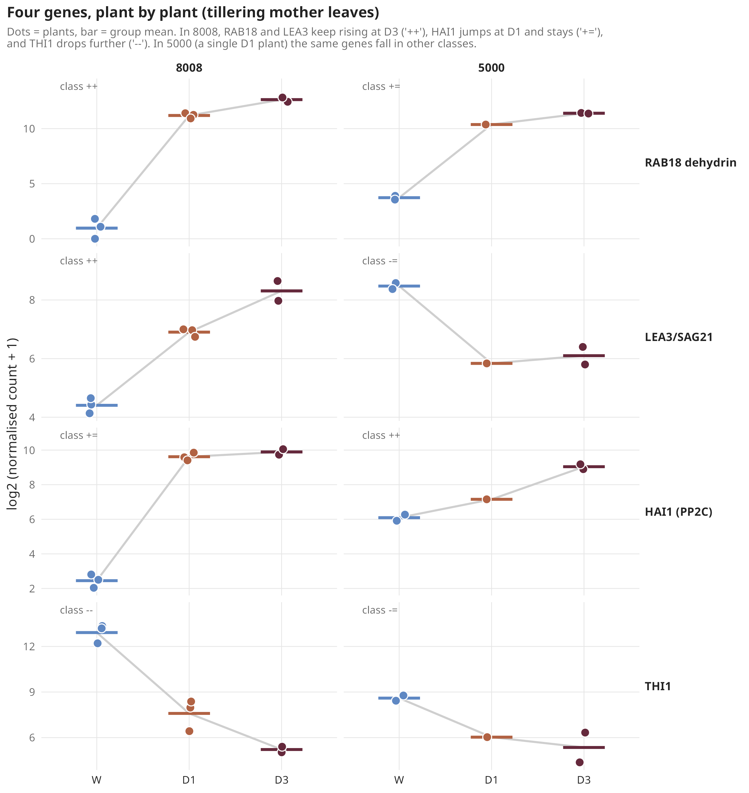

*Figure 14. Four genes plant by plant in tillering mother leaves (y = log2 expression). Left column 8008, right column 5000.*

Figure 14 makes the classes concrete:
- **RAB18 and LEA3 (8008):** they jump at D1 and **keep rising** at D3 (`++`).
- **HAI1 (8008):** a PP2C phosphatase of the ABA pathway. It jumps at D1 and **stays** (`+=`): a strong drought gene without memory.
- **THI1 (8008):** a thiamine (vitamin B1) biosynthesis gene. It drops at D1 and **drops further** at D3 (`--`).
- **5000 (right column):** the same genes fall in other classes. RAB18 is `+=`, LEA3 even goes down, and HAI1 is `++`. Remember that the 5000 D1 group is one plant.

One caution for 8008. THI1 and CCA1/LHY, both tied to the daily clock, are among the memory genes. The clock genes of each library were checked (section 5.5): the day and evening clock genes are equal at D1 and D3, THI1 is repressed by drought for certain, and its further fall at D3 goes together with the rise of CCA1/LHY. Whether that pair is memory or a slightly earlier sampling hour stays open. The drying-protection genes of Table 6 are not clock genes.

### 6.3 5000: a bigger response at D3, but on one plant

5000 responds more strongly at D3: 9,303 DEGs against 3,841 at D1. Part of that gap comes from statistical power, since D1 has one plant. But the response sizes are also larger at D3. What dominates the change?

> **Concept: GO enrichment and how to read the lollipop plots.** The Gene Ontology (GO) labels genes with the processes they take part in ("translation", "response to heat"…). Enrichment asks whether a process appears among the DEGs more often than chance would predict.
> - **x-axis:** fold enrichment = observed / expected. 5 means five times more DEGs in the term than expected.
> - **Dot size:** how many DEG groups are in the term.
> - **Colour:** −log10 p (darker = stronger evidence).
>
> These p-values are not corrected for testing many terms, and terms with 2–3 genes are fragile. Read the plots for themes, not for single terms.

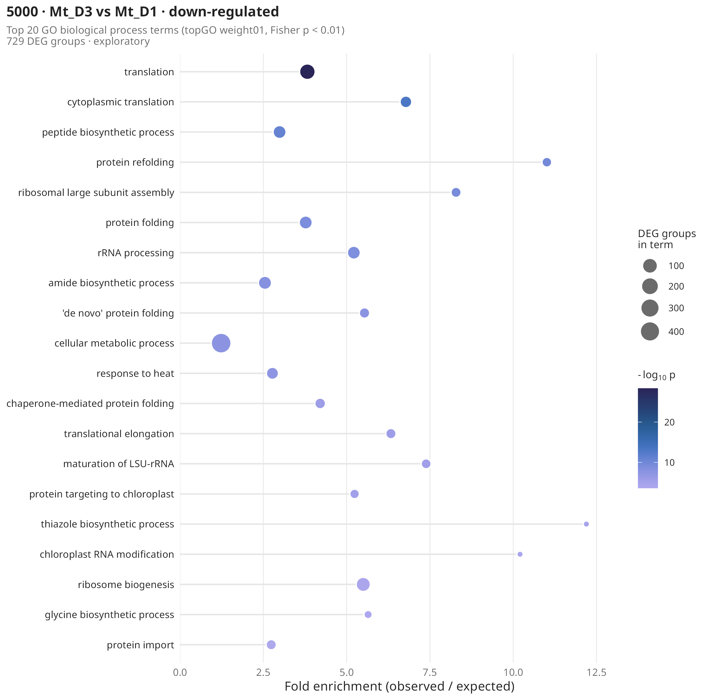

*Figure 15. GO processes among the genes lower at D3 than at D1 in 5000.*

- **What goes down.** The list is dominated by **translation** and **ribosome** genes (translation p = 4e-29; the KEGG "Ribosome" pathway holds 102 groups). Under severe stress, plants stop building ribosomes and making proteins to save energy.
- **Not memory-specific.** In 5000, genes the literature calls *non-memory* also respond more strongly at D3. Two explanations remain:
  - the 3rd drought was harsher;
  - the single D1 plant was mildly stressed.

  Section 7 shows that the second explanation is enough.

### 6.4 Maturation mother leaves (descriptive only)

- **5000 drought response,** with one plant in every drought group:
  - Mm_D1 vs Mm_W: 3,000 up / 2,563 down;
  - Mm_D3 vs Mm_W: 2,337 / 2,093;
  - Mm_D3 vs Mm_D1: 710 / 865.
- **8008:** only watered maturation leaves exist.
- **Development stage (Mm_W vs Mt_W):** 915 groups differ in 5000 and 2,246 in 8008. Maturation leaves have more phenylpropanoid and flavonoid expression; in 8008 they have less thiamine synthesis and clock-gene expression. In 5000, ABA-PP2C and aquaporin sets are lower in maturation leaves. This contrast crosses runs and 135 days (section 5.2).

Two later sections back up the H1 answer from other angles. Gene copies within a group move together, so no single allele hides a memory the group sum misses (section 12). And no group of co-expressed genes changes at the 3rd drought beyond its change at the 1st (section 13).

**H1 verdict.**
- **8008:** yes, for a defined set of genes. Against about 8,000 groups that respond the same way at both droughts, 84 respond differently at the 3rd and 32 are memory genes, most of them desiccation-protection genes led by RAB18.
- **5000:** 1,229 groups differ between the droughts, 162 of them in the memory classes, with a strong further shutdown of translation. This rests on one D1 plant, so it is not resolved yet.

---

## 7. Does the tolerant cultivar remember more? (H2)

We expected 8008, the drought-tolerant cultivar, to show more memory. Counting genes says the opposite: 84 groups change between D3 and D1 in 8008, against 1,229 in 5000 (Table 5). But 5000's D1 group has **one plant**, so the difference cannot be taken at face value. We tested it properly in two ways.

> **Concept: an interaction test.** "Does 8008 respond differently from 5000?" is not answered by counting DEGs in each cultivar separately. One cultivar can pass a cut-off and the other just miss it, with almost the same change. The proper test fits both cultivars in one model and asks whether the *difference* between D3 and D1 is itself different between cultivars: (D3 − D1 in 8008) − (D3 − D1 in 5000). That is the **genotype × cycle interaction**. A gene with a significant interaction "remembers" differently in the two cultivars.

### 7.1 Both cultivars in one model

All tillering leaves of both cultivars went into one DESeq2 model, with one group per cultivar and condition. The cultivar-specific contrasts barely change from the separate models (Table 7).

| Contrast | Status | Up | Down |
|---|---|---|---|
| 8008 Mt_D3_vs_Mt_D1 | conclusive | 48 | 49 |
| 5000 Mt_D3_vs_Mt_D1 | exploratory (5000 Mt_D1 has 1 plant) | 156 | 428 |
| interaction, D1 vs W | exploratory | 614 | 290 |
| interaction, D3 vs W | conclusive | 1,896 | 1,534 |
| interaction, D3 vs D1 | exploratory | 175 | 77 |

*Table 7. DEGs in the joint model (padj < 0.05, at least two-fold). Source: `h2_genotype_cycle/joint_deg_summary.tsv`. "Exploratory" marks every contrast that uses 5000's single D1 plant.*

Gene by gene, the D3-vs-D1 interaction gives 252 genes, all resting on that one plant. A set-level view is more robust. We took the drought-responsive genes (the average D1 and D3 response of both cultivars, 4,842 induced and 5,995 repressed) and asked how much stronger they are at D3 than at D1 in each cultivar. We call this **amplification**.

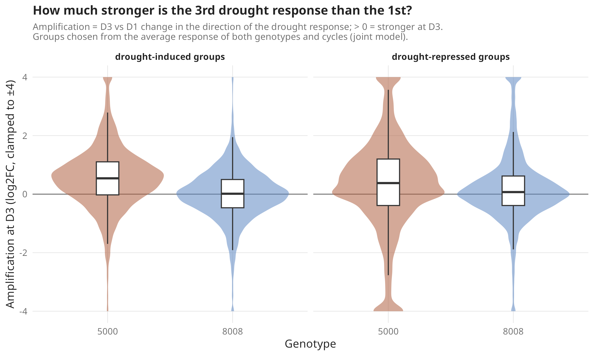

*Figure 16. How much stronger the drought response is at D3 than at D1, for drought-induced and drought-repressed genes. Positive values mean a stronger response at the 3rd drought.*

- In 8008 the 3rd drought looks like the 1st: median amplification 0.01 (induced) and 0.07 (repressed), on a log2 scale.
- In 5000 the 3rd drought looks stronger: 0.54 and 0.38.
- The interaction test on these sets agrees: the D3-vs-D1 interaction leans toward "5000 stronger" (camera FDR 6 × 10⁻⁵ for induced genes, 7 × 10⁻⁴ for repressed genes; `h2_genotype_cycle/interaction_camera.tsv`).
- At D1 the reverse is true: 8008 induces the drought genes more strongly than 5000 (FDR 1.5 × 10⁻⁴).

Read literally, that would say 5000 amplifies its response and 8008 does not. But every one of these tests compares against 5000's single D1 plant. If that plant was simply less stressed than average, D1 looks weak and D3 looks "amplified".

### 7.2 Cutting 8008 down to 5000's design

> **Concept: downsampling as a check.** If a result could come from having only one plant, build the same weak design in a group where we have more plants, and see whether the "result" appears there too. Here: refit 8008 with one D1 plant and two watered plants, exactly like 5000, and repeat for every possible choice of plants.

8008 has three D1 plants and three watered plants. We refitted it nine times, each time with one D1 plant and two watered plants (Figure 17, Table 8).

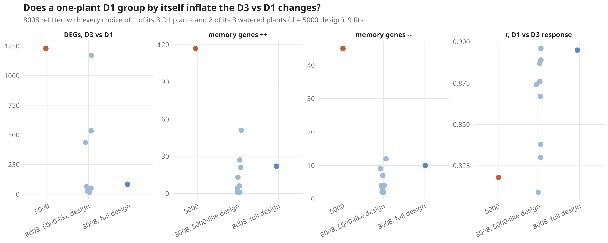

*Figure 17. 8008 refitted with one D1 plant and two watered plants, as in 5000. Each point is one choice of plants. The 5000 result is shown for comparison.*

| Design | D3 vs D1 DEGs | `++` memory genes | r(D1, D3) |
|---|---|---|---|
| 8008, all plants | 84 | 22 | 0.90 |
| 8008, D1 = plant 165_a_S40 (3 fits) | 17–65 | 4–13 | 0.87–0.90 |
| 8008, D1 = plant 166_S23 (3 fits) | 19–50 | 1–6 | 0.87–0.89 |
| 8008, D1 = plant 168_S25 (3 fits) | 436–1,171 | 21–51 | 0.81–0.84 |
| 5000, actual | 1,229 | 117 | 0.82 |

*Table 8. Range over the three choices of watered plants for each D1 plant. r(D1, D3) is the correlation between the D1 and D3 responses; lower means the two droughts look less alike. Source: `h2_genotype_cycle/design_check_8008_as_5000.tsv`.*

With plant 168_S25 as the only D1 plant, 8008 looks very much like 5000: up to 1,171 D3-vs-D1 genes, and a D1–D3 correlation of 0.81. With either of the other two plants, the "memory" almost disappears. So one plant is enough to produce 5000's result.

**H2 verdict:** not supported. There is no evidence that either cultivar remembers more: 5000's larger response at D3 is within the range that a single D1 plant can produce. The one difference that does not depend on that plant is at the 1st drought: 8008 responds more strongly than 5000 (the D3 vs W interaction is conclusive, and D1 vs W points the same way). A real test of H2 needs more 5000 D1 plants.

---

## 8. Do the textbook memory genes behave as memory genes here? (H6)

We collected the memory genes published for *Arabidopsis* (Ding 2013) and maize (Ding 2014) and 40 hand-picked candidates: ABA pathway, dehydrins, osmolytes, aquaporins, and chromatin and DNA-methylation enzymes. Orthology mapped them onto sugarcane groups.

> **Concept: gene-set test (camera).** Instead of asking gene by gene, a set test asks whether a whole list of genes tends to move up or down in a contrast. It detects many small coordinated shifts that no single gene would show, and it accounts for genes in a list being correlated with each other.

> **Concept: odds ratio (OR).** An OR of 2.8 means that a gene in list A is 2.8 times more likely (in odds) to also be in list B than a gene outside list A. OR = 1 means no link. The FDR says whether the overlap could be chance.

The results (`memory_genes/camera_literature_sets.tsv`):
- **As drought genes: yes, strongly.** In 8008, the maize `++` set goes up at D1 (FDR 5e-43), and so does the *Arabidopsis* `++` set (FDR 7e-17). The orthologues of known drought genes respond in sugarcane too.
- **As memory genes: single genes, not whole sets.**
  - In 8008 none of the `++` sets is induced further at D3.
  - The *Arabidopsis* `--` set even goes the other way: less repressed at D3 (FDR 0.005).
- **Single genes that do match.** Our 8008 `++` class overlaps the *Arabidopsis* `++` class through 3 genes: RAB18, LEA3/SAG21 and PIT1. That is far more than chance (odds ratio 25, FDR 0.003).
- **Genes we cannot test.** RD29A and RD29B, the other *Arabidopsis* classics, have no orthologue in grasses.

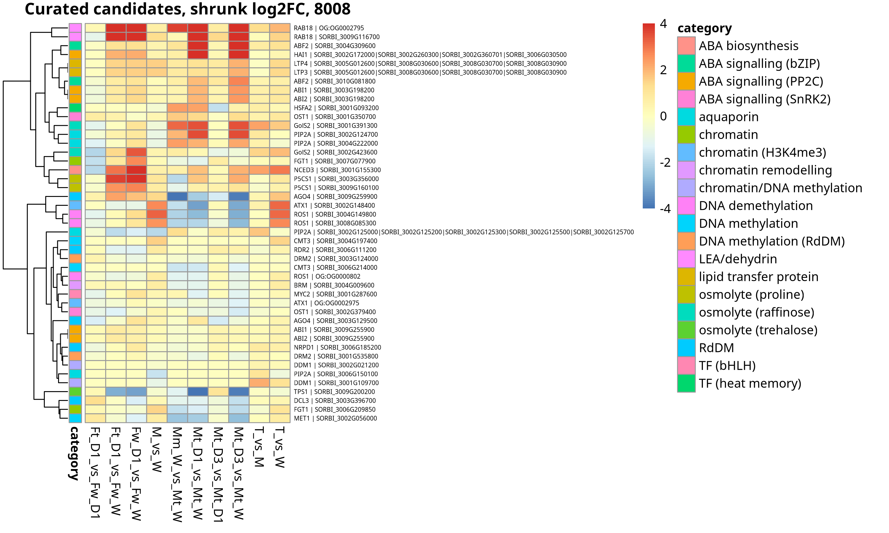

*Figure 18. Hand-picked candidates in 8008 (rows) across all contrasts (columns). Red = higher, blue = lower (shrunk log2FC). The coloured strip on the left gives each gene's category.*

How to read Figure 18: look down one column to see a whole contrast, or along one row to follow one gene.
- **The leaf drought columns** (`Mt_D1_vs_Mt_W`, `Mt_D3_vs_Mt_W`): the top rows (RAB18, ABF2, HAI1) are deep red in both, and TPS1 is deep blue.
- **The `Mt_D3_vs_Mt_D1` column:** pale. Even the classic drought genes barely change between the 1st and 3rd drought; RAB18 is the only one that rises significantly.
- **The bud columns** (`T_vs_W`, `M_vs_W`): ATX1 and ROS1, chromatin and DNA-demethylation enzymes, are red. That would be exciting for inheritance, but these are the batch-confounded columns (section 5.3).

- **Curated candidates in numbers** (`memory_genes/curated_lfc_8008.tsv`, shrunk log2FC at D1 vs W): NCED3 +1.8, ABF2 +4.1, HAI1 +7.4, P5CS1 +1.8, GolS2 +3.4, PIP2;1 +3.5, TPS1 −4.9. Between D3 and D1, RAB18 rises another +1.4 (padj 0.006).

**H6 verdict:** partly. The drought genes are conserved, and memory behaviour is kept by single genes: RAB18, LEA3 and PIT1.

---

## 9. Do buds keep a mark? (H3)

Buds matter most for sugarcane, because they become the next plants.

| Genotype | T vs W | M vs W | T vs M (clean) |
|---|---|---|---|
| 8008 | 3,748 / 2,014 | 2,773 / 1,873 | **261 / 146** |
| 5000 | 2,576 / 1,377 | 3,164 / 1,278 | **34 / 113** |

*Table 9. Bud DEGs (up / down).*

- **Stressed vs watered buds.** Thousands of DEGs, but section 5.3 showed that this comparison is dominated by a library preparation difference that no correction can remove. We cannot say how much of it is drought.
- **T vs M.** Same run, three plants each (two where one was excluded), so this comparison is trustworthy. It asks something narrower: do buds stressed long ago (T, 135 days) differ from buds stressed recently (M, 6 days)? They do: 407 groups in 8008 and 147 in 5000.

What the T vs M genes do:

| Cultivar | Higher in T buds (stressed 135 days before) | Higher in M buds (stressed 6 days before) |
|---|---|---|
| 8008 (261 / 146) | PAL (5 groups) and cinnamyl alcohol dehydrogenase (lignin), expansins, aquaporins, potassium transporters, B-box and NF-Y transcription factors. GO: phenylpropanoid synthesis, response to UV-B, photomorphogenesis. | Raffinose synthase (6 groups; KEGG galactose metabolism padj 2e-4), thiamine synthesis (THI1, 5 groups), circadian rhythm, phosphate-sensing SPX proteins. |
| 5000 (34 / 113) | Aquaporins, a chlorophyll a/b-binding protein, clock genes (KEGG circadian rhythm padj 0.03). | PAL (8 groups; KEGG phenylalanine metabolism padj 2e-6), tubulins (4 groups), thiamine-pyrophosphate enzymes, LOB and TCP transcription factors, malic enzyme, callose synthase. |

*Functional content of the bud T vs M contrast (up / down DEG counts in brackets).*

Raffinose-family sugars and thiamine are typical of a tissue under or just after stress, which fits M buds being 6 days into recovery. For reference, the confounded contrasts against watered buds show cell-wall and callose synthesis, calcium and potassium transport and ABC transporters higher in stressed buds, and photosynthesis and heat-response genes lower. They cannot be read as drought effects (section 5.3).

In both genotypes, the top of the list is the **PAL** family.

> **Concept: PAL.** Phenylalanine ammonia-lyase is the first enzyme of the phenylpropanoid pathway. That pathway makes lignin (cell walls), flavonoids and other protective compounds, and one route to the defence hormone salicylic acid.

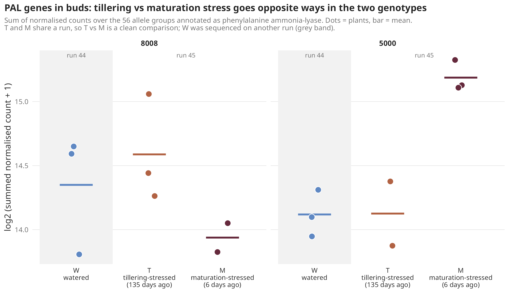

*Figure 19. Total expression of the 56 PAL allele groups in buds. The grey band marks the watered buds, sequenced on another run.*

PAL moves in **opposite directions** in the two genotypes:
- **8008:** T buds are higher than M buds.
- **5000:** M buds are clearly higher than T buds.

So how long ago the stress happened changes the phenylpropanoid state of the bud, and the two genotypes do it differently.

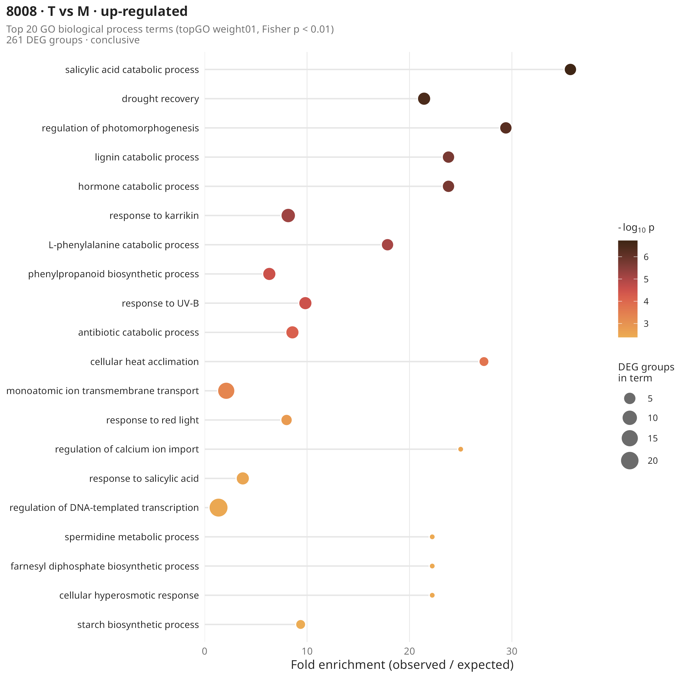

*Figure 20. GO processes among the genes higher in T than in M buds, 8008.*

A lesson about GO labels. The top terms here are "salicylic acid catabolic process", "drought recovery", "lignin catabolic process" and "L-phenylalanine catabolic process". They sound like four different biological stories. In fact they are mostly the **same PAL genes**, which carry all these labels in the annotation we transferred from other species. Always check which genes are behind a term before telling a story about it.

Two other 8008 bud results:
- **Thiamine (THI1) is lower in T buds,** the same gene that was a `--` memory gene in 8008 leaves.
- **T buds carry a little of the mother's leaf drought programme.** Genes that 8008 mother leaves switch on under drought are slightly higher in T than in M buds (section 11).

**H3 verdict:** yes, for the timing of the stress. Buds stressed 135 days before sampling differ from buds stressed 6 days before in 407 groups (8008) and 147 (5000), with a clean, genotype-specific mark in the PAL genes. Whether stressed buds differ from never-stressed buds is hidden behind a library preparation batch.

---

## 10. Do propagules respond differently? (H4)

Propagules from stressed mothers (Ft, Fm) were compared with propagules from watered mothers (Fw), all under one drought.
- **Direct comparison.** Against Fw_D1, 229 groups differ in 8008 Ft, 376 in 5000 Ft and 85 in 5000 Fm.
- **One reference plant.** Fw_D1 is one plant per genotype.

What the DEGs do:

| Contrast | Higher (up) | Lower (down) |
|---|---|---|
| Fw_D1 vs Fw_W, the propagule's own drought response (8008: 1,622 / 1,072; 5000: 2,672 / 2,851) | Lignin, wax and cutin synthesis; proline, asparagine and trehalose synthesis; response to water deprivation; phenylpropanoids. | Photosynthesis, chloroplast organisation, carotenoid and chlorophyll synthesis, Calvin cycle, thiamine synthesis. |
| 8008 Ft_D1 vs Fw_D1 (136 / 93) | Photosystem I assembly, chloroplast organisation, glucose metabolism; raffinose synthase, ClpB chaperones. | Defence proteins (glucanases, chitinase, thaumatin), HSP90, asparagine synthetase, glutamine synthetase. |
| 5000 Ft_D1 vs Fw_D1 (231 / 145) | Small heat-shock proteins (7 groups) and other chaperones; chlorophyll a/b-binding and light-harvesting proteins (KEGG photosynthesis padj 0.003); response to high light; translation. | ABC transporters, PP2C phosphatases, wax synthesis (3-ketoacyl-CoA synthase), MYB transcription factors. |
| 5000 Fm_D1 vs Fw_D1 (49 / 36) | Light harvesting in photosystem I, ferredoxin-NADP reductase, chaperonins. | Aminotransferases, wax synthesis. |

*Functional content of the propagule contrasts (up / down DEG counts in brackets).*

Because the reference is one plant, we did not stop at counting DEGs and asked a simpler question: **how strongly does each propagule group respond to drought?**

> **Concept: choosing genes fairly.** If we picked the genes that change most in one propagule contrast and then measured that same contrast, the result would be inflated by chance (the "winner's curse"). So the genes were chosen from **other plants**, the mother leaves at D1: one list induced by drought and one list repressed. Their response was then measured in each propagule group against the same watered propagules (Fw_W).

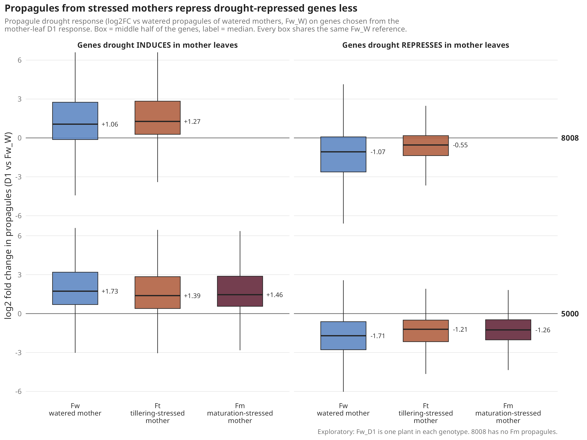

*Figure 21. Drought response of propagules on mother-leaf drought genes. Box = middle half of the genes, label = median log2FC. Left: genes drought induces; right: genes drought represses.*

- **Induced genes (left):** about the same in every group.
- **Repressed genes (right):** clearly weaker repression in propagules from stressed mothers.

  | Genotype | Fw (watered mother) | Ft (tillering-stressed mother) | Fm (maturation-stressed mother) |
  |---|---|---|---|
  | 8008 | −1.07 | −0.55 | — |
  | 5000 | −1.71 | −1.21 | −1.26 (3 plants) |

  *Median log2FC on the mother-repressed genes.*

The set tests agree in both genotypes:
- The *Arabidopsis* `--` set (genes drought represses) is higher in Ft than in Fw_D1 (FDR 1e-6 in 8008, 7e-9 in 5000, and 1e-5 for 5000 Fm).
- Rank-based tests on the mother's own drought genes (section 11) give the same picture. In 5000, genes drought switches on are lower in Ft_D1 than in Fw_D1, and genes it switches off are less switched off; Fm_D1 shows the same (FDR 10⁻⁷ to 10⁻²⁰). In 8008 only the repressed genes differ (FDR 6 × 10⁻⁴).
- **The two cultivars agree.** The Ft_D1 vs Fw_D1 profile of 8008 correlates with that of 5000 (rho 0.20; camera FDR 10⁻¹¹ to 10⁻²⁵). Two cultivars, each against its own reference plant, giving the same answer is the strongest evidence for this result.

Which repressed genes are spared? Photosynthesis and growth, above all.

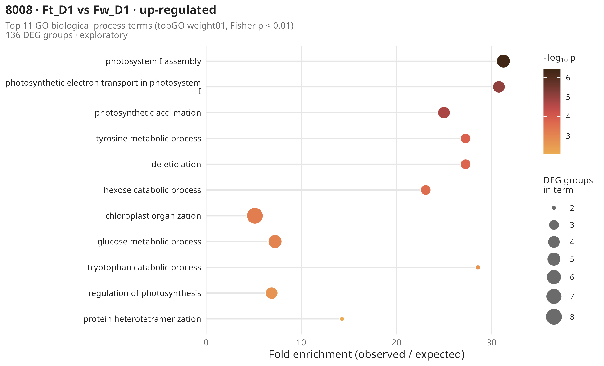

*Figure 22. GO processes higher in Ft than in Fw_D1 propagules under drought, 8008.*

In 8008 the top terms are photosystem I assembly, photosynthetic electron transport and photosynthetic acclimation. In 5000, KEGG "Photosynthesis" comes out (padj 0.003). The co-expression analysis finds the same thing on its own: the only module that follows the mother's history is a translation and chloroplast module, less repressed in propagules of stressed mothers (section 13). Drought normally shuts these genes down. Propagules from stressed mothers shut them down less. That fits the better drought performance Marcos et al. 2018 saw in such propagules.

> **Concept: milder response, two readings.** A propagule that "responds less" to drought may be **better prepared** (it needs less emergency response, as Marcos et al. 2018 suggested from physiology), or it may simply have been **less stressed** (bigger, with more water reserve in the stalk piece, or in drier soil at a different time). Gene expression alone cannot tell the two apart. A measure of plant water status at sampling can.

**Why this is still exploratory:**
- **One reference plant per genotype.** If that Fw_D1 plant was simply drier than the others, we would see exactly this pattern.
- **In 8008 the reference is a weak library.** It is `79_S6`, the library with 76% rRNA (section 5.1). In a thin library many genes get few reads and look "repressed", which would inflate the Fw repression and make Ft look milder. So the 8008 result may be partly technical.
- **5000 is more trustworthy.** Its reference (`42_S39`) is a normal library, and its Fm group has three plants that agree with Ft. Its Ft group is one plant.
- **Sequencing run.** In each cultivar the reference plant is on the other run (51 or 52) from the plants compared with it. The two runs behave as one batch, and the arrangement is reversed between the cultivars (section 5.2), so a run effect cannot produce the same direction in both.

**H4 verdict:** propagules of stressed mothers respond more mildly to drought and spare photosynthesis and growth genes. The direction is the same in both genotypes, and the evidence is strongest in 5000. It is exploratory until more Fw_D1 plants are sequenced.

---

## 11. Is it the same genes from mother to bud to propagule? (H5)

If memory travelled from mother to bud to propagule, the same genes should change at each step. A first pass with overlaps of DEG lists found no shared genes between buds and propagules (`report_tables/h5_overlaps.tsv`). But cut-offs throw away most of the information, and with few plants many true changes miss them. So we compared whole gene rankings instead.

> **Concept: rank-based tests.** Instead of "which genes pass padj < 0.05 in both?", ask "do the genes that rank highest in contrast A also tend to rank high in contrast B?". Two tools:
> - **camera (pre-ranked)**: take the top 300 up and top 300 down genes from A and test whether they move as a set in B. This is tested in both directions, A → B and B → A.
> - **RRHO** (rank-rank hypergeometric overlap): rank all genes in A and in B, and for every pair of cut points count how many genes are in both tops. The result is a map. A hot spot in the up-up or down-down corner means the two contrasts agree; hot spots in the off-diagonal corners mean they go in opposite directions.

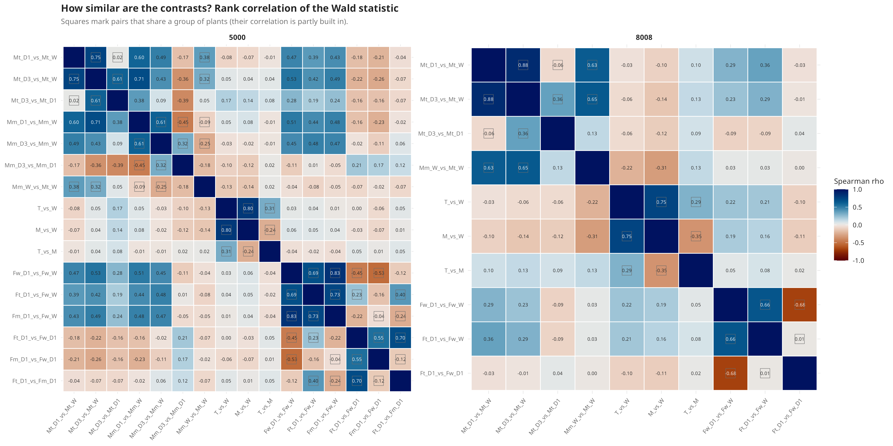

*Figure 23. Spearman correlation between the log2 fold changes of every pair of contrasts, per cultivar. Source: `h5_rank/contrast_correlations.tsv`.*

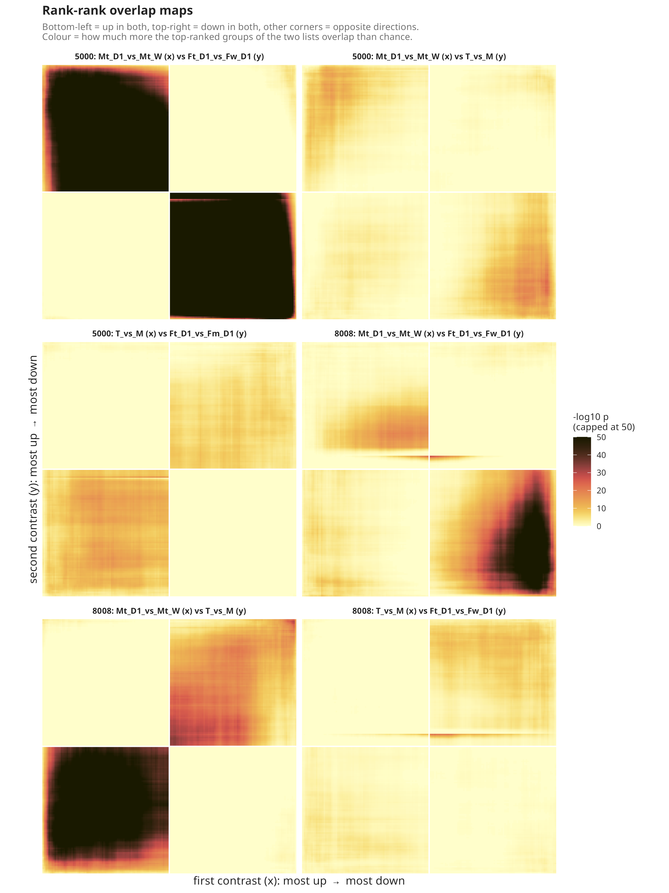

*Figure 24. RRHO maps for the steps of H5. Colour is −log10 p of the overlap. Bottom-left = both up; top-right = both down.*

We tested each step of the chain (Table 10).

| Step | Contrasts | 8008 | 5000 |
|---|---|---|---|
| Mother leaf → bud | Mt_D1_vs_Mt_W (leaf) vs T_vs_M (bud) | **agree**: leaf drought genes are higher in T buds (camera FDR 0.01; RRHO up-up peak 73) | no link, weakly opposite |
| Mother memory → bud | Mt_D3_vs_Mt_D1 vs T_vs_M | **agree**: D3 > D1 genes higher in T buds (FDR 0.001) | partial: D3 < D1 genes lower in T buds (FDR 0.001) |
| Bud → propagule | T_vs_M (bud) vs Ft_D1_vs_Fw_D1 | no link (FDR ≥ 0.1) | weak (FDR 0.07) |
| Bud → propagule, matched | T_vs_M vs Ft_D1_vs_Fm_D1 | (no Fm in 8008) | weak (FDR 0.06) |
| Mother drought → propagule | Mt_D1_vs_Mt_W vs Ft_D1_vs_Fw_D1 | **opposite** for repressed genes (FDR 6 × 10⁻⁴) | **opposite** for both sets (FDR down to 6 × 10⁻¹⁴; RRHO off-diagonal peaks 151 and 244) |

*Table 10. Rank-based tests of H5. Source: `h5_rank/h5_rank_tests.tsv`, `h5_rank/rrho_maxima.tsv`.*

Three things stand out.

**1. A modest mother → bud link in 8008.** In 8008, genes that the mother's leaves switch on under drought, and genes that rise more at the 3rd drought than at the 1st, are slightly higher in buds of tillering-stressed (T) mothers than in buds of maturation-stressed (M) mothers. T buds were collected 135 days after the last drought, M buds 6 days after. So T buds carry more of the leaf drought programme despite the longer gap, which is what long-term memory would look like. The correlation over all genes is small (rho 0.10), so this is a shift in a subset of genes, not a general state. 5000 does not show it.

**2. No link from buds to propagules.** Whatever separates T from M buds does not reappear in the propagules grown from them (Ft vs Fw, or Ft vs Fm in 5000). The mark in the bud, if there is one, is not what the propagule shows.

**3. The propagules show a milder drought response,** the H4 result (section 10). It concerns how the propagule responds, not a state carried over from the bud.

One thing cannot be tested: whether watered propagules from stressed mothers (T/W) start from a different resting state, because they were never sequenced.

**H5 verdict:** no chain from mother to bud to propagule. The two links that do appear, mother → bud in 8008 and the milder propagule response, are separate observations.

---

## 12. Does one copy of a gene carry the memory?

Sugarcane has about 8–12 copies of most genes, and every analysis so far summed the copies into **allele groups** (section 3). Memory could still sit in a single copy, for example the one copy that keeps a chromatin mark, and be diluted in the sum.

> **Concept: heterogeneity between alleles (I²).** For each allele group, take the log2 fold change of each copy and ask whether they agree. Cochran's Q tests whether the copies differ more than their uncertainty allows. I² is the share of the variation between copies that is real rather than noise: 0% means all copies agree, 75% means they disagree strongly. This comes from meta-analysis, where it measures whether several studies agree.

### 12.1 The copies move together

| Cultivar | Groups | Median I² | Heterogeneous (FDR < 0.05) | Copies going opposite ways |
|---|---|---|---|---|
| 5000, all drought-responsive | 2,136 | 0 | 6.3% | 1.6% |
| 8008, all drought-responsive | 3,511 | 0 | 11.3% | 1.4% |
| 5000, memory groups | 209 | 0 | 4.8% | 2.4% |
| 8008, memory groups | 20 | 0 | 10% | 0% |
| 5000, non-memory groups | 1,927 | 0 | 3.6% | 0.7% |
| 8008, non-memory groups | 3,491 | 0 | 3.9% | 0.1% |

*Table 11. Agreement between copies within each allele group. Source: `alleles/heterogeneity_summary.tsv`.*

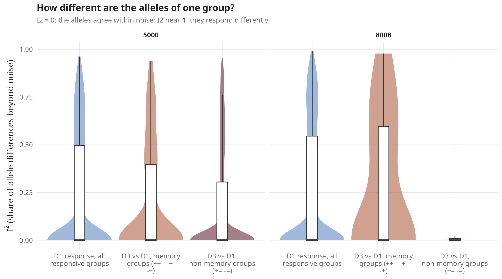

*Figure 25. I² for drought-responsive groups, memory groups and non-memory groups.*

In most groups the copies agree completely (median I² = 0). Memory groups are not more heterogeneous than other responsive groups: 8008's 10% is 2 groups out of 20. And when one copy does most of the change, it is usually the copy that is most expressed: the share of the change carried by a copy tracks its share of the expression (r = 0.97 in 8008; `alleles/memory_change_carriers.tsv`). So the change is spread across copies in proportion to how much each is used.

### 12.2 The named candidates

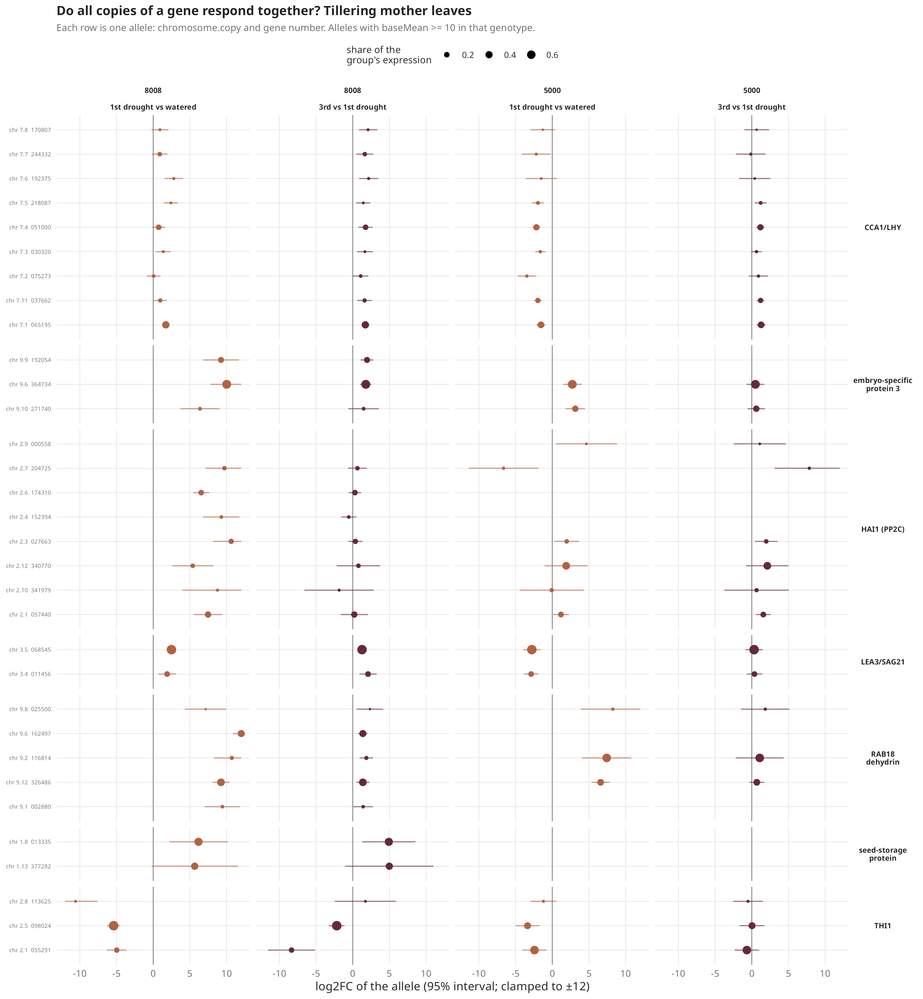

*Figure 26. Expression of each copy of the named candidate genes, per group. Each line is one copy (POJ2878 gene ID and chromosome copy).*

- **RAB18:** all copies rise together under drought in 8008. 5000 expresses only 3 of the 5 copies seen in 8008 (`alleles/named_allele_presence.tsv`).
- **LEA3, seed-storage protein, embryo-specific protein:** copies move together. The seed-storage protein copies are expressed only in 8008.
- **THI1:** one copy (chromosome 2, copy 1) drops sharply in 8008 at D3 (about −8 on the log2 scale), more than the other two copies. This is the one candidate where a single allele may behave differently. It is worth checking by qPCR with copy-specific primers.
- **PAL (bud signature):** see Figure 27.

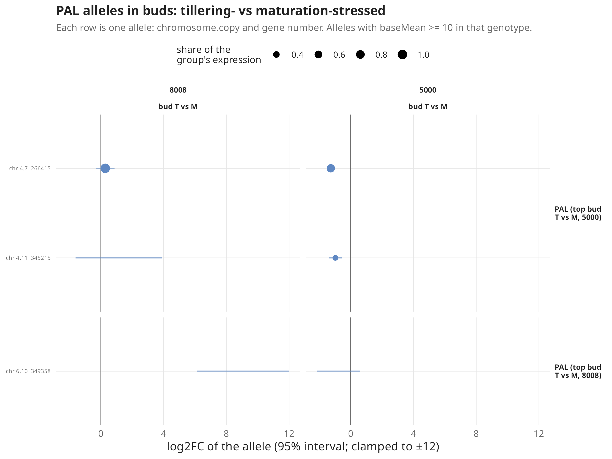

*Figure 27. Copies of the PAL group that best separates T from M buds in 5000.*

The two cultivars do not even share all copies. Among the copies of the named genes, 25 are expressed in both cultivars, 9 only in 8008 and 4 only in 5000. So "the same gene" is partly a different set of alleles in each cultivar, one more reason to analyse them separately.

### 12.3 How sure can we be about a single copy?

> **Concept: inferential variance (InfRV).** Salmon has to decide which copy each read came from. When copies are almost identical, it cannot be sure. Rerunning the assignment many times on resampled reads (bootstraps; we ran 30 per library) shows how much a copy's count changes just from that uncertainty. InfRV is that variance relative to the mean: near 0 means the count is solid, above 1 means the uncertainty is larger than the count itself.

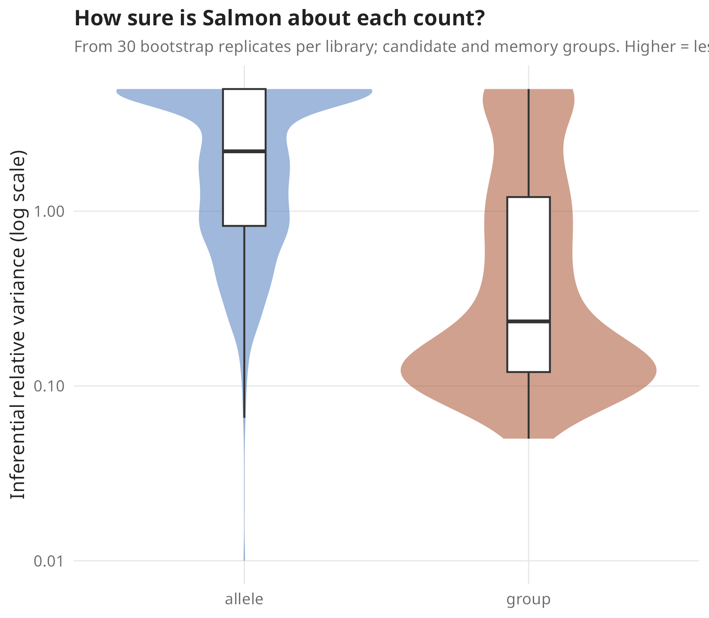

*Figure 28. Inferential uncertainty of single copies and of allele groups, for the candidate genes. Source: `alleles/bootstrap_infrv.tsv`.*

| Level | Features | Median InfRV | InfRV > 0.5 |
|---|---|---|---|
| Single copy | 1,882 | 2.2 | 86% |
| Allele group | 352 | 0.23 | 37% |

*Table 12. Uncertainty from read assignment, for copies of the candidate groups.*

For single copies, the uncertainty is usually larger than the signal. Within a group, the bootstrap counts of the copies are strongly anti-correlated (median of the lowest pair −0.89; `alleles/bootstrap_allele_correlation.tsv`): reads move from one copy to another between bootstraps, and the group total stays the same.

**Verdict:** in these data the copies of a gene move together, and the memory candidates are no exception. Short-read RNA-seq cannot say much more at the single-copy level, because reads cannot be assigned reliably among nearly identical copies. This also confirms that allele groups are the right unit. A real allele-level test needs long reads or copy-specific qPCR; THI1 is the best candidate for it.

---

## 13. Gene modules that follow history

The other analyses test genes one by one or in lists we chose. A co-expression network lets the data group genes on their own. If drought memory is a coordinated programme, some group of genes should follow the plant's **history** (a previous drought, or a stressed mother) and not only whether it is dry right now.

> **Concept: WGCNA and module eigengenes.** Weighted gene co-expression network analysis connects every pair of genes by how similarly they rise and fall across samples. Genes that move together form a **module** (we name them M01, M02… by size; M00 holds genes that fit nowhere). Each module is summarised by its **eigengene**, one number per library: the main shared pattern of the module, like a module-wide expression level. We can then test the eigengene against the design, the same way we test a single gene.

**What went in.** All 32 leaf libraries of both cultivars, and the 8,000 most variable allele groups. The cultivar difference was removed first, so the modules describe responses rather than "8008 genes" and "5000 genes". The network is signed (genes that go in opposite directions are not linked) and robust to outlier samples (biweight midcorrelation). No soft-threshold power reached the usual scale-free fit of 0.8 (the best was 0.76), which is common with strong treatment effects; we used 14, the value the WGCNA authors recommend for signed networks with 30–40 samples. The result: 13 modules of 44 to 1,945 groups, with 698 groups unassigned (`wgcna/modules.tsv`).

**The test.** Each eigengene was modelled with every factor of the design at once, so each factor is measured on top of the others:
- **current drought**: the leaf is under drought when sampled (D1, D3, propagule D1);
- **repeated (D3)**: the 3rd drought, on top of current drought. This is the plant's own history (H1);
- **maternal stress**: a propagule of a stressed mother (Ft, Fm), on top of its own drought. This is the mother's history (H4);
- **late run (Mt_W)**, **propagule** and **maturation**: the run, tissue and age differences, so they do not leak into the others.

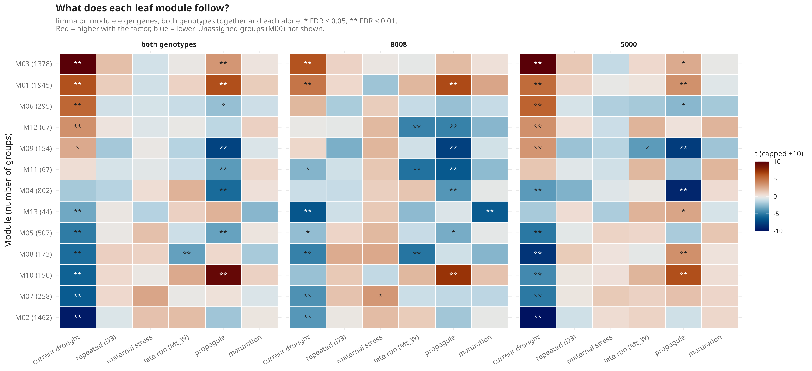

*Figure 29. What each module follows. Colour is the t-statistic of each factor for each module's eigengene; stars mark FDR < 0.05 and < 0.01. Left: both cultivars together; middle and right: each cultivar alone. Source: `wgcna/module_trait_tests.tsv`.*

### 13.1 The modules follow current drought, not history

Figure 29 is dominated by its first column. Eleven of the 13 modules change with current drought (FDR < 0.05), most of them strongly:
- **M03** (1,378 groups) rises under drought. Its hubs include the dehydrin DHN1 and ferritin; it holds 44% of 8008's D1-induced genes (`wgcna/module_list_overlaps.tsv`).
- **M02** (1,462 groups) falls under drought: cell-wall receptor kinases, callose synthase, translation-related GO terms.
- **M01** (1,945) rises under drought and is rich in phenylpropanoid genes (phenylalanine breakdown, the PAL step; hubs include chalcone synthase CHS1 and MYB12). It also holds most of 5000's D3-higher genes, but its eigengene does not move with the repeated term.
- **M05** (photosynthesis), **M07** (translation and chloroplast), **M10** (water and ion transport) and **M11/M12** (heat-shock proteins) complete the picture: drought switches photosynthesis and growth down and protection up, as expected.

The other big signal is the propagule vs mother difference (younger plants of a different age and season), which drives M04, M09 and M10.

The **repeated (D3)** column is empty: no module changes at the 3rd drought beyond the change it already shows at the 1st, in either cultivar or both together. This agrees with section 6: the 3rd drought looks like the 1st.

The **maternal stress** column is almost empty too. In the pooled model nothing passes FDR 0.05. One module does in one cultivar (Figure 30).

### 13.2 One module, M07, in propagules of stressed mothers

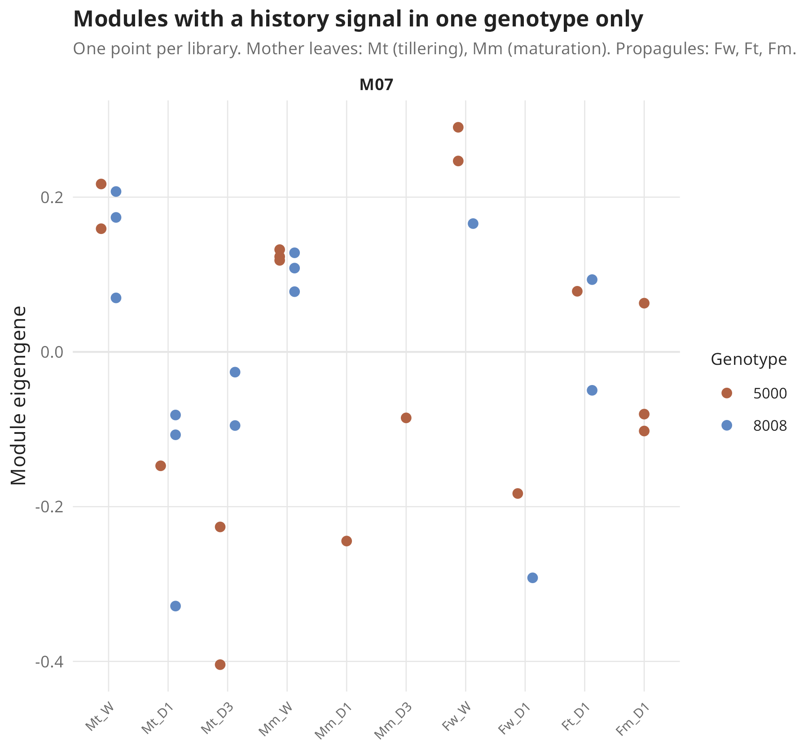

*Figure 30. The M07 eigengene in every leaf library. M07 falls under drought in mothers and propagules alike.*

**M07** (258 groups) is enriched for translation, ribosome and chloroplast organisation genes, and drought switches it off. In propagules of stressed mothers it is switched off **less** than in propagules of watered mothers:
- 8008: t = 3.3, FDR 0.04;
- 5000: same direction, t = 1.3, not significant; both together t = 2.7, FDR 0.16;
- in both cultivars, M07 is enriched for genes that are higher in Ft_D1 than in Fw_D1 (odds ratio 5.1 in 8008, 7.1 in 5000; `wgcna/module_list_overlaps.tsv`).

This is the module form of the H4 result (section 10): propagules of stressed mothers respond more mildly to drought, here in growth and chloroplast genes. But Figure 30 also shows its weakness: Fw_D1 is **one plant per cultivar**, and in both cultivars that plant is among the lowest points. Ft_D1 and Fm_D1 sit between watered and drought-stressed propagules. One unusually stressed Fw_D1 plant would produce the same picture.

### 13.3 Buds

We also scored every module in the buds (the mean of its genes, `wgcna/bud_module_T_vs_M.tsv`). No leaf module separates T from M buds (all p ≥ 0.05). The bud signal of sections 9 and 11 lives in a subset of genes and does not form a leaf-defined module.

**Verdict:** in these leaves, co-expression follows current drought and plant type, not drought history. The only history-related module, M07, repeats the milder propagule response and rests on the same single Fw_D1 plants.

### 13.4 Side analysis: lncRNAs

All analyses above use the annotated protein-coding genes. A pilot on the 13 copies of chromosome 1 (14% of the genome) and eight libraries asked whether long non-coding RNAs can be recovered from these data (`lncrna_pilot/README.md`, `../code/18_lnc_pilot.sh`). After assembling transcripts (HISAT2, StringTie) and removing anything coding (CPC2, ORF length, DIAMOND against the POJ2878 proteome) or next to a gene, 6,773 candidates remain. Of these, 2,975 are high-confidence (2 or more exons, TPM ≥ 1 in 2 or more libraries), about 1,425 distinct after collapsing allele copies. Extrapolated to the genome, that is roughly 10,000 lncRNAs. There is no drought test yet: the pilot has one library per group.

**Whole genome.** The search was then run on the whole genome and the 48 libraries (`lncrna_genome/`, scripts `21`, `22`, `24` to `27`), with the same filters, followed by Salmon quantification and the DESeq2 design of section 6 on coding groups plus lncRNA clusters (copies at 90% identity or more).

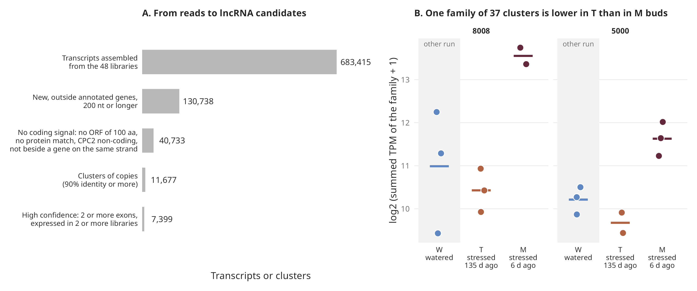

- **Candidates:** 683,415 assembled transcripts → 130,738 new and 200 nt or longer → 40,733 without coding signal → 11,677 clusters, 7,399 of high confidence.
- **Drought:** 1,327 clusters change in 8008 leaves at the 1st drought and 1,206 in 5000 at the 3rd; 459 in the same direction in both, 22 in opposite directions (`lnc_deg_summary.tsv`).
- **Leaf memory:** two clusters differ between D3 and D1 in 8008, so no support for H1 from lncRNAs.
- **Buds, T vs M:** 18 lncRNAs are shared by both genotypes in the same direction (0.2 expected). 13 belong to one family of 37 clusters and 815 genomic copies, 7 times (8008) and 4 times (5000) lower in T than in M buds, and repressed about 14 times by drought in 8008 leaves (`bud_shared_lncRNAs.tsv`, `bud_family_clusters.tsv`, `family_tpm_by_library.tsv`).
- **Identity:** the family matches only unannotated *Saccharum* genomic clones in NCBI core_nt, and nothing in nr, RepBase, the RepeatMasker library or Rfam; it is transcribed in SP80-3280 too (`family_identity.md`). Three of the other five shared lncRNAs are small protein genes missing from the annotation: a glycine-rich cell wall protein (two copies, higher in M) and a wound-induced basic protein (higher in T).
- **Limit:** the ORF filter (100 aa) lets small unannotated proteins through; the clusters were not all searched against nr.

---

## 14. The story so far

| # | Hypothesis | Answer | Rests on |
|---|---|---|---|
| H1 | Leaves learn | **8008: yes, for a defined set of genes.** Among about 8,000 groups that respond the same way both times (r = 0.90), 84 respond differently at the 3rd drought and 32 are memory genes, led by desiccation-protection genes (RAB18, LEA). **5000:** 1,229 groups differ, not resolved. | 8008: 2–3 plants per group, clean run. 5000: one D1 plant. |
| H2 | 8008 remembers more than 5000 | **Too weak for now.** 5000's larger D3 response can be produced by a single D1 plant, as downsampling 8008 shows. 8008 responds more strongly at the 1st drought. | joint model + downsampling |
| H3 | Buds keep a mark | **Yes, for the timing of the stress.** Long-ago vs recent stress differ in 407 groups (8008) and 147 (5000), led by PAL, opposite between genotypes. Stressed vs watered is lost to a library preparation batch that RUVg cannot remove. | T vs M: same run, 2–3 plants. |
| H4 | Propagules respond differently | **Yes, in both cultivars:** milder drought response, sparing photosynthesis and growth genes, in both cultivars, which agree with each other. | one Fw_D1 plant per cultivar (a weak library in 8008) |
| H5 | Same genes throughout | **Too weak for now.** Mother leaf → bud link in 8008; no bud → propagule link detected. | rank-based tests |
| H6 | Textbook memory genes are memory genes here | **Partly:** they are drought genes; RAB18, LEA3 and PIT1 keep memory behaviour. | set tests |
| — | One copy carries the memory | **No:** copies move together; single-copy counts are too uncertain to go further. | allele-level tests, bootstraps |
| — | Gene modules follow history | **No:** modules follow current drought and plant type; one module repeats the H4 result. | WGCNA |

*Table 13. All verdicts.*

In one paragraph:
- **Leaves:** the drought response of sugarcane leaves is highly reproducible from one cycle to the next. On top of it, the tolerant cultivar carries an *Arabidopsis*-like memory set of drying-protection genes. 5000 changes more between cycles, a result that one D1 plant can produce and that needs more plants.
- **Buds:** they carry a stress-timing signature built on phenylpropanoid genes, which differs between the cultivars. In 8008, buds stressed long ago keep a little of the mother's leaf drought programme.
- **Propagules:** propagules of stressed mothers respond more mildly to drought, sparing photosynthesis and growth genes, in both cultivars.
- **Caveat across the leaves:** the watered tillering leaves (Mt_W) carry a run fingerprint, mostly in 8008. Large leaf responses are unaffected, but small differences against Mt_W need care.

The 8008 leaf result and the T vs M bud result are solid. The propagule result is consistent in both cultivars and stays exploratory, since it rests on one reference plant per cultivar. H2, H5 and H6 are too weak to carry the story for now.

---

## 15. Where to go next, and why

There is no budget for new sequencing or new experiments, and the lab has already answered what it could about the sampling (hour of sampling: early morning to past midday, not recorded per plant). These 48 libraries are the data. Each result therefore keeps the confidence its design allows (section 14), and the lists below separate what can still be done from what would be needed if resources ever appear.

**What can still be done with the data in hand:**
1. **Use the physiology that already exists.** If the lab kept leaf water potential, relative water content, soil moisture or gas exchange per plant, it is the only way to tell memory apart from "this plant was simply drier". That question sits behind the 5000 D3 result (section 7) and the propagule result (section 10). Marcos et al. 2018 describe the physiology of such propagules.
2. **Name the bud lncRNA family** (section 13.4): no database identifies it; its genomic neighbourhood and its copies in other sugarcane genomes are the next places to look.

**What stays open, and what it would take (for the record, not planned):**
1. **Stressed vs never-stressed buds:** two W, two T and two M buds per genotype, prepared and sequenced together (section 5.3).
2. **Groups that rest on one plant:** 5000 Mt_D1 (H1, H2); Fw_D1 in both genotypes, with a better 8008 library than `79_S6` (H4); T/W propagules (H5).
3. **Validation by RT-qPCR in every available plant:** RAB18, LEA3 and the seed-storage protein (memory candidates); THI1 and CCA1/LHY at a fixed hour (memory or clock); PAL (buds); photosynthesis genes (propagules).
4. **The mechanism:** in *Arabidopsis*, trained genes keep a chromatin mark (H3K4me3) between droughts. ChIP-qPCR at RAB18 and LEA3, D1 vs D3, would test whether sugarcane does the same.

---

## Where everything is

Paths are relative to `analysis/results/`. To read the reports on a laptop, `DOLORES_report.zip` holds both documents as HTML plus every file they name (rebuild with `../code/09_report_package.py`).

| What | Results | Code |
|---|---|---|
| Short version, insights only | [`report_story.md`](analysis/results/report_story.md) | |
| All scripts, step by step | | [`analysis/README.md`](analysis/README.md) |
| Explanatory figures | `plots/story/` | `../code/08_story_figures.R` |
| PCA, UpSet and GO plots | `plots/`, `plots/go/` | `../code/06_plots.R` |
| DE tables, DEG counts, memory classes | `de/group/` (allele level: `de/gene/`) | `../code/03_de.R` |
| Literature and candidate gene tests (H6) | `memory_genes/` | `../code/04_memory_genes.R` |
| GO and KEGG tables | `enrichment/` | `../code/05_enrichment.R` |
| Numbers computed for the reports | `report_tables/` | `../code/07_report_stats.R` |
| Libraries per sequencing run | `qc/sequencing_runs.tsv` | `../code/08_story_figures.R` |
| Genotype check (section 5.1) | `qc/genotype_check/` | `../code/qc_genotype_check.R` |
| Which group the excluded libraries resemble (section 5.1) | `qc/relabel_check/` | `../code/19_relabel_check.R` |
| Library type, poly-A check | `qc/library_type/` | `../code/17_library_type.sh` |
| Distance between libraries within and across runs (section 5.2) | `qc/run_pair_distances.tsv` | `../code/20_run_check.R` |
| Clock genes and sampling hour (section 5.5) | `clock/` | `../code/23_clock_check.R` |
| Bud batch check (section 5.3) | `bud_batch/` | `../code/11_bud_batch.R` |
| H2, genotype × cycle (section 7) | `h2_genotype_cycle/` | `../code/10_genotype_cycle.R` |
| H5, rank-based tests (section 11) | `h5_rank/` | `../code/12_h5_rank.R` |
| Gene copies (section 12) | `alleles/` | `../code/13_alleles.R` |
| lncRNA pilot (section 13.4) | `lncrna_pilot/` | `../code/18_lnc_pilot.sh` |
| lncRNA search on the whole genome (section 13.4) | `lncrna_genome/` | `../code/21_lnc_index.sh`, `22_lnc_align.sh`, `24_lnc_candidates.sh`, `25_lnc_quant.sh`, `26_lnc_de.R`, `27_lnc_family.R` |
| Gene modules (section 13) | `wgcna/` | `../code/14_wgcna_prep.R`, `../code/15_wgcna.R`, `../code/16_wgcna_traits.R` |

---

## What is in git and what is not

Only scripts, configs, sample sheets, documentation and small summary tables are in this repository. The following stay on the server, under `/Storage/data1/jorge.munoz/DOLORES`, and are excluded in `.gitignore`:
- raw reads (`RAWDATA/*.fastq.gz`)
- the reference genome (`refs/POJ2878/*.gz`)
- the Salmon results, apart from the MultiQC report
- the protein FASTA files
- the eggNOG and InterProScan outputs and databases
- the GO tables
- Singularity images, Nextflow work directories and logs

---

## Glossary

| Term | Meaning |
|---|---|
| Allele group | All sugarcane gene copies (alleles) that share the same sorghum orthologue, summed together; our unit of analysis. |
| Allele | One of the copies of a gene; the POJ2878 genome lists each copy as a separate gene. |
| Batch effect | A technical difference between groups of samples processed separately (here, sequencing runs and library preparation). |
| camera | A gene-set test from the limma package (section 8). |
| Confounding | Two effects that change together, so they cannot be separated (section 5.2). |
| Contrast | A comparison between two groups, written `A_vs_B`. |
| DEG | Differentially expressed gene (group): padj < 0.05 and at least a two-fold change. |
| DESeq2 | The statistical method used to test differential expression. |
| Dispersion | How much a gene varies between plants of the same group; must be estimated to test differences. |
| Downsampling | Refitting a well-replicated group with fewer plants, to see what a weak design can produce (section 7.2). |
| Eigengene | One number per library that summarises a co-expression module (section 13). |
| FDR | False discovery rate: the expected share of false hits among the hits. |
| Fragment length | The length of the RNA pieces in a library; set during library preparation (section 5.3). |
| GO | Gene Ontology: a shared vocabulary of biological processes and functions. |
| I² | The share of the variation between gene copies that is real rather than noise (section 12). |
| InfRV | Uncertainty in a count caused by not knowing which copy a read came from (section 12.3). |
| Interaction | Whether an effect differs between cultivars, e.g. D3 − D1 in 8008 vs D3 − D1 in 5000 (section 7). |
| KEGG | A database of metabolic and signalling pathways. |
| LEA / dehydrin | Proteins that protect cells during drying; abundant in maturing seeds (section 6.2). |
| log2FC | Log2 fold change: +1 = double, −1 = half (section 3). |
| Memory class | `++`, `--`, `+-`, `-+`, `+=`, `-=`, `0+`, `0-` (Figure 11). |
| Module | A group of genes that rise and fall together across samples (section 13). |
| Odds ratio | How much more likely an overlap is than chance; 1 = no link (section 8). |
| Orthologue | Genes in different species that descend from one ancestral gene. |
| padj | p-value adjusted for testing many genes. |
| PAL | Phenylalanine ammonia-lyase, entry enzyme of the phenylpropanoid pathway (section 9). |
| PCA | Principal component analysis: draws each sample as a point so similar samples sit close (section 4). |
| Propagule | A new plant grown from a bud on a cut stalk. |
| RRHO | Rank-rank hypergeometric overlap: a map of where two gene rankings agree (section 11). |
| rRNA | Ribosomal RNA. Normally removed before sequencing; a library full of it has few reads on genes. |
| RUVg | A batch-correction method that estimates technical factors from control genes (section 5.3). |
| Shrunk log2FC | A log2FC pulled toward 0 when the evidence is weak, which makes noisy genes look less extreme. |
| UpSet plot | A Venn diagram for many sets (section 6.1). |
| VST | Variance-stabilising transformation of counts, used for PCA. |
| WGCNA | Weighted gene co-expression network analysis (section 13). |

---

## Appendix: sample table

All 78 planned samples. Group names follow the nf-core sample sheet. "Used" means in the models; copies and libraries of the other cultivar are explained in section 5.1.

| Sample | Set | Genotype | Group | Replicate | In `RAWDATA/` | Source | Used |
|---|---|---|---|---|---|---|---|
| F25C1_S6 | Mother bud | 5000 | 5000_Maturation_W | 1 | YES | original | yes |
| F25C2_S7 | Mother bud | 5000 | 5000_Maturation_W | 2 | YES | original | yes |
| F25C3_S8 | Mother bud | 5000 | 5000_Maturation_W | 3 | YES | original | yes |
| FIDH15000_S27 | Mother bud | 5000 | 5000_Tillering_D | 1 | YES | original | yes |
| FIDH25000_S28 | Mother bud | 5000 | 5000_Tillering_D | 2 | YES | original | yes |
| FIDH35000_S29 | Mother bud | 5000 | 5000_Tillering_D | 3 | YES | original | **no**, carries 8008 alleles (section 5.1) |
| 21DH5_S21 | Mother bud | 5000 | 5000_Maturation_D | 1 | YES | original | yes |
| 22DH5_S22 | Mother bud | 5000 | 5000_Maturation_D | 2 | YES | original | yes |
| 23DH5_S23 | Mother bud | 5000 | 5000_Maturation_D | 3 | YES | original | yes |
| F28C1_S9 | Mother bud | 8008 | 8008_Maturation_W | 1 | YES | original | yes |
| F28C2_S10 | Mother bud | 8008 | 8008_Maturation_W | 2 | YES | original | yes |
| F28C3_S11 | Mother bud | 8008 | 8008_Maturation_W | 3 | YES | original | yes |
| FIDH1800_S30 | Mother bud | 8008 | 8008_Tillering_D | 1 | YES | original | yes |
| FIDH28000_S31 | Mother bud | 8008 | 8008_Tillering_D | 2 | YES | original | yes |
| FIDH38000_S32 | Mother bud | 8008 | 8008_Tillering_D | 3 | YES | original | yes |
| 21DH8_S24 | Mother bud | 8008 | 8008_Maturation_D | 1 | YES | original | **no**, carries 5000 alleles (section 5.1) |
| 22DH8_S25 | Mother bud | 8008 | 8008_Maturation_D | 2 | YES | original | yes |
| 23DH8_S26 | Mother bud | 8008 | 8008_Maturation_D | 3 | YES | original | yes |
| Dolores_249_S3 | Mother leaf | 5000 | 5000_Mt_W | 1 | YES | original | yes |
| 250_S2 | Mother leaf | 5000 | 5000_Mt_W | 2 | YES | original | yes |
| 251_S3 | Mother leaf | 5000 | 5000_Mt_W | 3 | YES | original | **no**, carries 8008 alleles (section 5.1) |
| 157_S12 | Mother leaf | 5000 | 5000_Mt_D1 | 2 | YES | original | yes |
| D158_S48 | Mother leaf | 5000 | 5000_Mt_D1 | 2 | YES | Drive (transcriptome_3) | **no**, copy of `223_S42` |
| 159_S5 | Mother leaf | 5000 | 5000_Mt_D1 | 3 | YES | Drive (transcriptome_3) | **no**, copy of `157_S12` |
| 221_S19 | Mother leaf | 5000 | 5000_Mt_D3 | 2 | YES | original | yes |
| 222_S6 | Mother leaf | 5000 | 5000_Mt_D3 | 2 | YES | Drive (transcriptome_3) | **no**, copy of `223_S42` |
| 223_S42 | Mother leaf | 5000 | 5000_Mt_D3 | 3 | YES | original | yes |
| 156_S22 | Mother leaf | 5000 | 5000_Mm_W | 1 | YES | original | yes |
| 154_S28 | Mother leaf | 5000 | 5000_Mm_W | 2 | YES | original | yes |
| 155_S11 | Mother leaf | 5000 | 5000_Mm_W | 3 | YES | original | yes |
| 253_S41 | Mother leaf | 5000 | 5000_Mm_D1 | 1 | YES | original | yes |
| 254_S7 | Mother leaf | 5000 | 5000_Mm_D1 | 2 | YES | Drive (transcriptome_2) | **no**, copy of `253_S41` |
| 255_S8 | Mother leaf | 5000 | 5000_Mm_D1 | 3 | YES | Drive (transcriptome_3) | **no**, copy of `157_S12` |
| 9_S15 | Mother leaf | 5000 | 5000_Mm_D3 | 1 | YES | Drive (transcriptome_1) | **no**, copy of `11_S1` |
| 10_S16 | Mother leaf | 5000 | 5000_Mm_D3 | 2 | YES | Drive (transcriptome_2) | **no**, copy of `251_S3` |
| 11_S1 | Mother leaf | 5000 | 5000_Mm_D3 | 3 | YES | original | yes |
| Dolores_257_S5 | Mother leaf | 8008 | 8008_Mt_W | 1 | YES | original | yes |
| 258_S5 | Mother leaf | 8008 | 8008_Mt_W | 2 | YES | original | yes |
| Dolores_259_S6 | Mother leaf | 8008 | 8008_Mt_W | 3 | YES | original | yes |
| 165_a_S40 | Mother leaf | 8008 | 8008_Mt_D1 | 2 | YES | original | yes |
| 166_S23 | Mother leaf | 8008 | 8008_Mt_D1 | 2 | YES | original | yes |
| 168_S25 | Mother leaf | 8008 | 8008_Mt_D1 | 3 | YES | original | yes |
| 230_S15 | Mother leaf | 8008 | 8008_Mt_D3 | 2 | YES | original | yes |
| D231_D46 | Mother leaf | 8008 | 8008_Mt_D3 | 2 | YES | Drive (transcriptome_2) | **no**, copy of `230_S15` |
| 232_S8 | Mother leaf | 8008 | 8008_Mt_D3 | 3 | YES | original | yes |
| 161_S13 | Mother leaf | 8008 | 8008_Mm_W | 1 | YES | original | yes |
| 162_S20 | Mother leaf | 8008 | 8008_Mm_W | 2 | YES | original | yes |
| 163_S7 | Mother leaf | 8008 | 8008_Mm_W | 3 | YES | original | yes |
| 261_S9 | Mother leaf | 8008 | 8008_Mm_D1 | 1 | YES | Drive (transcriptome_2) | **no**, copy of `258_S5` |
| 262_S10 | Mother leaf | 8008 | 8008_Mm_D1 | 2 | YES | Drive (transcriptome_2) | **no**, copy of `157_S12` |
| 263_S11 | Mother leaf | 8008 | 8008_Mm_D1 | 3 | **NO** | not available | no |
| 13_S17 | Mother leaf | 8008 | 8008_Mm_D3 | 1 | YES | Drive (transcriptome_2) | **no**, copy of `230_S15` |
| 14 | Mother leaf | 8008 | 8008_Mm_D3 | 2 | **NO** | not available | no |
| 15_S18 | Mother leaf | 8008 | 8008_Mm_D3 | 3 | YES | Drive (transcriptome_2) | **no**, copy of `230_S15` |
| 33_S2 | Propagule leaf | 5000 | 5000_Fw_W | 1 | YES | original | yes |
| 34_S19 | Propagule leaf | 5000 | 5000_Fw_W | 2 | **NO** | not available | no |
| 35_S9 | Propagule leaf | 5000 | 5000_Fw_W | 3 | YES | original | yes |
| D33_S40 | Propagule leaf | 5000 | 5000_Fw_D1 | 1 | YES | Drive (transcriptome_2) | **no**, copy of `65_S3` |
| 42_S39 | Propagule leaf | 5000 | 5000_Fw_D1 | 2 | YES | original | yes |
| D43_S52 | Propagule leaf | 5000 | 5000_Fw_D1 | 3 | **NO** | not available | no |
| 53_S10 | Propagule leaf | 5000 | 5000_Ft_D1 | 1 | YES | original | yes |
| D54_S5 | Propagule leaf | 5000 | 5000_Ft_D1 | 2 | YES | Drive (transcriptome_2) | **no**, copy of `65_S3` |
| D55_S5 | Propagule leaf | 5000 | 5000_Ft_D1 | 3 | **NO** | not available | no |
| 65_S3 | Propagule leaf | 5000 | 5000_Fm_D1 | 1 | YES | original | yes |
| 66_S4 | Propagule leaf | 5000 | 5000_Fm_D1 | 2 | YES | original | yes |
| 67_S5 | Propagule leaf | 5000 | 5000_Fm_D1 | 3 | YES | original | yes |
| D69_S47 | Propagule leaf | 8008 | 8008_Fw_W | 1 | YES | Drive (transcriptome_2) | **no**, copy of `70_S34` |
| 70_S34 | Propagule leaf | 8008 | 8008_Fw_W | 2 | YES | original | yes |
| D71_S54 | Propagule leaf | 8008 | 8008_Fw_W | 3 | **NO** | not available | no |
| 77 | Propagule leaf | 8008 | 8008_Fw_D1 | 1 | **NO** | not available | no |
| 79_S2 | Propagule leaf | 8008 | 8008_Fw_D1 | 2 | YES | Drive (transcriptome_1) | **no**, copy of `91_S37` |
| 79_S6 | Propagule leaf | 8008 | 8008_Fw_D1 | 3 | YES | original | yes |
| 89_S30 | Propagule leaf | 8008 | 8008_Ft_D1 | 1 | YES | original | yes |
| D66_S41 | Propagule leaf | 8008 | 8008_Ft_D1 | 2 | **NO** | not available | no |
| 91_S37 | Propagule leaf | 8008 | 8008_Ft_D1 | 3 | YES | original | yes |
| 101_S20 | Propagule leaf | 8008 | 8008_Fm_D1 | 1 | YES | Drive (transcriptome_1) | **no**, copy of `91_S37` |
| 102_S3 | Propagule leaf | 8008 | 8008_Fm_D1 | 2 | YES | Drive (transcriptome_1) | **no**, copy of `91_S37` |
| 103_S4 | Propagule leaf | 8008 | 8008_Fm_D1 | 3 | **NO** | not available | no |
