# What more the data can tell us: five follow-up analyses

*November 2026. This is the follow-up to [`report_story.md`](report_story.md). Section 13 of that report listed five things we could still do with the data we already have. This report does them, in the same style: **Concept** boxes explain each method when it first comes up, and every number comes from a file in this folder.*

---

## 0. The short version

| Question | Analysis | Answer |
|---|---|---|
| Does one cultivar remember more than the other? (H2) | Genotype × cycle interaction in one joint model, plus a downsampling check | **No evidence.** 5000 looks more "amplified" at D3, but 8008 shows the same pattern when it is cut down to 5000's one-plant design. |
| Can the watered buds be rescued? (H3) | Technical metrics of runs 44 and 45, stable genes, RUVg | **No.** The two runs differ in library preparation (fragment length, adapter content), so watered vs stressed buds is mostly a technical difference. T vs M buds stay clean. |
| Does a mark travel mother → bud → propagule? (H5) | Rank-based tests (camera, RRHO) with no cut-offs | **Only a weak link mother → bud, in 8008.** No bud → propagule link. Propagules of stressed mothers respond more mildly to drought, in both cultivars. |
| Does one allele carry the memory? | Allele-by-allele tests inside each allele group, plus bootstrap uncertainty | **No.** Gene copies move together. Allele-level counts are too uncertain to say more. |
| Are there gene modules that follow drought *history*? | WGCNA co-expression modules | **No.** The 13 leaf modules follow current drought and plant type. One module (growth and chloroplast genes) is less repressed in propagules of stressed mothers, the same milder response as in H5. |

---

## 1. Does the tolerant cultivar remember more? (H2)

In the first report, 5000 had many more "memory" genes than 8008: 1,229 genes changed between D3 and D1 in 5000, against 84 in 8008. But 5000's D1 group has **one plant**, so we did not trust the difference. Here we test it properly, in two ways.

> **Concept: an interaction test.** "Does 8008 respond differently from 5000?" is not answered by counting DEGs in each cultivar separately. One cultivar can pass a cut-off and the other just miss it, with almost the same change. The proper test fits both cultivars in one model and asks whether the *difference* between D3 and D1 is itself different between cultivars: (D3 − D1 in 8008) − (D3 − D1 in 5000). That is the **genotype × cycle interaction**. A gene with a significant interaction "remembers" differently in the two cultivars.

### 1.1 The joint model

All tillering leaves of both cultivars went into one DESeq2 model, with one group per cultivar and condition. The cultivar-specific contrasts barely change from the first report (Table 1).

| Contrast | Status | Up | Down |
|---|---|---|---|
| 8008 Mt_D3_vs_Mt_D1 | conclusive | 48 | 49 |
| 5000 Mt_D3_vs_Mt_D1 | exploratory (5000 Mt_D1 has 1 plant) | 156 | 428 |
| interaction, D1 vs W | exploratory | 614 | 290 |
| interaction, D3 vs W | conclusive | 1,896 | 1,534 |
| interaction, D3 vs D1 | exploratory | 175 | 77 |

*Table 1. DEGs in the joint model (padj < 0.05, at least two-fold). Source: `h2_genotype_cycle/joint_deg_summary.tsv`. "Exploratory" marks every contrast that uses 5000's single D1 plant.*

Gene by gene, the D3-vs-D1 interaction gives 252 genes, all resting on that one plant. A set-level view is more robust. We took the drought-responsive genes (the average D1 and D3 response of both cultivars, 4,842 induced and 5,995 repressed) and asked how much stronger they are at D3 than at D1 in each cultivar. We call this **amplification**.

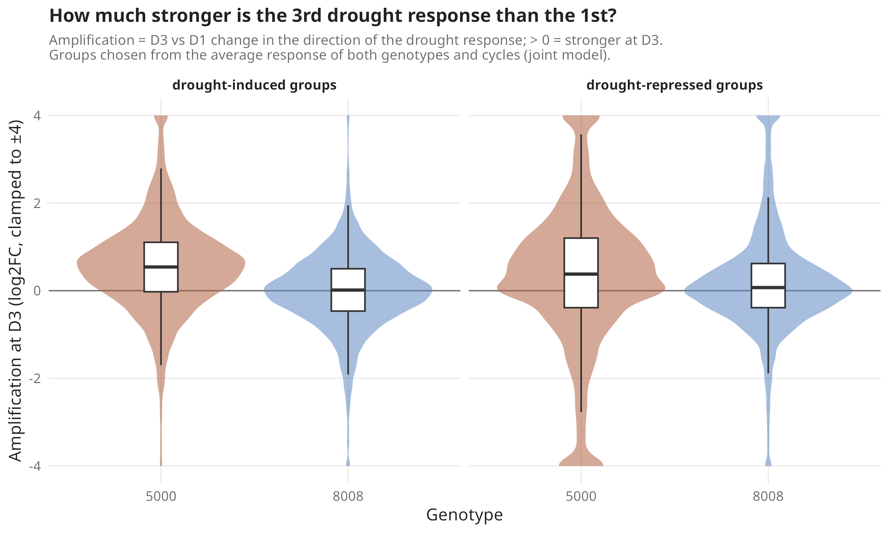

*Figure 1. How much stronger the drought response is at D3 than at D1, for drought-induced and drought-repressed genes. Positive values mean a stronger response at the 3rd drought.*

- In 8008 the 3rd drought looks like the 1st: median amplification 0.01 (induced) and 0.07 (repressed), on a log2 scale.
- In 5000 the 3rd drought looks stronger: 0.54 and 0.38.
- The interaction test on these sets agrees: the D3-vs-D1 interaction leans toward "5000 stronger" (camera FDR 6 × 10⁻⁵ for induced genes, 7 × 10⁻⁴ for repressed genes; `h2_genotype_cycle/interaction_camera.tsv`).
- At D1 the reverse is true: 8008 induces the drought genes more strongly than 5000 (FDR 1.5 × 10⁻⁴).

Read literally, that would say 5000 amplifies its response and 8008 does not. But every one of these tests compares against 5000's single D1 plant. If that plant was simply less stressed than average, D1 looks weak and D3 looks "amplified".

### 1.2 Cutting 8008 down to 5000's design

> **Concept: downsampling as a check.** If a result could come from having only one plant, build the same weak design in a group where we have more plants, and see whether the "result" appears there too. Here: refit 8008 with one D1 plant and two watered plants, exactly like 5000, and repeat for every possible choice of plants.

8008 has three D1 plants and three watered plants. We refitted it nine times, each time with one D1 plant and two watered plants (Figure 2, Table 2).

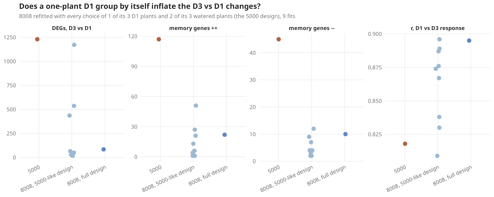

*Figure 2. 8008 refitted with one D1 plant and two watered plants, as in 5000. Each point is one choice of plants. The 5000 result is shown for comparison.*

| Design | D3 vs D1 DEGs | `++` memory genes | r(D1, D3) |
|---|---|---|---|
| 8008, all plants | 84 | 22 | 0.90 |
| 8008, D1 = plant 165_a_S40 (3 fits) | 17–65 | 4–13 | 0.87–0.90 |
| 8008, D1 = plant 166_S23 (3 fits) | 19–50 | 1–6 | 0.87–0.89 |
| 8008, D1 = plant 168_S25 (3 fits) | 436–1,171 | 21–51 | 0.81–0.84 |
| 5000, actual | 1,229 | 117 | 0.82 |

*Table 2. Range over the three choices of watered plants for each D1 plant. r(D1, D3) is the correlation between the D1 and D3 responses; lower means the two droughts look less alike. Source: `h2_genotype_cycle/design_check_8008_as_5000.tsv`.*

With plant 168_S25 as the only D1 plant, 8008 looks very much like 5000: up to 1,171 D3-vs-D1 genes, and a D1–D3 correlation of 0.81. With either of the other two plants, the "memory" almost disappears. So one plant is enough to produce 5000's result.

**Answer to H2:** there is no evidence that either cultivar remembers more. 5000's larger response at D3 is within the range that a single D1 plant can produce. The one difference that does not depend on that plant is at the 1st drought: 8008 responds more strongly than 5000 (interaction D3 vs W is conclusive, and D1 vs W points the same way). A real test of H2 needs more 5000 D1 plants.

---

## 2. Can the watered buds be rescued? (H3)

The strongest bud question is "do buds of stressed mothers differ from buds of watered mothers?". But all watered (W) buds were sequenced on run 44, and all T and M buds on run 45 (report_story section 5.2). We asked three things: how do the two runs differ technically, do genes that should never change look stable, and can a batch-correction method remove the run effect?

### 2.1 What differs between the runs

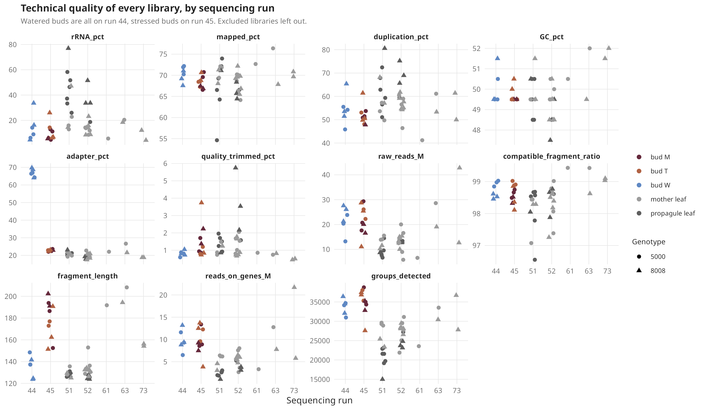

*Figure 3. Technical metrics of the bud libraries, by run. Leaves are shown for reference.*

Most metrics are the same in both runs: read depth, mapping rate, rRNA, duplication, GC content, genes detected. Two are not (Table 3).

| Metric | Run 44 (W buds) | Run 45 (T, M buds) | Leaves | Wilcoxon p |
|---|---|---|---|---|
| Adapter content (% of reads) | 66.7 | 22.6 | 20.3 | 0.00025 |
| Fragment length (Salmon, bp) | 137 | 182 | 130 | 0.00025 |
| Mapped (%) | 70.6 | 68.5 | 69.3 | 0.04 |

*Table 3. Median per group. Source: `bud_batch/qc_run44_vs_run45.tsv`.*

Short fragments and high adapter content go together: when a fragment is shorter than the read, the sequencer reads into the adapter. So the W buds' libraries were built with shorter fragments. That points to a **library preparation** difference (fragmentation time, size selection, or a different kit lot), not only a different sequencing run.

> **Concept: why fragment length matters.** Fragment length changes which genes are counted efficiently. Short fragments favour short transcripts and are sensitive to GC content in a different way from long fragments. Salmon corrects some of this, but not all. A batch of short-fragment libraries therefore shifts many genes up or down at once, according to their length and GC, without any biology.

### 2.2 The run leaves a fingerprint by gene length and GC

If the run difference is technical, the log2 fold changes between runs should follow gene length and GC content. A biological contrast should not (Table 4).

| Contrast | Same run? | rho with GC | rho with length |
|---|---|---|---|
| 8008 T_vs_W (bud) | no (45 vs 44) | −0.20 | 0.33 |
| 8008 M_vs_W (bud) | no | −0.27 | 0.35 |
| 8008 T_vs_M (bud) | yes (45) | 0.11 | −0.03 |
| 5000 T_vs_W (bud) | no | −0.31 | 0.39 |
| 5000 M_vs_W (bud) | no | −0.20 | 0.44 |
| 5000 T_vs_M (bud) | yes | −0.18 | −0.09 |
| 8008 Mt_D1_vs_Mt_W (leaf) | no (51/52 vs 61/63/73) | 0.21 | −0.17 |
| 8008 Mm_W_vs_Mt_W (leaf) | no | 0.32 | −0.28 |
| 8008 Mt_D3_vs_Mt_D1 (leaf) | yes | 0.17 | −0.10 |
| 5000 Mt_D1_vs_Mt_W (leaf) | no | 0.11 | −0.08 |

*Table 4. Spearman correlation between each contrast's log2 fold change and the gene group's GC content or length. Source: `bud_batch/gc_length_bias.tsv`.*

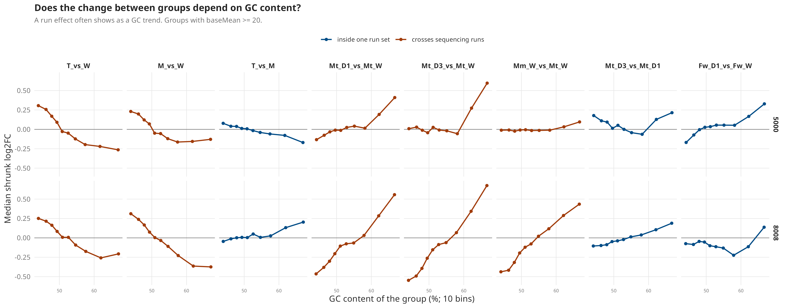

*Figure 4. Log2 fold change against gene GC content and length, for contrasts within one run and across runs.*

Every bud contrast against W carries a clear length trend (rho 0.33 to 0.44). T vs M, within one run, does not. There is a side finding for the leaves: 8008 contrasts against the watered tillering leaves (Mt_W, sequenced on later runs) carry a GC trend too, and Mm_W vs Mt_W, which should be a mild age effect, shows the strongest one. So the Mt_W leaves also carry a run fingerprint. It is weaker than in buds and the D1/D3 responses are large, so the leaf conclusions stand, but small leaf differences against Mt_W should be read with care.

### 2.3 Genes that should not change

> **Concept: negative-control genes.** Some genes are expected to stay constant: "housekeeping" genes such as actin or GAPDH, or genes that barely vary among all our leaf samples. If many of them come out as differentially expressed, the contrast is driven by something other than biology.

We used two sets: 1,000 groups that were the least variable across all leaf libraries, and 28 reference genes from the sugarcane qPCR literature (Figure 5).

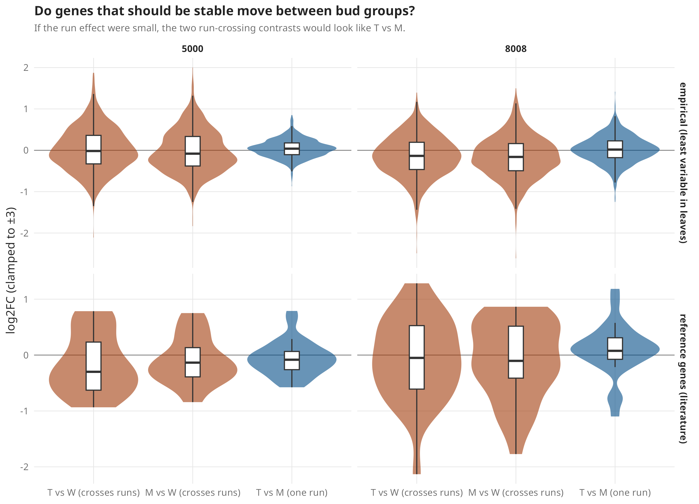

*Figure 5. Log2 fold change of control genes in each contrast. Source: `bud_batch/control_genes_lfc_summary.tsv`.*

- In buds, W vs T or M: 16–34% of the stable genes come out with padj < 0.05.
- In buds, T vs M (same run): 0.3–0.4%.
- In leaves, Mt_D3 vs Mt_D1 (same run): 0%.

The stable genes are only "stable" when no run boundary is crossed.

### 2.4 Trying to remove the run effect (RUVg)

> **Concept: RUVg.** "Remove Unwanted Variation" estimates hidden technical factors from control genes, genes assumed not to be affected by the biology. The factors are then added to the model as covariates, like a batch label. It only works if the unwanted factor is not the same thing as the biological groups. If every W bud is on one run and every stressed bud on the other, the factor and the treatment are identical, and removing the factor removes the treatment too.

We estimated one or two factors (k = 1, 2) from the 1,000 stable genes (Figure 6).

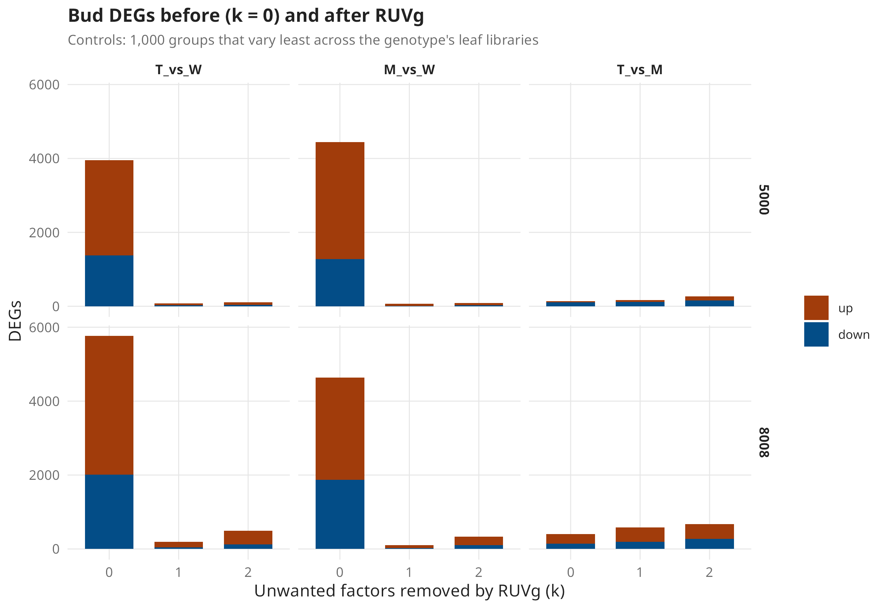

*Figure 6. Bud DEGs before (k = 0) and after removing one or two RUVg factors. Source: `bud_batch/ruvg_deg_summary.tsv`.*

- The first factor correlates −0.97 (8008) and −0.98 (5000) with "watered or not". It *is* the run.
- Removing it drops the W-vs-stressed DEGs from about 4,000–5,700 to about 60–200.
- T vs M, within one run, keeps a similar number of DEGs (8008: 404 before, 581 after; 5000: 143 before, 172 after).

One detail is worth mentioning. After removing the factor, the genes that leaves switch on under drought come out *higher* in 8008 stressed buds than in W buds (camera FDR 7 × 10⁻¹⁴ for T vs W; `bud_batch/leaf_drought_programme_in_buds.tsv`). Before correction there was no such signal. This is what we would expect if the buds of stressed mothers kept part of the drought programme. But it is what is left after removing a factor that is 97% the same as the treatment, so it can also be an artefact of the correction. 5000 shows nothing of the kind. We note it as a hint, not a result.

**Answer:** the W-vs-stressed bud comparison cannot be rescued with these data. The difference between the runs is a library preparation difference, it is as large as the biology, and it is perfectly confounded with the treatment. Only the re-sequencing proposed in report_story section 13 can fix it. The T vs M bud comparison is clean and remains the one usable bud test.

---

## 3. Does a mark travel from mother to bud to propagule? (H5)

The first report asked this with overlaps of DEG lists: genes that pass a cut-off in one contrast and also in another. Cut-offs throw away most of the information, and with few plants many true changes miss the cut-off. Here we use the whole ranking of genes.

> **Concept: rank-based tests.** Instead of "which genes pass padj < 0.05 in both?", ask "do the genes that rank highest in contrast A also tend to rank high in contrast B?". Two tools:
> - **camera (pre-ranked)**: take the top 300 up and top 300 down genes from A and test whether they move as a set in B. This is tested in both directions, A → B and B → A.
> - **RRHO** (rank-rank hypergeometric overlap): rank all genes in A and in B, and for every pair of cut points count how many genes are in both tops. The result is a map. A hot spot in the up-up or down-down corner means the two contrasts agree; hot spots in the off-diagonal corners mean they go in opposite directions.

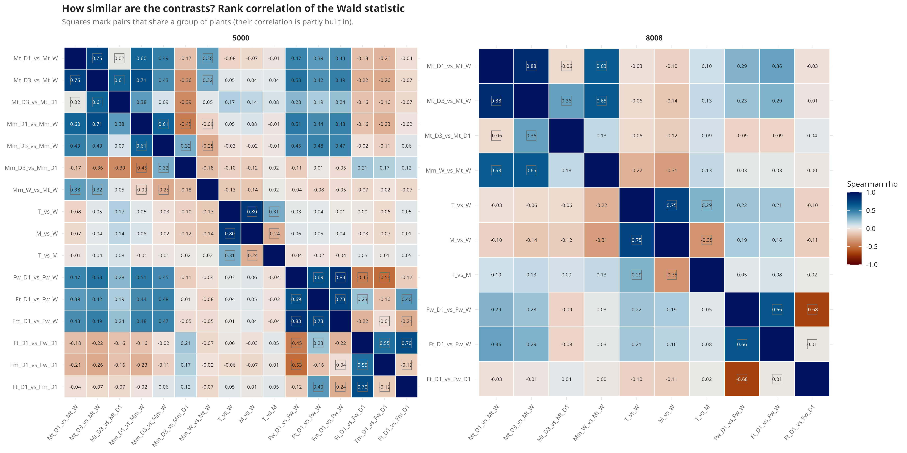

*Figure 7. Spearman correlation between the log2 fold changes of every pair of contrasts, per cultivar. Source: `h5_rank/contrast_correlations.tsv`.*

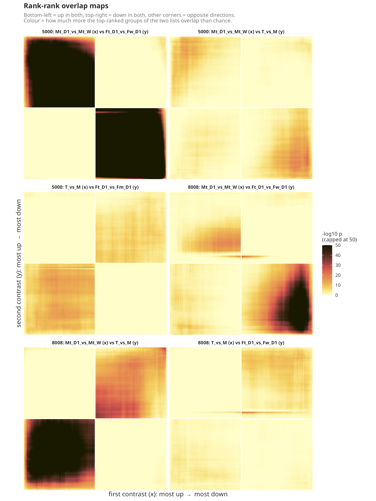

*Figure 8. RRHO maps for the three steps of H5. Colour is −log10 p of the overlap. Bottom-left = both up; top-right = both down.*

We tested each step of the chain (Table 5).

| Step | Contrasts | 8008 | 5000 |
|---|---|---|---|
| Mother leaf → bud | Mt_D1_vs_Mt_W (leaf) vs T_vs_M (bud) | **agree**: leaf drought genes are higher in T buds (camera FDR 0.01; RRHO up-up peak 73) | no link, weakly opposite |
| Mother memory → bud | Mt_D3_vs_Mt_D1 vs T_vs_M | **agree**: D3 > D1 genes higher in T buds (FDR 0.001) | partial: D3 < D1 genes lower in T buds (FDR 0.001) |
| Bud → propagule | T_vs_M (bud) vs Ft_D1_vs_Fw_D1 | no link (FDR ≥ 0.1) | weak (FDR 0.07) |
| Bud → propagule, matched | T_vs_M vs Ft_D1_vs_Fm_D1 | (no Fm in 8008) | weak (FDR 0.06) |
| Mother drought → propagule | Mt_D1_vs_Mt_W vs Ft_D1_vs_Fw_D1 | **opposite** for repressed genes: they are less repressed in Ft (FDR 6 × 10⁻⁴); induced genes do not differ | **opposite** for both sets (FDR down to 6 × 10⁻¹⁴; RRHO off-diagonal peaks 151 and 244) |

*Table 5. Rank-based tests of H5. Source: `h5_rank/h5_rank_tests.tsv`, `h5_rank/rrho_maxima.tsv`.*

Three things stand out.

**1. A modest mother → bud link in 8008.** In 8008, genes that the mother's leaves switch on under drought, and genes that rise more at the 3rd drought than at the 1st, are slightly higher in buds of tillering-stressed (T) mothers than in buds of maturation-stressed (M) mothers. T buds were collected 135 days after the last drought, M buds 6 days after. So T buds carry more of the leaf drought programme despite the longer gap, which is what long-term memory would look like. The correlation over all genes is small (rho 0.10), so this is a shift in a subset of genes, not a general state. 5000 does not show it.

**2. No link from buds to propagules.** Whatever separates T from M buds does not reappear in the propagules grown from them (Ft vs Fw, or Ft vs Fm in 5000). The mark in the bud, if there is one, is not what the propagule shows.

**3. The maternal effect is a milder drought response, and it is reproducible.** Propagules of stressed mothers (Ft_D1) responded less to their own drought than propagules of watered mothers (Fw_D1). In 5000, the genes that drought switches on in mother leaves are *lower* in Ft_D1 than in Fw_D1, and the genes it switches off are *less* switched off; Fm_D1 shows the same (FDR 10⁻⁷ to 10⁻²⁰). In 8008 only the second half holds: drought-repressed genes are less repressed in Ft_D1 (FDR 6 × 10⁻⁴), while induced genes are unchanged. The Ft_D1 vs Fw_D1 profile also agrees between the two cultivars (rho 0.20; camera FDR 10⁻¹¹ to 10⁻²⁵). Two independent cultivars giving the same answer is the strongest evidence in this report.

> **Concept: milder response, two readings.** A propagule that "responds less" to drought may be **better prepared** (it needs less emergency response, as Marcos et al. 2018 suggested from physiology), or it may simply have been **less stressed** (bigger, with more water reserve in the stalk piece, or in drier soil at a different time). Gene expression alone cannot tell the two apart. A measure of plant water status at sampling can.

The caveat from the first report still holds: Fw_D1 has one plant in each cultivar, so every Ft/Fm vs Fw_D1 contrast compares against one plant. That the two cultivars agree, each against its own single plant, makes a fluke in one plant less likely, but more Fw_D1 plants are needed.

**Answer to H5:** there is no evidence for a chain mother → bud → propagule. The two links that do appear, mother → bud in 8008 and the milder propagule response, are separate observations.

---

## 4. Does one allele carry the memory?

Sugarcane has about 8–12 copies of most genes. All analyses so far summed the copies into **allele groups**. Memory could still sit in a single copy, for example the one copy that keeps a chromatin mark, and be diluted in the sum.

> **Concept: heterogeneity between alleles (I²).** For each allele group, take the log2 fold change of each copy and ask whether they agree. Cochran's Q tests whether the copies differ more than their uncertainty allows. I² is the share of the variation between copies that is real rather than noise: 0% means all copies agree, 75% means they disagree strongly. This comes from meta-analysis, where it measures whether several studies agree.

### 4.1 The copies move together

| Cultivar | Groups | Median I² | Heterogeneous (FDR < 0.05) | Copies going opposite ways |
|---|---|---|---|---|
| 5000, all drought-responsive | 2,136 | 0 | 6.3% | 1.6% |
| 8008, all drought-responsive | 3,511 | 0 | 11.3% | 1.4% |
| 5000, memory groups | 209 | 0 | 4.8% | 2.4% |
| 8008, memory groups | 20 | 0 | 10% | 0% |
| 5000, non-memory groups | 1,927 | 0 | 3.6% | 0.7% |
| 8008, non-memory groups | 3,491 | 0 | 3.9% | 0.1% |

*Table 6. Agreement between copies within each allele group. Source: `alleles/heterogeneity_summary.tsv`.*

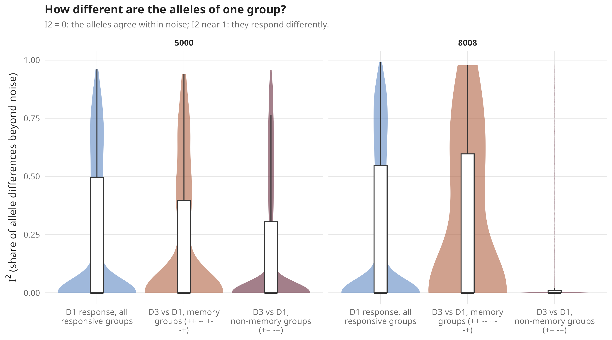

*Figure 9. I² for drought-responsive groups, memory groups and non-memory groups.*

In most groups the copies agree completely (median I² = 0). Memory groups are not more heterogeneous than other responsive groups: 8008's 10% is 2 groups out of 20. And when one copy does most of the change, it is usually the copy that is most expressed: the share of the change carried by a copy tracks its share of the expression (r = 0.97 in 8008; `alleles/memory_change_carriers.tsv`). So the change is spread across copies in proportion to how much each is used.

### 4.2 The named candidates

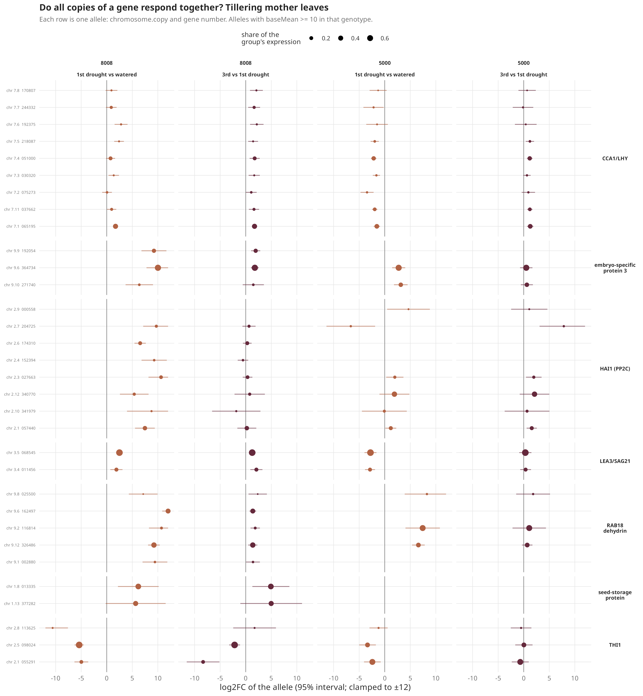

*Figure 10. Expression of each copy of the named candidate genes, per group. Each line is one copy (POJ2878 gene ID and chromosome copy).*

- **RAB18:** all copies rise together under drought in 8008. 5000 expresses only 3 of the 5 copies seen in 8008 (`alleles/named_allele_presence.tsv`).
- **LEA3, seed-storage protein, embryo-specific protein:** copies move together. The seed-storage protein copies are expressed only in 8008.
- **THI1:** one copy (chromosome 2, copy 1) drops sharply in 8008 at D3 (about −8 on the log2 scale), more than the other two copies. This is the one candidate where a single allele may behave differently. It is worth checking by qPCR with copy-specific primers.
- **PAL (bud signature):** see Figure 11.

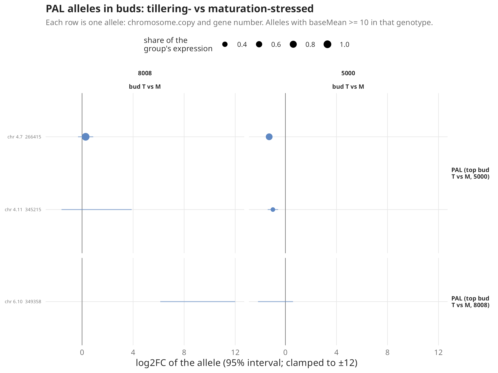

*Figure 11. Copies of the PAL group that best separates T from M buds in 5000.*

The two cultivars do not even share all copies. Among the copies of the named genes, 25 are expressed in both cultivars, 9 only in 8008 and 4 only in 5000. So "the same gene" is partly a different set of alleles in each cultivar, one more reason to analyse them separately.

### 4.3 How sure can we be about a single copy?

> **Concept: inferential variance (InfRV).** Salmon has to decide which copy each read came from. When copies are almost identical, it cannot be sure. Rerunning the assignment many times on resampled reads (bootstraps; we ran 30 per library) shows how much a copy's count changes just from that uncertainty. InfRV is that variance relative to the mean: near 0 means the count is solid, above 1 means the uncertainty is larger than the count itself.

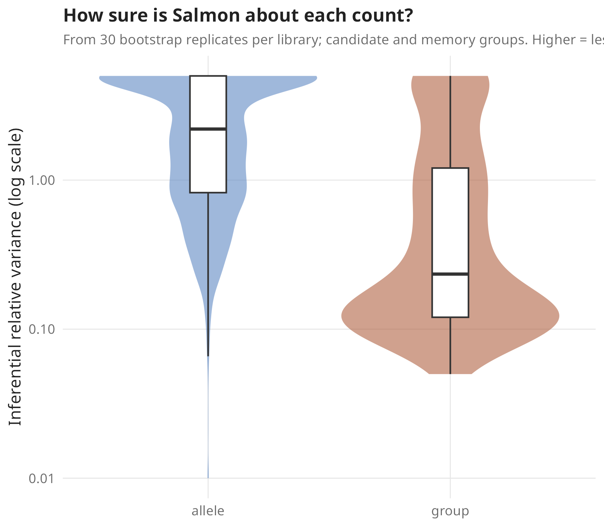

*Figure 12. Inferential uncertainty of single copies and of allele groups, for the candidate genes. Source: `alleles/bootstrap_infrv.tsv`.*

| Level | Features | Median InfRV | InfRV > 0.5 |
|---|---|---|---|
| Single copy | 1,882 | 2.2 | 86% |
| Allele group | 352 | 0.23 | 37% |

*Table 7. Uncertainty from read assignment, for copies of the candidate groups.*

For single copies, the uncertainty is usually larger than the signal. Within a group, the bootstrap counts of the copies are strongly anti-correlated (median of the lowest pair −0.89; `alleles/bootstrap_allele_correlation.tsv`): reads move from one copy to another between bootstraps, and the group total stays the same.

**Answer:** in these data the copies of a gene move together, and the memory candidates are no exception. Short-read RNA-seq cannot say much more at the single-copy level, because reads cannot be assigned reliably among nearly identical copies. This also confirms that summing copies into groups, as the first report did, was the right unit. A real allele-level test needs long reads or copy-specific qPCR. THI1 is the best candidate for it.

---

## 5. Gene modules that follow history (WGCNA)

The analyses so far test genes one by one or in lists we chose. A co-expression network lets the data group genes on their own. If drought memory is a coordinated programme, some group of genes should follow the plant's **history** (a previous drought, or a stressed mother) and not only whether it is dry right now.

> **Concept: WGCNA and module eigengenes.** Weighted gene co-expression network analysis connects every pair of genes by how similarly they rise and fall across samples. Genes that move together form a **module** (we name them M01, M02… by size; M00 holds genes that fit nowhere). Each module is summarised by its **eigengene**, one number per library: the main shared pattern of the module, like a module-wide expression level. We can then test the eigengene against the design, the same way we test a single gene.

**What went in.** All 32 leaf libraries of both cultivars, and the 8,000 most variable allele groups. The cultivar difference was removed first, so the modules describe responses rather than "8008 genes" and "5000 genes". The network is signed (genes that go in opposite directions are not linked) and robust to outlier samples (biweight midcorrelation). No soft-threshold power reached the usual scale-free fit of 0.8 (the best was 0.76), which is common with strong treatment effects; we used 14, the value the WGCNA authors recommend for signed networks with 30–40 samples. The result: 13 modules of 44 to 1,945 groups, with 698 groups unassigned (`wgcna/modules.tsv`).

**The test.** Each eigengene was modelled with every factor of the design at once, so each factor is measured on top of the others:
- **current drought**: the leaf is under drought when sampled (D1, D3, propagule D1);
- **repeated (D3)**: the 3rd drought, on top of current drought. This is the plant's own history;
- **maternal stress**: a propagule of a stressed mother (Ft, Fm), on top of its own drought. This is the mother's history;
- **late run (Mt_W)**, **propagule** and **maturation**: the run, tissue and age differences, so they do not leak into the others.

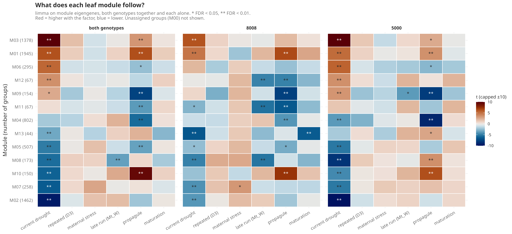

*Figure 13. What each module follows. Colour is the t-statistic of each factor for each module's eigengene; stars mark FDR < 0.05 and < 0.01. Left: both cultivars together; middle and right: each cultivar alone. Source: `wgcna/module_trait_tests.tsv`.*

### 5.1 The modules follow current drought, not history

Figure 13 is dominated by its first column. Eleven of the 13 modules change with current drought (FDR < 0.05), most of them strongly:
- **M03** (1,378 groups) rises under drought. Its hubs include the dehydrin DHN1 and ferritin; it holds 44% of 8008's D1-induced genes (`wgcna/module_list_overlaps.tsv`).
- **M02** (1,462 groups) falls under drought: cell-wall receptor kinases, callose synthase, translation-related GO terms.
- **M01** (1,945) rises under drought and is rich in phenylpropanoid genes (phenylalanine breakdown, the PAL step; hubs include chalcone synthase CHS1 and MYB12). It also holds most of 5000's D3-higher genes, but its eigengene does not move with the repeated term.
- **M05** (photosynthesis), **M07** (translation and chloroplast), **M10** (water and ion transport) and **M11/M12** (heat-shock proteins) complete the picture: drought switches photosynthesis and growth down and protection up, as expected.

The other big signal is the propagule vs mother difference (younger plants of a different age and season), which drives M04, M09 and M10.

The **repeated (D3)** column is empty: no module changes at the 3rd drought beyond the change it already shows at the 1st, in either cultivar or both together. This matches section 6 of the first report: the 3rd drought looks like the 1st.

The **maternal stress** column is almost empty too. In the pooled model nothing passes FDR 0.05. One module does in one cultivar (Figure 14).

### 5.2 One module, M07, in propagules of stressed mothers

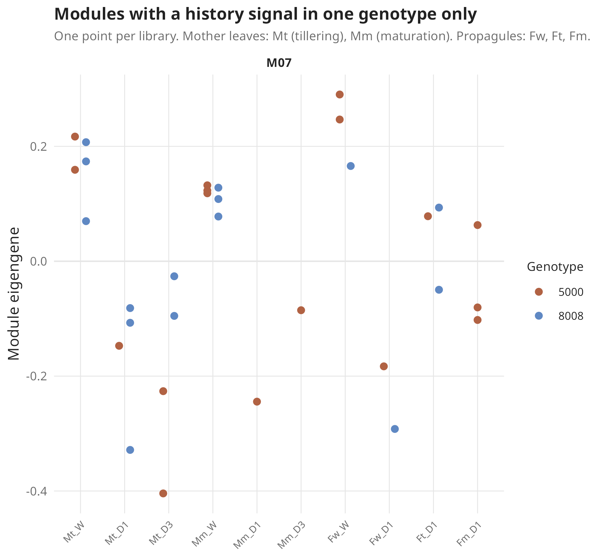

*Figure 14. The M07 eigengene in every leaf library. M07 falls under drought in mothers and propagules alike.*

**M07** (258 groups) is enriched for translation, ribosome and chloroplast organisation genes, and drought switches it off. In propagules of stressed mothers it is switched off **less** than in propagules of watered mothers:
- 8008: t = 3.3, FDR 0.04;
- 5000: same direction, t = 1.3, not significant; both together t = 2.7, FDR 0.16;
- in both cultivars, M07 is enriched for genes that are higher in Ft_D1 than in Fw_D1 (odds ratio 5.1 in 8008, 7.1 in 5000; `wgcna/module_list_overlaps.tsv`).

This is the module form of the result of section 3: propagules of stressed mothers respond more mildly to drought, and here the milder response is in growth and chloroplast genes. But Figure 14 also shows its weakness: Fw_D1 is **one plant per cultivar**, and in both cultivars that plant is among the lowest points. Ft_D1 and Fm_D1 sit between watered and drought-stressed propagules. One unusually stressed Fw_D1 plant would produce the same picture.

### 5.3 Buds

We also scored every module in the buds (the mean of its genes, `wgcna/bud_module_T_vs_M.tsv`). No leaf module separates T from M buds (all p ≥ 0.05). The bud signal of section 3 lives in a subset of genes and does not form a leaf-defined module.

**Answer:** in these leaves, co-expression follows current drought and plant type, not drought history. The only history-related module, M07, repeats the milder propagule response and rests on the same single Fw_D1 plants.

---

## 6. What changes in the overall picture

- **H2 (tolerant cultivar remembers more):** still unsupported, and now with a reason: the apparent memory in 5000 can be produced by its single D1 plant. 8008 responds more strongly at the 1st drought.
- **H3 (buds keep a mark):** the W-vs-stressed comparison is lost to a library preparation difference that no correction can undo. The T vs M comparison is clean.
- **H5 (a chain from mother to propagule):** no chain. There is a modest link from mother leaf to bud in 8008, and a reproducible, milder drought response in propagules of stressed mothers in both cultivars.
- **Alleles:** gene copies move together; the group-level analysis was the right one.
- **Networks:** no gene module follows the plant's own drought history. One module follows the mother's history, and it is the milder propagule response again.
- **New caveat:** the watered tillering leaves (Mt_W) carry a run fingerprint, mostly in 8008. Large leaf responses are unaffected, but small differences against Mt_W should be treated with care.

What we can ask the lab, in order of value:
1. Were the W buds' libraries prepared separately from the T and M buds' libraries? The fragment length and adapter content say yes. If tissue or RNA is left, re-preparing a few W buds together with T and M buds would rescue the strongest bud test.
2. More 5000 Mt_D1 plants and more Fw_D1 plants: these decide H2 and the propagule result.
3. Plant water status at sampling, to tell a "better prepared" propagule from a "less stressed" one.
4. Copy-specific qPCR for THI1.

---

## Where everything is

| Analysis | Results | Code |
|---|---|---|
| Shared settings and helpers | | `../code/common.R`, `../code/run_r.sh` |
| H2, genotype × cycle | `h2_genotype_cycle/` | `../code/10_genotype_cycle.R` |
| Bud batch check | `bud_batch/` | `../code/11_bud_batch.R` |
| H5, rank-based tests | `h5_rank/` | `../code/12_h5_rank.R` |
| Alleles | `alleles/` | `../code/13_alleles.R` |
| WGCNA | `wgcna/` | `../code/14_wgcna_prep.R`, `../code/15_wgcna.R`, `../code/16_wgcna_traits.R` |
