# Does sugarcane remember a drought? The DOLORES RNA-seq results, explained

*November 2026. This is the long, narrative version of [`report.md`](report.md). It tells the analysis as a story: the question, what the data look like, what went wrong on the way, and what the genes say. Boxes marked **Concept** explain the methods when they first come up, and a glossary at the end collects the terms. Every number comes from a file in this folder, and every figure appears where it is discussed.*

---

## 1. The question

A plant that survives a drought is sometimes better prepared for the next one. This is called **drought memory**, or **stress priming**.

The best-studied case comes from Zoya Avramova's lab:
- They dried *Arabidopsis* and maize plants several times and compared the response to the 1st and the 3rd dehydration (Ding et al. 2012, 2013, 2014).
- Most drought genes respond the same way every time.
- A few hundred respond **more strongly** the 3rd time. They "remember".
- The textbook example is the dehydrin gene **RAB18**: after training, it is switched on faster and higher.

Sugarcane adds a twist. It is planted from pieces of stalk, not from seeds: each new plant grows from a **bud** on a stalk cut from the mother plant. If a drought leaves a mark in the mother's buds, the new plants, called **propagules**, could inherit it.

The same group at IAC/Unicamp saw a hint of this. Propagules from drought-stressed mothers coped better with drought (Marcos et al. 2018, PLoS One). DOLORES asks whether that memory can be seen in gene expression, in three places:
- the leaves of the mother;
- her buds;
- the propagules.

There are two cultivars:
- **IACSP95-5000** ("5000"): a productive cultivar.
- **IACCTC07-8008** ("8008"): a drought-tolerant one.

We expected them to behave differently, so every analysis treats them separately.

---

## 2. The experiment in two pictures

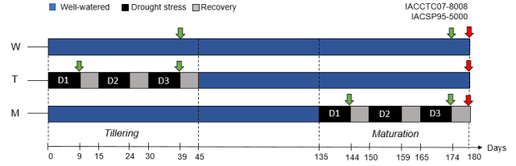

*Figure 1. Mother plants. W plants are always watered. T plants go through three drought cycles (D1, D2, D3) while young (tillering, days 0–45). M plants go through three cycles late in the season (maturation, days 135–180). Green arrows mark leaf samples; red arrows mark bud samples.*

Figure 1 already contains three facts that shape everything later:
- **Leaves were sampled at the peak of a drought** (day 9 of a cycle), at the 1st (D1) and the 3rd (D3) cycle. So we see the drought response at cycle 1 and cycle 3, not the recovery.
- **All buds were collected on day 180.** For T plants that is 135 days after their last drought: a test of long-term memory. For M plants it is only 6 days after the last drought, so "memory" and "still recovering" are mixed.
- **The watered control leaves were sampled on day 39**, the same day as D3, but 30 days after D1. So "D1 vs W" also compares plants sampled on day 9 with plants sampled on day 39, which adds 30 days of growth to the drought effect.

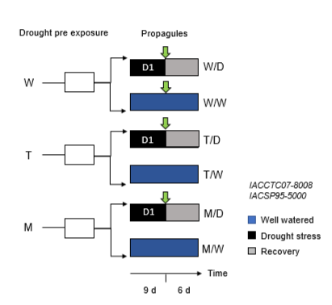

*Figure 2. Propagules. Buds from W, T and M mothers were grown into new plants. Each group was then split: one drought cycle (D) or kept watered (W). Only W/W, W/D, T/D and M/D were sequenced.*

The labels used in every table and figure:

| Label | Meaning |
|---|---|
| W | well-watered |
| D1, D3 | leaf sampled at the peak of the 1st / 3rd drought |
| `Mt_…`, `Mm_…` | mother leaf, tillering / maturation experiment |
| T, M (buds) | buds of tillering-stressed / maturation-stressed mothers |
| `Fw`, `Ft`, `Fm` | propagule from a watered / tillering-stressed / maturation-stressed mother |
| `Fw_W`, `Fw_D1`, `Ft_D1` … | propagule group, then the propagule's own treatment |
| `A_vs_B` | a **contrast**: A compared with B. A positive value means higher in A. |

---

## 3. From reads to numbers

Three ideas are needed before any result makes sense.

> **Concept: a genome with many copies of each gene.** Sugarcane is a highly polyploid hybrid: most genes exist in about 8–12 copies (alleles), inherited from two ancestral species. The POJ2878 reference genome assembles each copy separately, so its 397,650 "genes" are really alleles. Reads from one gene are split among nearly identical copies, which makes each copy noisy.
>
> We therefore grouped the copies. **OrthoFinder** compared the proteins of sugarcane, sorghum, maize, rice and *Arabidopsis* and found **orthologues**: genes in different species that descend from the same ancestral gene. All sugarcane alleles whose orthologue is the same sorghum gene were summed into one **allele group**, giving 78,613 groups. Sorghum is the closest diploid relative, so a group is close to "one gene" in the usual sense.
>
> Bonus: the same orthology links sugarcane groups to genes already studied in *Arabidopsis* and maize (section 8).

> **Concept: log2 fold change (log2FC).** This is how much a gene changes between two conditions, on a doubling scale:
> - +1 = twice as much;
> - +3 = 8 times;
> - −2 = a quarter;
> - +10 ≈ 1,000 times.
>
> 0 means no change.

> **Concept: differential expression and replicates.**
> - **What the test asks.** DESeq2 asks whether the difference between two groups is large compared with how much plants *within* a group differ. That within-group variation can only be measured with 2 or more plants.
> - **One plant per group.** When a group has a single plant, DESeq2 borrows the variation measured in the other groups of the same model. This is why mother and propagule leaves share one model.
> - **What that costs.** The contrast can be computed, but if that one plant is unusual nothing in the data can reveal it. So every contrast carries a label:
>   - **conclusive**: both groups have 2 or more plants;
>   - **exploratory**: one group is a single plant;
>   - **descriptive**: maturation leaves, which have one plant per drought group.
> - **padj and DEG.** Testing ~30,000 groups at once produces many false hits by chance. **padj** is the p-value corrected for this (it controls the false discovery rate). A **DEG** (differentially expressed gene, here a group) has padj < 0.05 and changes at least two-fold (|log2FC| ≥ 1).

---

## 4. First look at all the data

> **Concept: PCA.** Each library is a list of ~30,000 numbers, impossible to look at directly. Principal component analysis (PCA) finds the directions along which libraries differ most and draws each library as one point.
> - **PC1** is the strongest axis of difference, **PC2** the second strongest.
> - The percentage on each axis says how much of the total variation it captures.
> - Libraries that are close together have similar transcriptomes.

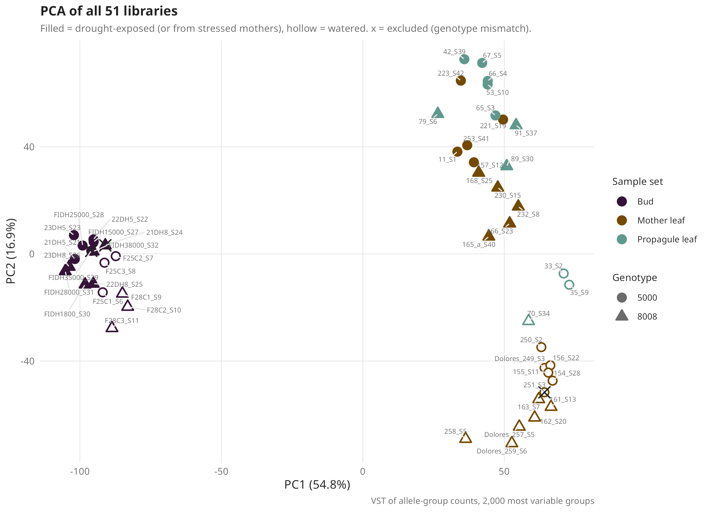

*Figure 3. PCA of all 51 libraries. Colour = sample set, shape = genotype, filled = drought-exposed, hollow = watered, × = excluded library (section 5).*

The dataset has a clear structure:
- **PC1 (55%) is tissue.** Buds sit on the left and leaves on the right. Buds and leaves are simply very different organs.
- **PC2 (17%) is drought.** Among the leaves, drought-stressed leaves (filled) sit at the top and watered leaves (hollow) at the bottom. The treatment worked: drought is the second largest signal in the whole experiment.
- **Genotype is a smaller effect.** Circles (5000) and triangles (8008) are mixed within each cloud.

The next figure zooms in, one panel per genotype and tissue.

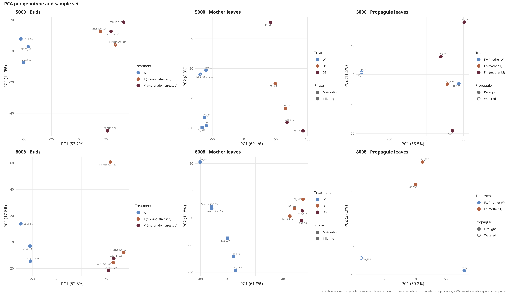

*Figure 4. PCA per genotype and sample set (excluded libraries left out). Colour = treatment history: blue = watered, orange = 1st drought or tillering stress, dark red = 3rd drought or maturation stress.*

Each panel already hints at part of the story:
- **8008 mother leaves (bottom middle).** Watered plants sit on the left, drought plants on the right, and the D1 (orange) and D3 (dark red) plants are **mixed together**. If the leaves had "learned", D3 should sit apart from D1. Keep this picture in mind for section 6.
- **5000 mother leaves (top middle).** The single D1 plant (`157_S12`) sits halfway between watered plants and D3 plants. Either the 1st drought response was weaker, or this one plant was less stressed. With one plant we cannot tell.
- **Buds (left).** In both genotypes PC1 (~52%) separates watered buds from stressed buds, while T and M buds overlap. This looks like a strong drought mark, but section 5.2 shows why we cannot trust it.
- **Propagules (right).** Watered propagules sit on the left and drought propagules on the right. In 8008 the two Ft plants sit between the watered plant and the Fw_D1 plant. This is a first hint of the propagule story, with a catch explained in section 10.

---

## 5. Detective work: problems found before any biology

Before asking biological questions, we checked whether the data can answer them. Four problems turned up.

### 5.1 Three tubes belong to the other cultivar

> **Concept: an expression fingerprint.** 5000 and 8008 carry different alleles, and an allele that is missing from a genome can never be expressed. So whether each of ~31,000 genes is "on" or "off" works as a genetic fingerprint, whatever the tissue or the treatment.

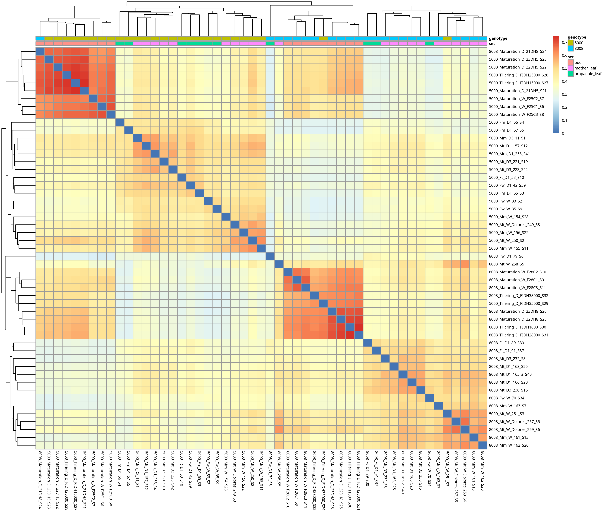

*Figure 5. Similarity of the on/off patterns between libraries (red = similar). The colour bar on top gives the labelled genotype.*

Two large blocks appear, one per genotype. Three libraries sit in the wrong block:

| Library | Labelled as | Actually matches |
|---|---|---|
| `FIDH35000_S29` | 5000 tillering-stressed bud | 8008 buds |
| `21DH8_S24` | 8008 maturation-stressed bud | 5000 buds |
| `251_S3` | 5000 watered tillering leaf | 8008 watered leaves |

The first two look like a swap of two tubes. None of the three is a copy of another library: each looks like a real sample of the other cultivar. We excluded all three until Dolores can check the lab records. This leaves **48 libraries** in the analysis (marked × in Figure 3).

Figure 5 holds one more warning. The row `8008_Fw_D1_79_S6` is pale against everything. This library is about 76% ribosomal RNA (the median library is 25%), so only 1.05 million reads count genes (the median is 6.2 million) and only ~15,000 groups are detected (the median is ~29,000). It is the **only** 8008 propagule of a watered mother under drought, the reference for the 8008 propagule comparisons. We come back to it in section 10.

### 5.2 Batch: when two effects are glued together

> **Concept: confounding.** Imagine every watered bud went through one sequencing run and every stressed bud through another. Any difference between the runs (chemistry, loading, flow cell) then looks exactly like a drought effect, and no statistics can pull the two apart. The only cure is in the design: spread every group across runs.

The FASTQ files record which sequencing run produced each read, so we could check this directly.

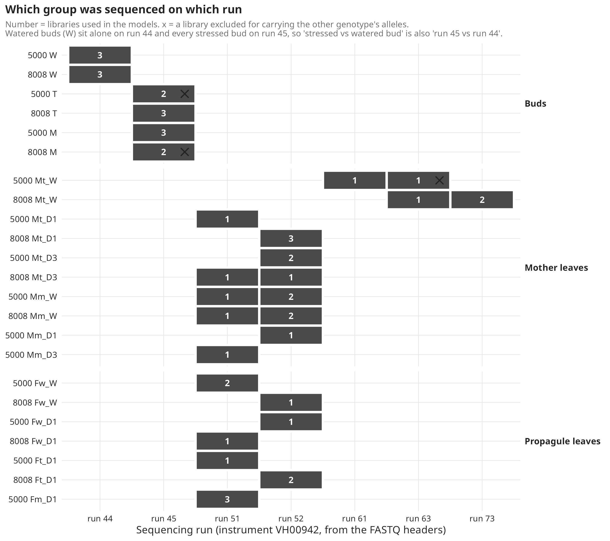

*Figure 6. Number of libraries per group (rows) and sequencing run (columns). × = excluded library.*

What the figure shows:
- **Buds.** Every watered bud is on run 44 and every stressed bud on run 45. "Stressed vs watered bud" is the same comparison as "run 45 vs run 44". This is why PC1 of the bud PCAs (Figure 4) cannot be trusted.
- **Tillering vs maturation buds.** T and M buds share run 45, so **T vs M is a clean comparison.**
- **Mother leaves.** The watered tillering controls (Mt_W) were sequenced on later runs (61, 63, 73), and every drought leaf on runs 51/52. So D1 vs W and D3 vs W are partly confounded. **D3 vs D1, the actual memory test, is clean.**
- **Propagules.** All on runs 51/52. Clean.

### 5.3 Groups with a single plant

The groups with a single library are:
- **5000:** Mt_D1, Mm_D1, Mm_D3, Fw_D1 and Ft_D1;
- **8008:** Fw_W and Fw_D1.

Every propagule comparison against Fw_D1 therefore rests on one plant in each genotype.

### 5.4 Age and time of day

- **Age.** D1 leaves are 30 days younger than the watered controls (Figure 1).
- **Time of day.** In 8008, D1 leaves differ from watered leaves in **clock genes**:
  - the morning gene CCA1/LHY is up;
  - PRR7, TOC1, GI and ELF3, which peak later in the day, are down.

  Drought can shift the plant's internal clock. But the same pattern appears if two groups were simply sampled at different hours. Only the lab notes can say.

---

## 6. Do leaves "learn"? (hypothesis H1)

> **Concept: memory classes.** Following Ding et al., every gene gets two signs: how it changed at the 1st drought (D1 vs watered), then how it changed at the 3rd drought compared with the 1st (D3 vs D1).

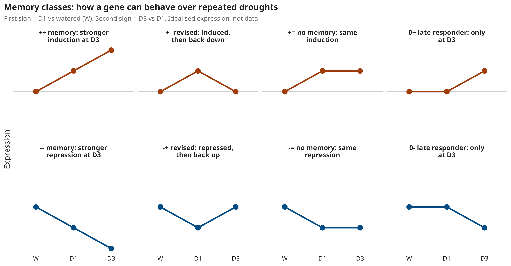

*Figure 7. The memory classes, drawn as idealised genes. Top row: genes switched on by drought. Bottom row: genes switched off.*

The names to remember:
- **`++` and `--`** are **memory genes**: the 3rd response is stronger than the 1st.
- **`+=` and `-=`** are **non-memory genes**: same response both times.
- **`+-` and `-+`** are "revised" genes, whose response reverses.
- **`0+` and `0-`** are late responders, which only react at D3.

### 6.1 The overall answer: the 3rd drought looks like the 1st

| Genotype | D1 vs W (up / down) | D3 vs W (up / down) | D3 vs D1 (up / down) | D3 vs D1 status |
|---|---|---|---|---|
| 8008 | 3,905 / 4,196 | 3,585 / 3,978 | **35 / 49** | conclusive |
| 5000 | 2,091 / 1,750 | 4,646 / 4,657 | 500 / 729 | exploratory (one D1 plant) |

*Table 1. DEG counts in tillering mother leaves (`de/group/deg_summary.tsv`).*

In 8008, about 8,000 groups respond to the 1st drought and about 7,500 to the 3rd, yet only **84** differ between the two. Figure 8 shows why.

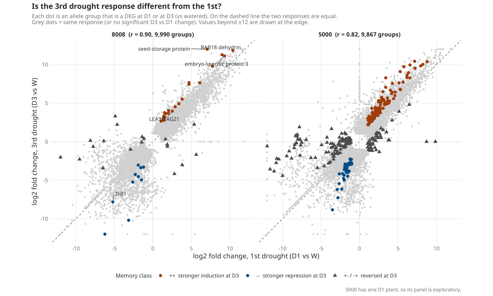

*Figure 8. Each dot is a group that responds to drought at D1 or at D3. x = response at the 1st drought, y = response at the 3rd. On the dashed diagonal the two are equal. Coloured dots are the memory classes.*

How to read it:
- **On the diagonal:** the gene did the same thing both times.
- **Above the diagonal on the right:** a stronger induction at D3 (`++`).
- **Below it on the left:** a stronger repression (`--`).

In 8008 (left) almost everything hugs the diagonal: the correlation is **r = 0.90**. Of 5,674 groups that respond at both cycles, 5,673 respond in the same direction (`report_tables/h1_d1_vs_d3_concordance.tsv`). The 3rd drought response is essentially a **replay** of the 1st.

The UpSet plot shows the same thing from another angle.

> **Concept: UpSet plot.** A Venn diagram for many sets at once.
> - **Rows** are sets: here, the DEGs of each contrast, split into up and down.
> - **Each column** of connected dots is one intersection: the groups that are in exactly those sets.
> - **The bar above** gives its size, and the bars on the left give the size of each set.

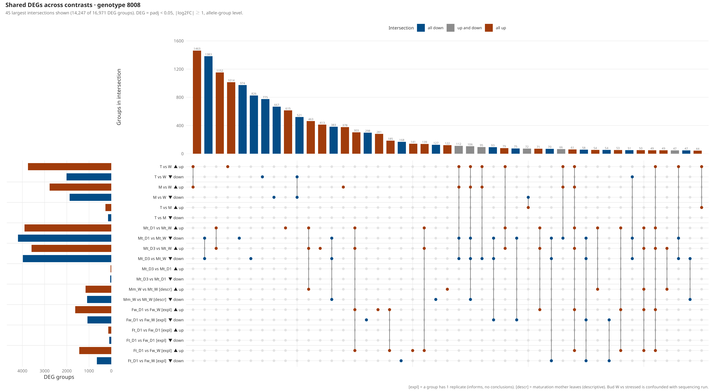

*Figure 9. Shared DEGs across all contrasts in 8008. Red = up, blue = down, grey = intersections that mix up and down.*

What stands out in 8008:
- **The leaf columns.** Two of the three largest columns are leaf groups: 1,383 groups go **down at both D1 and D3**, and 1,152 go **up at both**. The rows `Mt_D3 vs Mt_D1` are almost empty.
- **The largest column overall (1,463).** These are buds, up in both T vs W and M vs W: the "stressed vs watered bud" signal, which is the batch-confounded one from Figure 6.

### 6.2 The few genes that do remember (8008)

A small set behaves like memory genes in 8008: 22 groups are `++` and 10 are `--`. Their identity is striking. Most of the `++` genes are **desiccation-protection** genes:

| Gene | D1 vs W | D3 vs D1 |
|---|---|---|
| RAB18/XERO1 dehydrin | +10.4 | +1.4 |
| LEA3/SAG21 | +2.5 | +1.4 |
| another LEA protein | +7.8 | +2.0 |
| seed-storage protein | +7.1 | +4.9 |
| embryo-specific protein 3 | +9.3 | +1.8 |
| sugar transporter | +9.0 | +2.3 |

*Table 2. Some 8008 `++` groups (log2FC, `de/group/memory_classes_8008_tillering.tsv.gz`).*

> **Concept: LEA proteins and dehydrins.** "Late embryogenesis abundant" proteins pile up in seeds as they dry out at the end of maturation. They protect membranes and other proteins when water is lost. Dehydrins such as RAB18 are one family of LEA proteins. Plants switch the same genes on in leaves under drought.

So the genes that 8008 leaves induce more strongly at the 3rd drought are **seed-like drying-protection genes**. RAB18 is the canonical trainable gene of *Arabidopsis*, and its maize orthologue is a memory gene as well. Finding it in the `++` class is the clearest link to the literature.

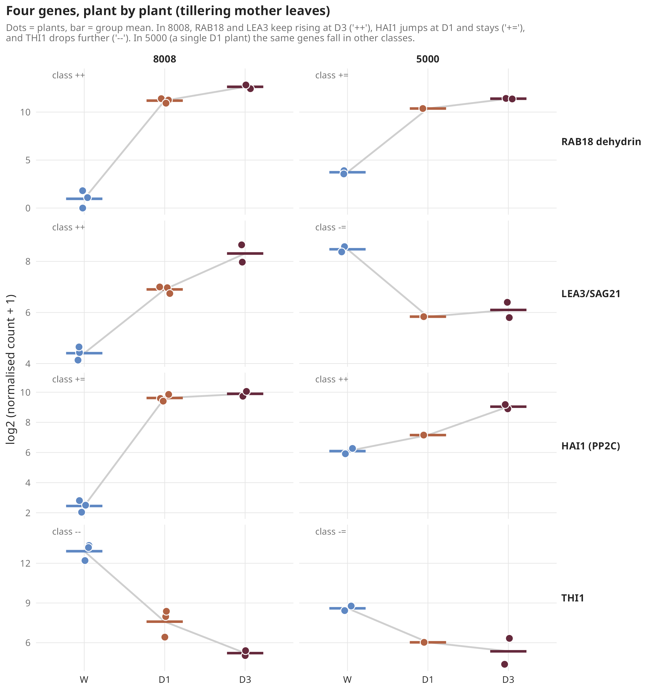

*Figure 10. Four genes plant by plant in tillering mother leaves (y = log2 expression). Left column 8008, right column 5000.*

Figure 10 makes the classes concrete:
- **RAB18 and LEA3 (8008):** they jump at D1 and **keep rising** at D3 (`++`).
- **HAI1 (8008):** a PP2C phosphatase of the ABA pathway. It jumps at D1 and **stays** (`+=`): a strong drought gene without memory.
- **THI1 (8008):** a thiamine (vitamin B1) biosynthesis gene. It drops at D1 and **drops further** at D3 (`--`).
- **5000 (right column):** the same genes fall in other classes. RAB18 is `+=`, LEA3 even goes down, and HAI1 is `++`. Remember that the 5000 D1 group is one plant.

One caution for 8008. THI1 and CCA1/LHY, both strongly controlled by the circadian clock, are among the memory genes. If D1 and D3 leaves were sampled at different hours, part of this "memory" could be time of day (section 5.4).

### 6.3 5000: a bigger response at D3, but on one plant

5000 responds more strongly at D3: 9,303 DEGs against 3,841 at D1. Part of that gap comes from statistical power, since D1 has one plant. But the response sizes are also larger at D3. What dominates the change?

> **Concept: GO enrichment and how to read the lollipop plots.** The Gene Ontology (GO) labels genes with the processes they take part in ("translation", "response to heat"…). Enrichment asks whether a process appears among the DEGs more often than chance would predict.
> - **x-axis:** fold enrichment = observed / expected. 5 means five times more DEGs in the term than expected.
> - **Dot size:** how many DEG groups are in the term.
> - **Colour:** −log10 p (darker = stronger evidence).
>
> These p-values are not corrected for testing many terms, and terms with 2–3 genes are fragile. Read the plots for themes, not for single terms.

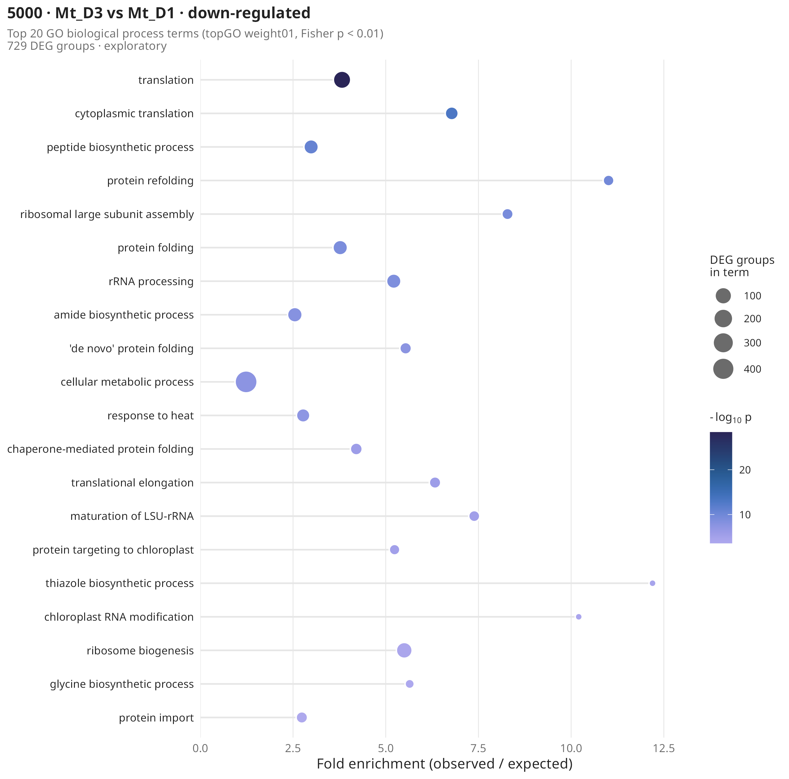

*Figure 11. GO processes among the genes lower at D3 than at D1 in 5000.*

- **What goes down.** The list is dominated by **translation** and **ribosome** genes (translation p = 4e-29; the KEGG "Ribosome" pathway holds 102 groups). Under severe stress, plants stop building ribosomes and making proteins to save energy.
- **Not memory-specific.** In 5000, genes the literature calls *non-memory* also respond more strongly at D3. Two explanations remain:
  - the 3rd drought was harsher;
  - the single D1 plant was mildly stressed.

  Only measurements of how stressed each plant was can separate them.

**H1 verdict.**
- **8008:** mostly no. The 3rd drought replays the 1st, except for a few dozen genes, most of them desiccation-protection genes led by RAB18.
- **5000:** unresolved.

---

## 7. Does the tolerant cultivar remember more? (H2)

We expected 8008, the drought-tolerant cultivar, to show more memory. It shows less:
- **8008:** 84 groups change between D3 and D1, with r = 0.90.
- **5000:** 1,229 groups change, with r = 0.82, but on one D1 plant.

A formal test of "genotype × cycle" was not run, because the genotypes were modelled separately. **H2 is not supported.**

---

## 8. Do the textbook memory genes behave as memory genes here? (H6)

We collected the memory genes published for *Arabidopsis* (Ding 2013) and maize (Ding 2014) and 40 hand-picked candidates: ABA pathway, dehydrins, osmolytes, aquaporins, and chromatin and DNA-methylation enzymes. Orthology mapped them onto sugarcane groups.

> **Concept: gene-set test (camera).** Instead of asking gene by gene, a set test asks whether a whole list of genes tends to move up or down in a contrast. It detects many small coordinated shifts that no single gene would show, and it accounts for genes in a list being correlated with each other.

The results (`memory_genes/camera_literature_sets.tsv`):
- **As drought genes: yes, strongly.** In 8008, the maize `++` set goes up at D1 (FDR 5e-43), and so does the *Arabidopsis* `++` set (FDR 7e-17). The orthologues of known drought genes respond in sugarcane too.
- **As memory genes: mostly no.**
  - In 8008 none of the `++` sets is induced further at D3.
  - The *Arabidopsis* `--` set even goes the other way: less repressed at D3 (FDR 0.005).
- **Single genes that do match.** Our 8008 `++` class overlaps the *Arabidopsis* `++` class through 3 genes: RAB18, LEA3/SAG21 and PIT1. That is far more than chance (odds ratio 25, FDR 0.003; section 11 explains odds ratios).
- **Genes we cannot test.** RD29A and RD29B, the other *Arabidopsis* classics, have no orthologue in grasses.

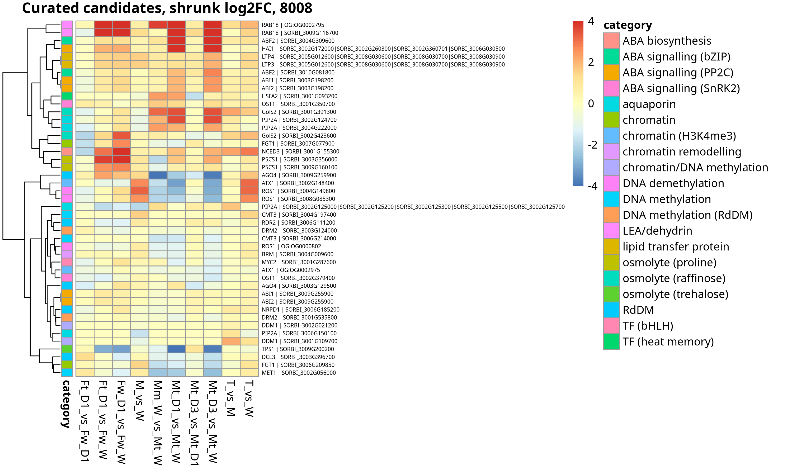

*Figure 12. Hand-picked candidates in 8008 (rows) across all contrasts (columns). Red = higher, blue = lower (shrunk log2FC). The coloured strip on the left gives each gene's category.*

How to read Figure 12: look down one column to see a whole contrast, or along one row to follow one gene.
- **The leaf drought columns** (`Mt_D1_vs_Mt_W`, `Mt_D3_vs_Mt_W`): the top rows (RAB18, ABF2, HAI1) are deep red in both, and TPS1 is deep blue.
- **The `Mt_D3_vs_Mt_D1` column:** pale. Even the classic drought genes barely change between the 1st and 3rd drought; RAB18 is the only one that rises significantly.
- **The bud columns** (`T_vs_W`, `M_vs_W`): ATX1 and ROS1, chromatin and DNA-demethylation enzymes, are red. That would be exciting for inheritance, but these are the batch-confounded columns.

**H6 verdict:** partly. The drought genes are conserved, but memory behaviour is limited to a few genes, led by RAB18.

---

## 9. Do buds keep a mark? (H3)

Buds matter most for sugarcane, because they become the next plants.

| Genotype | T vs W | M vs W | T vs M (clean) |
|---|---|---|---|
| 8008 | 3,748 / 2,014 | 2,773 / 1,873 | **261 / 146** |
| 5000 | 2,576 / 1,377 | 3,164 / 1,278 | **34 / 113** |

*Table 3. Bud DEGs (up / down).*

- **Stressed vs watered buds.** Thousands of DEGs, but this comparison is the run-44-vs-run-45 problem of Figure 6. We cannot say how much of it is drought.
- **T vs M.** Same run, three plants each (two where one was excluded), so this comparison is trustworthy. It asks something narrower: do buds stressed long ago (T, 135 days) differ from buds stressed recently (M, 6 days)? They do: 407 groups in 8008 and 147 in 5000.

What are they? In both genotypes, the top of the list is the **PAL** family.

> **Concept: PAL.** Phenylalanine ammonia-lyase is the first enzyme of the phenylpropanoid pathway. That pathway makes lignin (cell walls), flavonoids and other protective compounds, and one route to the defence hormone salicylic acid.

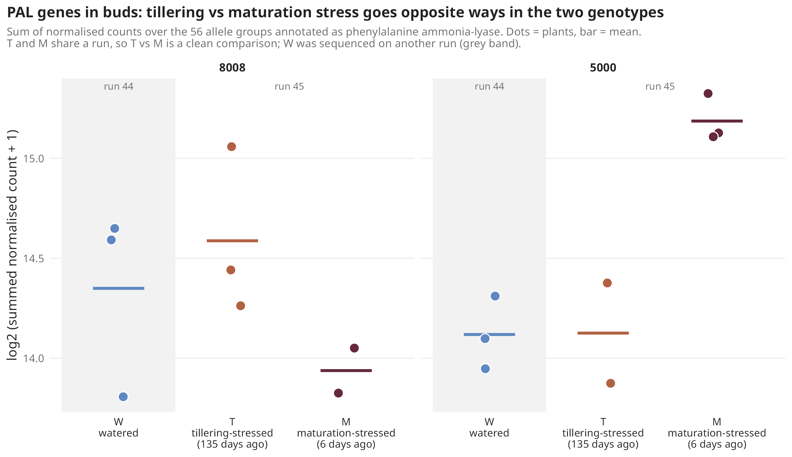

*Figure 13. Total expression of the 56 PAL allele groups in buds. The grey band marks the watered buds, sequenced on another run.*

PAL moves in **opposite directions** in the two genotypes:
- **8008:** T buds are higher than M buds.
- **5000:** M buds are clearly higher than T buds.

So how long ago the stress happened changes the phenylpropanoid state of the bud, and the two genotypes do it differently.

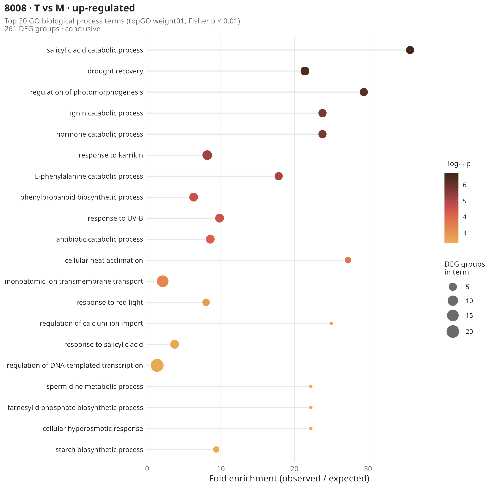

*Figure 14. GO processes among the genes higher in T than in M buds, 8008.*

A lesson about GO labels. The top terms here are "salicylic acid catabolic process", "drought recovery", "lignin catabolic process" and "L-phenylalanine catabolic process". They sound like four different biological stories. In fact they are mostly the **same PAL genes**, which carry all these labels in the annotation we transferred from other species. Always check which genes are behind a term before telling a story about it.

Two other 8008 bud results:
- **Thiamine (THI1) is lower in T buds,** the same gene that was a `--` memory gene in 8008 leaves.
- **T vs M genes are enriched for mother-leaf drought genes:** 140 groups, odds ratio 2.4 (section 11 explains odds ratios).

**H3 verdict:** partly. The timing of the stress leaves a clean, genotype-specific mark (PAL). Whether stressed buds differ from never-stressed buds is hidden behind the run effect.

---

## 10. Do propagules respond differently? (H4)

Propagules from stressed mothers (Ft, Fm) were compared with propagules from watered mothers (Fw), all under one drought.
- **Few DEGs.** Directly against Fw_D1 there are few: 229 groups in 8008 Ft and 376 in 5000 Ft.
- **One reference plant.** Fw_D1 is one plant per genotype.

So instead of counting DEGs, we asked a simpler question: **how strongly does each propagule group respond to drought?**

> **Concept: choosing genes fairly.** If we picked the genes that change most in one propagule contrast and then measured that same contrast, the result would be inflated by chance (the "winner's curse"). So the genes were chosen from **other plants**, the mother leaves at D1: one list induced by drought and one list repressed. Their response was then measured in each propagule group against the same watered propagules (Fw_W).

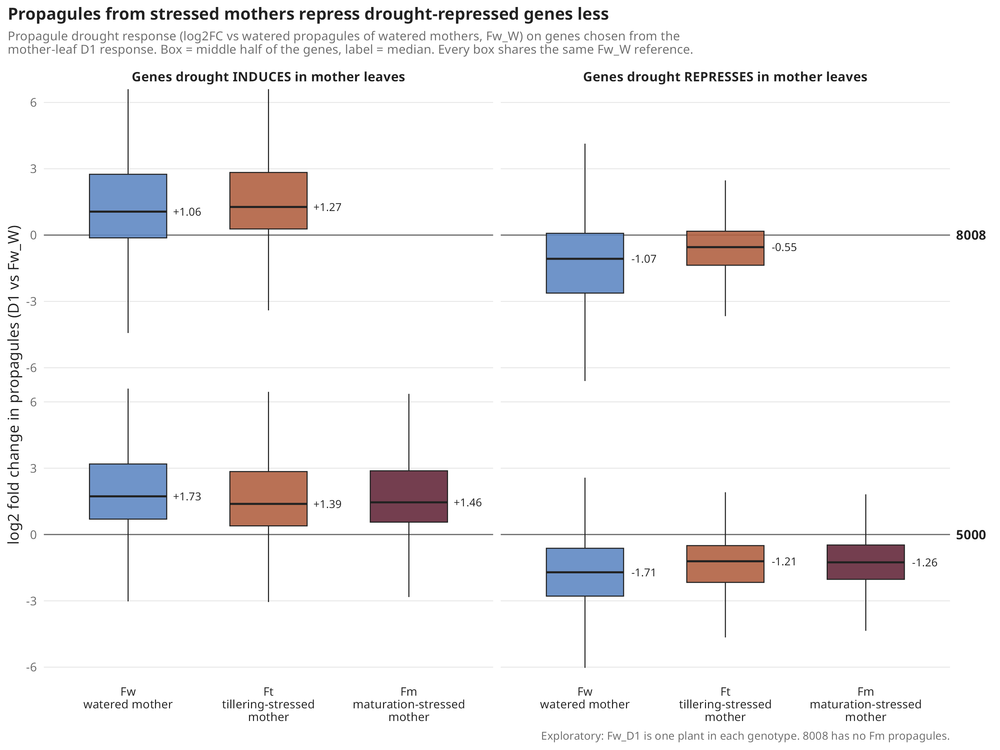

*Figure 15. Drought response of propagules on mother-leaf drought genes. Box = middle half of the genes, label = median log2FC. Left: genes drought induces; right: genes drought represses.*

- **Induced genes (left):** about the same in every group.
- **Repressed genes (right):** clearly weaker repression in propagules from stressed mothers.

  | Genotype | Fw (watered mother) | Ft (tillering-stressed mother) | Fm (maturation-stressed mother) |
  |---|---|---|---|
  | 8008 | −1.07 | −0.55 | — |
  | 5000 | −1.71 | −1.21 | −1.26 (3 plants) |

  *Median log2FC on the mother-repressed genes.*

The set test agrees in both genotypes: the *Arabidopsis* `--` set (genes drought represses) is higher in Ft than in Fw_D1 (FDR 1e-6 in 8008, 7e-9 in 5000, and 1e-5 for 5000 Fm).

Which repressed genes are spared? Photosynthesis, above all.

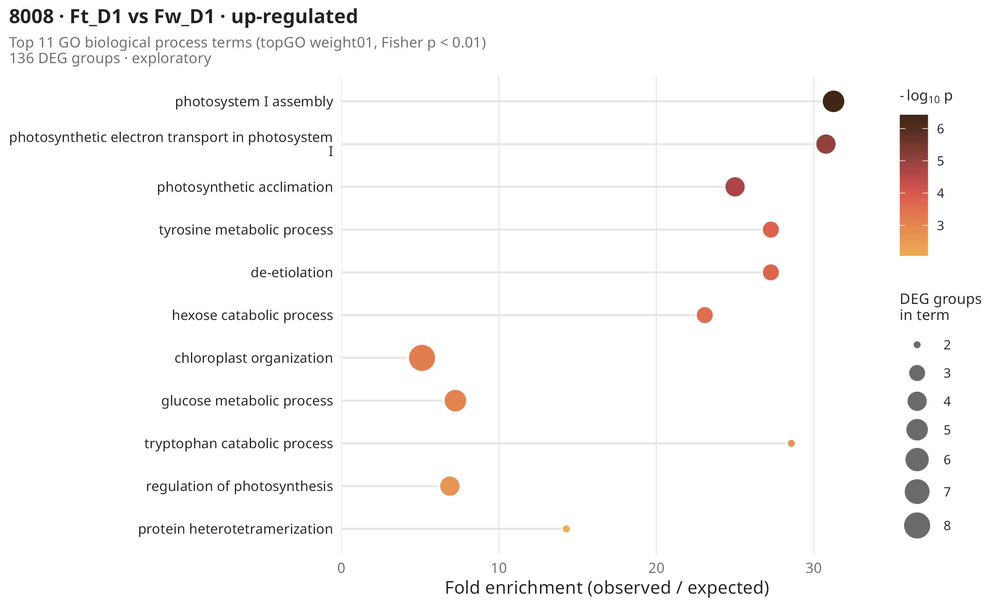

*Figure 16. GO processes higher in Ft than in Fw_D1 propagules under drought, 8008.*

In 8008 the top terms are photosystem I assembly, photosynthetic electron transport and photosynthetic acclimation. In 5000, KEGG "Photosynthesis" comes out (padj 0.003). Drought normally shuts photosynthesis genes down. Propagules from stressed mothers shut them down less. That fits the better drought performance Marcos et al. 2018 saw in such propagules.

**Why this is still exploratory:**
- **One reference plant per genotype.** If that Fw_D1 plant was simply drier than the others, we would see exactly this pattern.
- **In 8008 the reference is a weak library.** It is `79_S6`, the library with 76% rRNA (section 5.1). In a thin library many genes get few reads and look "repressed", which would inflate the Fw repression and make Ft look milder. So the 8008 result may be partly technical.
- **5000 is more trustworthy.** Its reference (`42_S39`) is a normal library, and its Fm group has three plants that agree with Ft.

**H4 verdict:** suggestive, the same direction in both genotypes, and most convincing in 5000.

---

## 11. Is it the same genes from mother to bud to propagule? (H5)

If memory travelled from mother to bud to propagule, the same genes should turn up at each step. We tested overlaps between DEG lists (`report_tables/h5_overlaps.tsv`).

> **Concept: odds ratio (OR).** An OR of 2.8 means that a gene in list A is 2.8 times more likely (in odds) to also be in list B than a gene outside list A. OR = 1 means no link. The FDR says whether the overlap could be chance.

| Overlap | 8008 | 5000 |
|---|---|---|
| Mother-leaf drought genes ∩ Ft vs Fw_D1 | 88 groups, OR 1.4 | **152 groups, OR 2.8, FDR 2e-19; 118 of 152 respond less in Ft** |
| Mother-leaf drought genes ∩ Fm vs Fw_D1 | — | 30 groups, OR 3.0; 22 of 30 respond less in Fm |
| Bud T vs M ∩ Ft vs Fw_D1 | 5 groups, not significant | 2 groups, not significant |
| Leaf D3 vs D1 ∩ bud T vs M | 4 groups, OR 4.9 | 6 groups, not significant |

*Table 4. Overlaps between tissues.*

- **What the propagules share:** their differences fall on **drought-response genes**, and mostly make that response milder.
- **What they don't share:** the genes that separate the bud groups.

So what passes to the propagule looks like a changed drought **response**, not a carried-over bud **state**. One thing cannot be tested: whether watered propagules from stressed mothers (T/W) start from a different resting state, because they were never sequenced.

**H5 verdict:** no evidence that the same genes carry the memory through.

---

## 12. The story so far

| # | Hypothesis | Answer |
|---|---|---|
| H1 | Leaves learn | 8008: mostly no; a small memory module of desiccation-protection genes (RAB18, LEA). 5000: unresolved (one D1 plant). |
| H2 | 8008 remembers more than 5000 | Not supported. |
| H3 | Buds keep a mark | Partly: long-ago vs recent stress differ (PAL, opposite between genotypes). Stressed vs watered is hidden by the run effect. |
| H4 | Propagules respond differently | Suggestive: milder repression, especially of photosynthesis, in both genotypes; best supported in 5000. |
| H5 | Same genes throughout | No evidence. |
| H6 | Textbook memory genes are memory genes here | Partly: they are drought genes; only a few (RAB18) keep memory behaviour. |

In one paragraph:
- **Leaves:** sugarcane leaves mostly reset their drought response between cycles. The tolerant cultivar keeps a small, *Arabidopsis*-like memory module of drying-protection genes.
- **Buds:** they carry a stress-timing signature built on phenylpropanoid genes, which differs between the cultivars.
- **Propagules:** propagules of stressed mothers seem to repress photosynthesis less under drought.

The leaf result is the most solid. The bud and propagule results need the checks below before they can be claimed.

---

## 13. Where to go next, and why

The biggest uncertainties are about the samples, not the statistics, so the cheapest steps come first.

**Ask Dolores and the lab (free):**
1. **The three mislabelled libraries.** Tube and plate records would let us relabel them instead of losing them (section 5.1).
2. **Sampling time of day for every group.** This decides whether the clock and THI1 genes among the "memory" genes are biology or the hour of sampling (sections 5.4 and 6.2).
3. **How stressed each sampled plant was:** leaf water potential or relative water content, soil moisture, gas exchange. This is the only way to tell memory apart from "this plant was simply drier". That question sits behind the 5000 D3 result (section 6.3) and the propagule result (section 10). Marcos et al. 2018 may already have the propagule data.
4. **Library preparation batches.** Were watered buds also *prepared* separately, or only *sequenced* separately? If library prep was shared, the run effect is probably small and the bud comparison with watered buds becomes usable with a caveat (section 5.2).
5. **Leftover RNA or tissue,** for the groups with one plant and for the never-sequenced T/W and M/W propagules.

**In the lab, if there is budget:**
1. **Re-sequence a few existing libraries together on one run:** two W, two T and two M buds per genotype, plus a few watered and drought leaves. Shallow sequencing is enough. This measures the run effect directly and could rescue the strongest bud test.
2. **Add plants where everything rests on one:**
   - 5000 Mt_D1 (H1, H2);
   - Fw_D1 in both genotypes, and a better 8008 Fw_D1 than `79_S6` (H4);
   - if possible, T/W propagules (H5).
3. **RT-qPCR on a short list, in every available plant:**
   - RAB18, LEA3 and the seed-storage protein (memory candidates);
   - THI1 and CCA1/LHY (memory or clock?);
   - PAL (the bud signature);
   - a few photosynthesis genes (the propagule signature).
4. **Only after the qPCR holds, the mechanism.** In *Arabidopsis*, trained genes keep a chromatin mark (H3K4me3) between droughts. ChIP-qPCR for that mark at RAB18 and LEA3, at D1 vs D3, would test whether sugarcane uses the same mechanism.

**With the data we already have** (done since; see [`report_followup.md`](report_followup.md)):
1. **A formal genotype × cycle test** for H2.
2. **A partial bud batch check:** compare technical quality metrics of runs 44 and 45, look at genes that should be stable, and try a batch-correction method (RUVg).
3. **Rank-based H5 tests** instead of cut-off overlaps.
4. **An allele-level look at the candidates:** in a polyploid, does one allele carry the memory, or do all copies move together?
5. **Co-expression modules (WGCNA)** that follow drought *history* rather than current drought.

---

## Where everything is

| What | File |
|---|---|
| Short technical summary | [`report.md`](report.md) |
| Follow-up analyses (H2, bud batch, H5, alleles, WGCNA) | [`report_followup.md`](report_followup.md) |
| Figures made for this post | `plots/story/` (code: `../code/08_story_figures.R`) |
| PCA, UpSet and GO plots | `plots/`, `plots/go/` |
| DE tables, DEG counts, memory classes | `de/group/` (allele level: `de/gene/`) |
| Literature and candidate gene tests | `memory_genes/` |
| GO and KEGG tables | `enrichment/` |
| Numbers computed for the reports | `report_tables/` (code: `../code/07_report_stats.R`) |
| Libraries per sequencing run | `qc/sequencing_runs.tsv` |

---

## Glossary

| Term | Meaning |
|---|---|
| Allele group | All sugarcane gene copies (alleles) that share the same sorghum orthologue, summed together; our unit of analysis. |
| Batch effect | A technical difference between groups of samples processed separately (here, sequencing runs). |
| camera | A gene-set test from the limma package (section 8). |
| Confounding | Two effects that change together, so they cannot be separated (section 5.2). |
| Contrast | A comparison between two groups, written `A_vs_B`. |
| DEG | Differentially expressed gene (group): padj < 0.05 and at least a two-fold change. |
| DESeq2 | The statistical method used to test differential expression. |
| Dispersion | How much a gene varies between plants of the same group; must be estimated to test differences. |
| FDR | False discovery rate: the expected share of false hits among the hits. |
| GO | Gene Ontology: a shared vocabulary of biological processes and functions. |
| KEGG | A database of metabolic and signalling pathways. |
| LEA / dehydrin | Proteins that protect cells during drying; abundant in maturing seeds (section 6.2). |
| log2FC | Log2 fold change: +1 = double, −1 = half (section 3). |
| Memory class | `++`, `--`, `+-`, `-+`, `+=`, `-=`, `0+`, `0-` (Figure 7). |
| Odds ratio | How much more likely an overlap is than chance; 1 = no link (section 11). |
| Orthologue | Genes in different species that descend from one ancestral gene. |
| padj | p-value adjusted for testing many genes. |
| PAL | Phenylalanine ammonia-lyase, entry enzyme of the phenylpropanoid pathway (section 9). |
| PCA | Principal component analysis: draws each sample as a point so similar samples sit close (section 4). |
| Propagule | A new plant grown from a bud on a cut stalk. |
| rRNA | Ribosomal RNA. Normally removed before sequencing; a library full of it has few reads on genes. |
| Shrunk log2FC | A log2FC pulled toward 0 when the evidence is weak, which makes noisy genes look less extreme. |
| UpSet plot | A Venn diagram for many sets (section 6.1). |
| VST | Variance-stabilising transformation of counts, used for PCA. |
